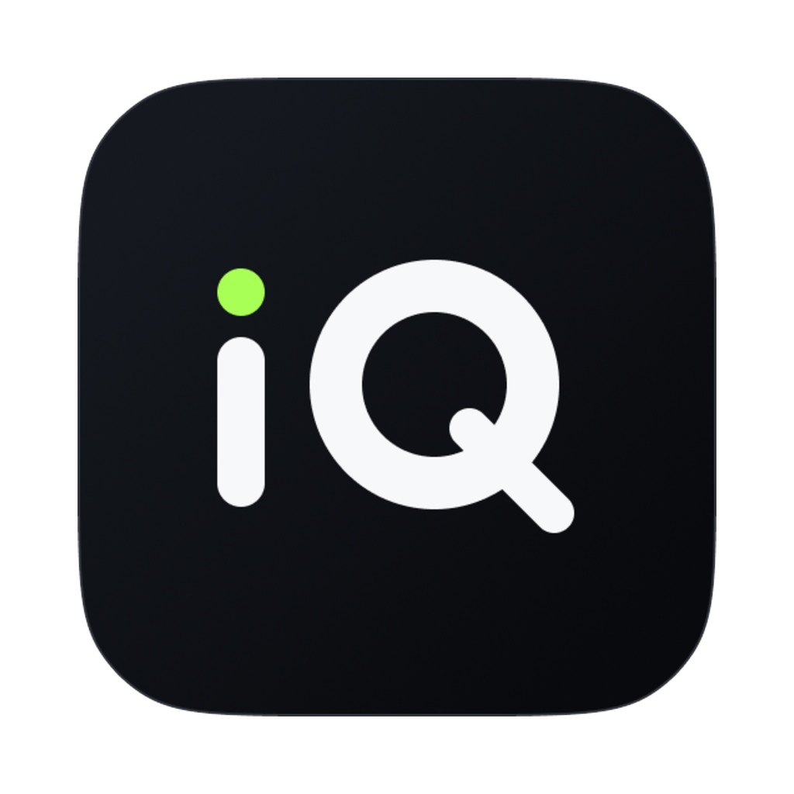
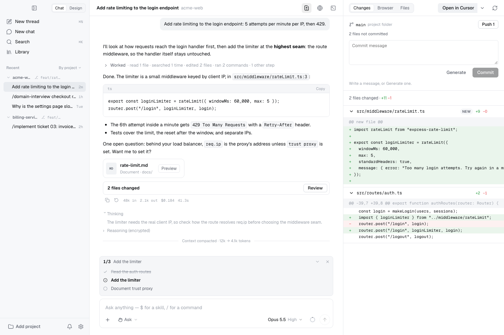
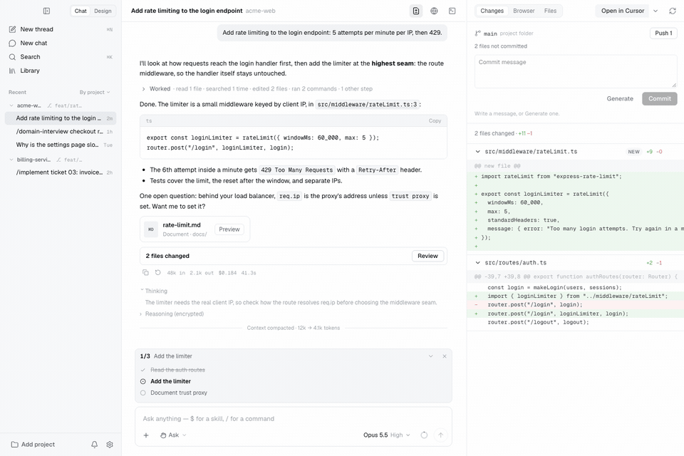
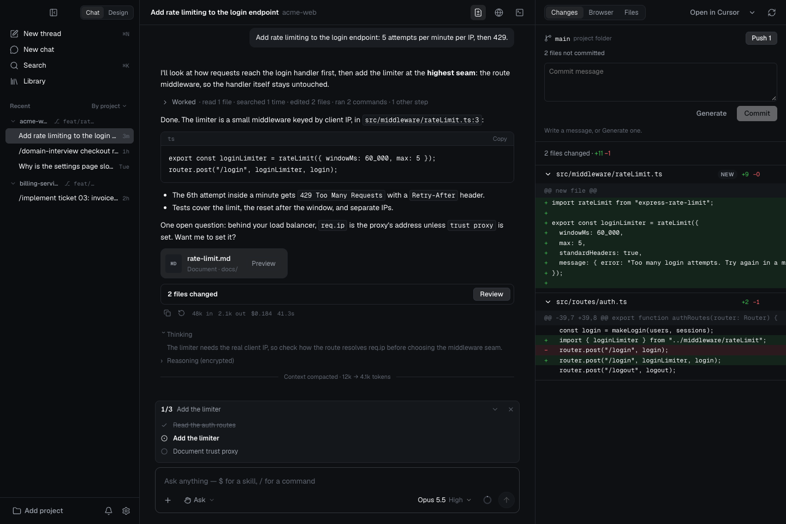
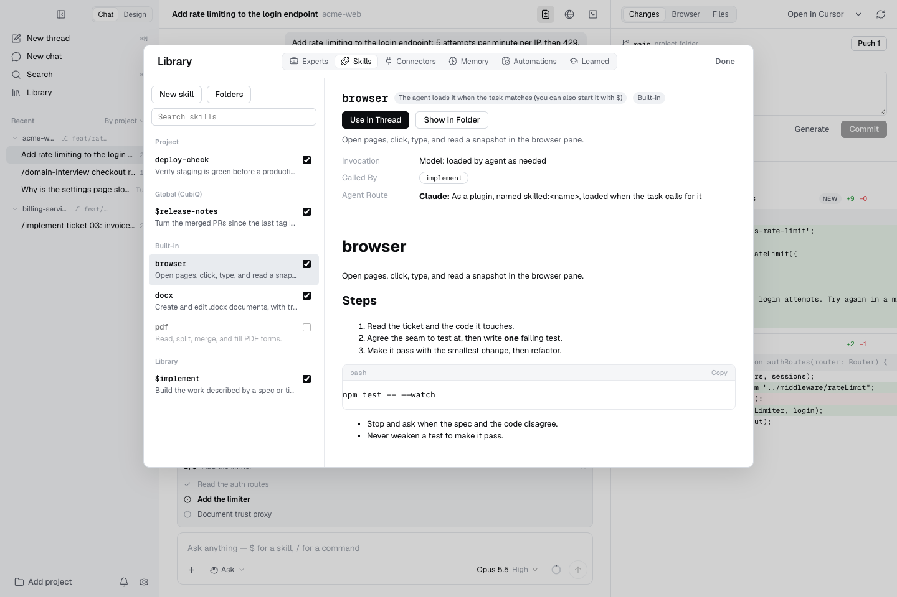

<div align="center">



# CubiQ

**One desktop workspace for AI coding and visual design.**

Work with your preferred agents, review every change, and turn ideas into live interfaces.

[](https://github.com/cubisai/harness/actions/workflows/ci.yml)
[](https://github.com/cubisai/harness/releases)

[](LICENSE)

[Download](https://github.com/cubisai/harness/releases) · [Demo](#demo) · [Features](#features) · [Get started](#get-started) · [Contribute](CONTRIBUTING.md)

</div>



## Overview

CubiQ is an open-source desktop app that brings AI agents, project files, a browser, and a terminal into one workspace. Use your existing agent sign-in or connect a model provider—without tying your workflow to a single engine.

**Code mode** helps you explore, edit, test, and review a project. **Design mode** turns a prompt into live HTML you can inspect, refine, and export.

> CubiQ is in early development. Features and agent integrations may change between releases.

## Demo

[](assets/readme/cubiq-demo.mp4)

**[Watch or download the MP4 walkthrough](assets/readme/cubiq-demo.mp4).** The tour is a sequence of captured UI views from the actual renderer’s sample-data preview, not a live agent run. No private projects or accounts are shown.

<details>
<summary>Dark-mode workspace and Library</summary>





</details>

## Features

| Area | What you can do |
| :--- | :--- |
| **Agent choice** | Work with Claude, Codex, OpenCode, Cursor, custom ACP agents, or compatible model endpoints. |
| **Project threads** | Keep conversations organized by project; choose an agent and model per thread and hand off context when switching agents. |
| **Change review** | Inspect file diffs beside the conversation and open a file at the relevant line in your preferred editor. |
| **Git & worktrees** | Isolate work in a thread’s worktree, then review, commit, merge, or push from the app. |
| **Project checks** | Configure a check command and bounded fix rounds to verify agent changes. |
| **Permissions** | Choose a permission mode and review tool requests. Available safeguards depend on the selected agent’s capabilities. |
| **Browser & terminal** | Preview a local app, attach page elements to a message, and use a real shell without leaving the workspace. |
| **Skills & MCP** | Manage reusable workflows and tool integrations in the Library, with global and project-level configuration. |
| **Experts & artifacts** | Attach reusable expert roles to threads and preview generated documents and code with version history. |
| **Memory & automations** | Keep reusable project notes and schedule recurring tasks with configurable budgets. |
| **Usage & notifications** | See token usage, reported cost and rate limits, plus permission requests and completed turns in the Message Center. |
| **Visual design** | Generate pages, app screens, mobile flows, and slide decks on a live canvas. |
| **Design refinement** | Edit text and properties, compare variants, add comments and drawings, and preview responsive sizes. |
| **Design systems & export** | Use component kits and design references; export HTML, PNG, or PDF, or hand a design to a coding thread in your project. |
| **Desktop experience** | Light and dark themes, keyboard shortcuts, editor integrations, and release updates. |

Agent features—including vision, MCP transport, sandboxing, and permission enforcement—vary by integration. Check the Library and Settings for the selected agent’s support.

## Download

Get the available installers from [GitHub Releases](https://github.com/cubisai/harness/releases).

| Platform | Release architecture | Installer |
| :--- | :--- | :--- |
| macOS | Apple Silicon (ARM64) | `.dmg` |
| Windows | x64 | `CubiQ-Setup-<version>.exe` |
| Linux | x64 | `.AppImage` |

If an installer is not available, [build from source](#build-from-source). Automatic updates are supported by packaged releases; macOS updates require a signed build.

<details>
<summary>Opening an unsigned build</summary>

Only proceed if you trust the build’s source. On macOS, use **System Settings → Privacy & Security → Open Anyway** if offered. On Windows, SmartScreen may offer **More info → Run anyway**. Signed and notarized releases avoid these warnings.

</details>

## Get started

1. **Connect an agent.** Use one of the integrations below, or add a provider in **Settings → Agents & Providers**.
2. **Open a project.** Choose a local folder and create a thread. Select the agent, model, and permission mode before sending a request.
3. **Review the work.** Follow the agent’s tool activity, inspect changes, and run your project’s checks.
4. **Try Design.** Switch to **Design**, describe a page or screen, and refine it on the canvas. A project folder is required for **Build in codebase**.

### Agent integrations

| Integration | Setup |
| :--- | :--- |
| **Claude** | Built-in SDK integration. Sign in with Claude Code (`claude`) or provide `ANTHROPIC_API_KEY`. |
| **Codex** | Install the `codex` CLI and sign in with `codex login`. |
| **OpenCode** | Install and configure the `opencode` CLI. CubiQ connects through ACP. |
| **Cursor** | Install and sign in to the `cursor-agent` CLI. |
| **Custom ACP agent** | Add its command to `agents.json` in CubiQ’s data folder, then restart. |
| **Model provider** | Add an OpenAI-compatible Chat Completions, Responses, or Anthropic Messages endpoint in Settings. |

`agents.json` in the app’s data folder configures custom integrations. [`bench/agents.json`](bench/agents.json) is a separate configuration used only for repository benchmarks.

### Keyboard shortcuts

| Action | macOS | Windows / Linux |
| :--- | :--- | :--- |
| Command palette | `⌘K` | `Ctrl+K` |
| Settings | `⌘,` | `Ctrl+,` |
| Library | `⌘⇧L` | `Ctrl+Shift+L` |
| Browser panel | `⌘⇧B` | `Ctrl+Shift+B` |
| Changes panel | `⌘⇧D` | `Ctrl+Shift+D` |

## Build from source

Install [Git](https://git-scm.com), [Node.js 22+](https://nodejs.org), and [Bun](https://bun.sh) using the version declared in `package.json`.

```bash
git clone https://github.com/cubisai/harness.git
cd harness
bun install --frozen-lockfile
bun run dev
```

```bash
bun run typecheck     # TypeScript checks
bun run test          # Automated test suite
bun run design:check  # Design-system checks
bun run build         # Compile the app
bun run dist          # Package for the current operating system
```

To explore the interface without Electron or an agent, run `bun run preview:ui` and open `http://localhost:5199`. This preview uses a mock backend; it does not edit projects or run agents.

See [CONTRIBUTING.md](CONTRIBUTING.md) for the repository layout, development conventions, and optional evaluations.

## Privacy & security

- Projects, threads, and settings are stored locally. Agents may send prompts, file contents, and tool results to the services you configure, subject to their terms.
- Provider credentials can come from environment variables or the app’s credential storage. Check **Settings → Data & Security** for encryption status on your system.
- Skills, MCP servers, and agents can access tools and files. Install only trusted integrations and choose permissions appropriate to your project.
- Local secrets, app profiles, evaluation traces, and benchmark output are excluded from the public repository.

See [SECURITY.md](SECURITY.md) for reporting guidance. Never include API keys, private code, or personal filesystem paths in a public issue.

## Contributing

Bug reports, documentation improvements, and focused pull requests are welcome. Read the [contribution guide](CONTRIBUTING.md), run the checks, and include screenshots for UI changes.

Use [GitHub Issues](https://github.com/cubisai/harness/issues) for bugs and feature requests. For security-sensitive reports, follow [SECURITY.md](SECURITY.md).

## Releases

<details>
<summary>Maintainer release and signing instructions</summary>

1. Bump `version` in `package.json` on `main`.
2. Push a matching `cubiq-v<version>` tag, or run **Actions → release-cubiq → Run workflow** with **publish** enabled.
3. The workflow builds macOS ARM64, Windows x64, and Linux x64 installers and publishes the updater’s `latest*.yml` files. An existing release or a mismatched version tag is rejected.

Without **publish**, installers remain workflow artifacts for seven days. Do not mark unrelated releases as “latest”—the app’s updater uses that release.

Signing is enabled separately for each platform when these repository secrets are configured:

| Secret | Purpose |
| :--- | :--- |
| `MAC_CSC_LINK` | Base64 `.p12` Developer ID Application certificate |
| `MAC_CSC_KEY_PASSWORD` | Password for the macOS certificate |
| `APPLE_ID` | Apple account used for notarization |
| `APPLE_APP_SPECIFIC_PASSWORD` | App-specific password for notarization |
| `APPLE_TEAM_ID` | Apple Developer team ID |
| `WIN_CSC_LINK` | Base64 `.pfx` code-signing certificate |
| `WIN_CSC_KEY_PASSWORD` | Password for the Windows certificate |

Unsigned macOS builds use ad-hoc signing; Windows builds show a SmartScreen warning. macOS auto-update requires a signed build. Packaging configuration lives in [`electron-builder.yml`](electron-builder.yml), and the publishing workflow in [`.github/workflows/release-cubiq.yml`](.github/workflows/release-cubiq.yml).

</details>

## License

The project is licensed under the [MIT License](LICENSE). Bundled fonts and other third-party assets retain their included licenses.
