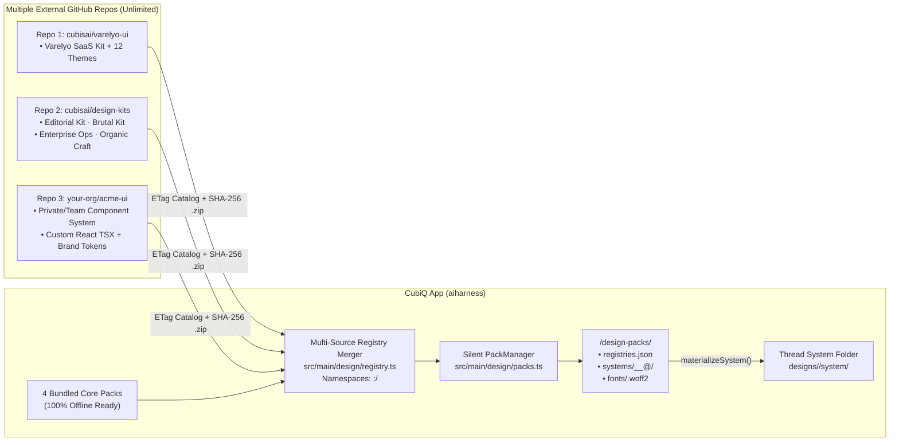

# CubiQ Design Mode 2.0 — Effortless UX & Multi-System Architecture Plan

> **Status:** Research Complete · UX-First Architecture & Implementation Specification  
> **Interactive UI Mock:** [`design_mode_mock.html`](./design_mode_mock.html) *(open in any browser to click through the 5-control Studio Bar, direct selection, inline text edit, live `Customize` panel, and 6 Varelyo-style multi-system packs)*  
> **Core UX Goal:** Make Design Mode feel **calm, obvious, and effortless** on the very first try—zero toolbar overload, zero mode-juggling, zero CSS jargon, and instant visual feedback.  
> **Primary External Benchmarks:** [Varelyo (`varelyo.com`)](https://varelyo.com/) · [Varelyo UI (`github.com/varelyo/ui`)](https://github.com/varelyo/ui)  
> **Internal UI Governance:** **CubiQ editor chrome** follows [`DESIGN.md`](./DESIGN.md) ("Ink Flat" tokens in [`src/renderer/src/styles/app.css`](./src/renderer/src/styles/app.css): 28px controls, 13px Geist UI, `1px solid var(--hairline)`, zero static shadows, no literal colors, no emoji icons). **Authored pages and component packs do not** — they follow their own validated pack contracts (§1A.6). Ink Flat rules never apply inside the page iframe.
> **Normative sections:** §1A (Architecture Contracts), §10 (Security) and §11 (Roadmap) are binding. Where UX prose elsewhere conflicts with them, §1A/§10 win.

---

## Table of Contents

1. [UX Philosophy: 6 Rules for an Effortless Design Studio](#1-ux-philosophy-6-rules-for-an-effortless-design-studio)
   - 1A. [Architecture Contracts (Normative)](#1a-architecture-contracts-normative)
2. [Current-State UX Audit (Why Design Mode Feels Confusing Today)](#2-current-state-ux-audit-why-design-mode-feels-confusing-today)
3. [End-to-End User Journeys (How Design Mode 2.0 Feels in Practice)](#3-end-to-end-user-journeys-how-design-mode-20-feels-in-practice)
4. [Pillar 1 — Calm Studio Chrome (21 Controls → 5, 4 Bottom Bars → 1)](#4-pillar-1--calm-studio-chrome-21-controls--5-4-bottom-bars--1)
5. [Pillar 2 — Direct Canvas Selection, Inline Editing & Scale-Locked Stage](#5-pillar-2--direct-canvas-selection-inline-editing--scale-locked-stage)
6. [Pillar 3 — Human-Friendly Live Inspector (Page Theme + Component Props)](#6-pillar-3--human-friendly-live-inspector-page-theme--component-props)
7. [Pillar 4 — 1-Click Visual Vibe & Style Picker (Invisible Streaming)](#7-pillar-4--1-click-visual-vibe--style-picker-invisible-streaming)
8. [Pillar 5 — Varelyo-Inspired Multi-System Tokens & AI Component Kits](#8-pillar-5--varelyo-inspired-multi-system-tokens--ai-component-kits)
9. [Pillar 6 — External Asset Repository & Zero-Friction Background Downloader](#9-pillar-6--external-asset-repository--zero-friction-background-downloader)
10. [Security, IPC & Local Cache Specification](#10-security-ipc--local-cache-specification)
11. [Phased Implementation Roadmap & File Map](#11-phased-implementation-roadmap--file-map)
12. [Verification Gates & Reference Links](#12-verification-gates--reference-links)

---

## 1. UX Philosophy: 6 Rules for an Effortless Design Studio

Comparing CubiQ's live screenshots against [Varelyo](https://varelyo.com/), Figma Sites, and Framer reveals why users feel overwhelmed today: CubiQ currently exposes **every internal feature and developer state simultaneously** (21 header buttons, 4 stacked bottom bars, explicit `Pick` mode toggles, raw `141.797px` CSS properties, manual `Apply` buttons, and cryptic tier/fence chips).

Every screen and interaction in Design Mode 2.0 obeys six strict UX rules:

1. **Progressive Disclosure Over Icon Soup:** Show only the **5 core studio controls** needed 95% of the time (`Layers`, `Design | Preview | Code`, `Desktop | Mobile`, `Customize`, `Export / ⋯`). Everything secondary hides until relevant or inside one clean menu.
2. **No "Pick Mode" Toggle — Direct Click Always Selects:** Within `Design` view, clicking any element selects it and double-clicking text edits it inline; there is no separate pick/insert/edit toggle. `Design | Preview | Code` is a *view* switch (what you are looking at), not a tool mode. This **eliminates the floating `LiveBar` toolbar**. The single contextual selection pill is the only element anchored to the canvas (see §1A.5).
3. **One Prompt Box, Never Two:** Retire `LiveBar`'s separate `Steer` input. There is **one** calm, centered Composer dock at the bottom. Typing with nothing selected steers the whole page; clicking an element attaches its chip (`[Hero Button ×]`) so typing steers that element.
4. **Live Edits + `⌘Z` Undo — Never an "Apply" Button:** Changing a variant, color swatch, font size, or padding in the right panel gives feedback on the next animation frame (optimistic preview), is committed through the mutation service (§1A.2), is saved after 250ms of inactivity, and is undoable with `⌘Z` / `⌘⇧Z`. IDs are assigned automatically when the target resolves unambiguously; ambiguous or stale targets produce a recoverable conflict, never a write to the wrong element.
5. **Speak Design, Not Browser Internals:** Lead with **Component Variants** (`Filled`, `Outline`, `Ghost`), **Size Presets** (`S`, `M`, `L`), and **Theme Swatches** (`Surface`, `Primary`, `Muted`)—never `rgb(255, 255, 255)`, `141.797px`, or `justify-content: normal`.
6. **Low-Friction Infrastructure, Visible Failure:** External design systems, kits, and `.woff2` fonts live in separate repositories and download on demand with immediate, cancellable feedback (no fixed network guarantee). The UI never becomes a package manager with `Installed | Cloud` tabs or file-size badges, but it does show restrained states: `Preparing style…`, `Unavailable offline`, `Retry`. Activation is atomic; the previous style stays in place on failure.

---

## 1A. Architecture Contracts (Normative)

### 1A.1 Theme Switch vs. Kit Migration

| Operation | Condition | Behavior | Picker label |
| :--- | :--- | :--- | :--- |
| **Theme switch** | Same `kitId` **and** compatible `contractVersion` (same major) | Swap tokens only. Content, structure, and user edits/overrides are preserved. Instant, undoable. | `Apply theme` |
| **Kit switch** | Different `kitId` **or** incompatible `contractVersion` | Compute a **migration preview** (side-by-side); list unsupported components; map `data-ui` primitives via the target kit's `migrations.json`; preserve content where possible; unmapped components are kept as-is and flagged. Cancellable before commit; committed as **one undo step**. | `Adapt page to this style` |

- **Picker structure:** the picker opens on **themes of the current kit** (`Apply theme`). A `Kit: <name> ▾` control in the picker header lists the available kits. Choosing another kit shows that kit's themes, labelled `Adapts page`, and applying one opens the migration preview. Cards never mix kits in one flat list.
- A kit switch is never silently executed via `tokens.css` alone. Cards show a kit badge only when it differs from the active kit.
- `components.json` declares `kitId`, `contractVersion`, and `compat: { themes: [...], migratesFrom: [...] }`.
- Migration is deterministic first (mapping tables); AI-assisted adaptation is an explicit, separate, opt-in step.
- §8.1's "swap `tokens.css` without rewriting HTML" applies **only within one kit**.

### 1A.2 Authoritative Editing Model

- **Authority:** the source HTML file on disk, mediated by a **single main-process `DocumentMutationService`**. The iframe is a **preview**, never a source of truth. (If a parsed intermediate model is introduced, it is derived from the HTML and rebuilt on each external change; it is never persisted separately.)
- **Stable IDs:** elements are addressed by `data-agent-id`. IDs are stamped automatically when the target resolves unambiguously (single structural match at `baseRevision`). Ambiguous or stale targets return a recoverable `conflict` — never a write to the wrong element.

```ts
type DesignMutation = {
  operationId: string      // idempotency key
  documentId: string
  baseRevision: number     // revision the client rendered against
  targetId: string         // data-agent-id (or a resolvable locator to stamp)
  transactionId: string    // groups continuous gestures (slider drags, typing)
  change: DesignChange     // setProp | setToken | setText | insert | remove | move
}
type MutationResult =
  | { ok: true; operationId: string; newRevision: number }
  | { ok: false; operationId: string; reason: 'stale' | 'ambiguous' | 'invalid' | 'external-change'; currentRevision: number }
```

- **Optimistic preview:** the renderer applies the change to the iframe immediately; the service acks (`newRevision`) or rejects. On rejection the preview **rolls back** to the authoritative render and shows a quiet inline notice with `Retry` / `Reapply on latest`.
- **Serialization:** mutations are applied in order per document; each increments `revision`. A mutation with a stale `baseRevision` is rebased only if its target resolves unambiguously and the touched property was not modified since; otherwise `stale`.
- **Undo grouping:** all mutations sharing a `transactionId` coalesce into one undo step (closed on pointer-up / blur / 500ms idle). Undo/redo are themselves mutations (inverse patches) with new revisions. History is per-document and stored with the document.
- **Save:** persisted via debounce of 250ms of inactivity, atomic write (temp file + rename). Flush on blur, navigation, and quit.
- **External changes (AI generation, external editor):** the service watches the file. If revision on disk differs from the last acknowledged one, pending local mutations are rebased or rejected as above, and undo history is annotated with an `external` boundary (undo does not cross it silently). During an AI turn that targets the same file, the Inspector is read-only for that file (`Design in progress`).
- **Crash/reload durability:** accepted-but-unsaved mutations are journaled to `<userData>/design-journal/<documentId>.wal` before the preview acks; on relaunch they are replayed against the on-disk revision (or surfaced as a recoverable conflict).

### 1A.3 Interaction State Machine

States: `Idle` → `Selected` → (`EditingText` | `ContextMenu` | `AiOperation`).

| State | Click | Double-click | Enter | Escape | Undo (`⌘Z`) | Focus |
| :--- | :--- | :--- | :--- | :--- | :--- | :--- |
| **Idle** | Select target | Select (text → `EditingText`) | — | — | Document undo | Canvas root |
| **Selected** | Reselect / clear on background | Text node or button label → `EditingText` (label wins over drill); container → drill one level | Enter `EditingText` if text, else drill in | Select parent; at root → `Idle` | Document undo | Selection outline; pill reachable via `Tab` |
| **EditingText** | Click outside commits | Select word | Commit (`Shift+Enter` newline in multi-line) | **Cancel edit, revert text**; stays `Selected` | Text-local undo, then one document step on commit | Caret in element |
| **ContextMenu** | Choose item / dismiss | — | Activate item | **Close menu only**; return focus to pill trigger | Document undo | Menu with roving focus |
| **AiOperation** | Cancels? No — selection locked | — | — | **Cancel operation** (confirm if destructive) | Undo of the finished operation is one step | Composer |

- Escape priority: dismiss menu → cancel edit → cancel AI op → select parent → clear. Exactly one action per press.
- Style picker: single-click or arrow-key **previews**; `Use Style` / `Enter` / double-click **commits** (Theme vs. Adapt per §1A.1). Not mixed.
- **Keyboard parity:** `Tab` enters canvas; arrow keys move among siblings, `Alt+↑/↓` parent/child, `Enter` edits, `Shift+Enter` inserts section after the selection (keyboard equivalent of seam insertion; also `Insert section…` in the Layers rail). All pill actions are reachable by keyboard; Layers rail is a full tree with selection sync.
- **Target size:** controls are 28px tall; interactive targets must satisfy WCAG 2.2 SC 2.5.8 (≥24×24 CSS px, or spacing exception). Icon-only controls get a minimum 28×28 hit area and are verified in tests; height alone is not accepted.

### 1A.4 Honest Performance Targets

| Operation | Acceptance target (reference hardware & fixture pages) |
| :--- | :--- |
| Local edit feedback | Next animation frame |
| Save scheduling | Debounced 250ms after last input; flush on blur/quit |
| Cached gallery open | p95 ≤ target set in Phase 0 benchmark (e.g. ≤150ms, 50 cards) |
| Cold pack download | Immediate `Preparing style…`; cancellable; no network guarantee; timeout + `Retry` |
| Pack activation | Atomic; previous style retained on failure |
| Offline | Bundled packs always work; others show `Unavailable offline` |

### 1A.5 Selection UI Model
"Zero floating toolbars" means **no persistent toolbars** (LiveBar retired). One transient contextual selection pill is allowed, dismissed on deselection, positioned to avoid covering the selection, and keyboard accessible.

### 1A.6 Token & Style Scopes (No Leakage)

| Scope | Examples | Owner | Rules |
| :--- | :--- | :--- | :--- |
| **Editor tokens** | `--bg`, `--hairline`, `--primary` | CubiQ chrome | Ink Flat (`DESIGN.md`); `design:check` applies |
| **Page tokens** | `--core-*`, `--bg-canvas`, `--btn-*` | Active pack | Validated against pack schema; color/shadow/typography are free within the pack |
| **Compatibility aliases** | `--color-*` | Versioned mapping in the pack (`aliases@v1`) | Read-only mapping for existing pages and `design_lint` |

- Pages render only inside the sandboxed iframe; editor CSS is never injected into it, and page CSS is never loaded in the renderer document. Editor overlays are drawn in the host layer using geometry from the bridge.

### 1A.7 Failure Behavior Matrix (User-Visible)

| Failure | What the user sees | System guarantee |
| :--- | :--- | :--- |
| Edit target stale or ambiguous | Banner: "This file changed outside the editor. Your last edit was not applied." + `Reapply on latest` / `Discard my edit`; status shows `Conflict` | No write to the wrong element |
| Save fails (disk, permission) | Status `Not saved` + `Retry`; edits stay in the journal | Nothing lost; retry is idempotent by `operationId` |
| External change mid-edit (AI turn, other editor) | Inspector read-only during AI turn; otherwise conflict banner above | Undo never crosses an `external` boundary silently |
| Pack download fails / offline | Preview shows `Unavailable offline` + `Retry`; bundled styles keep working | Previous style stays active |
| Pack download in progress | `Preparing style…` with thin progress bar + `Cancel` | Cancel leaves no partial install |
| Pack fails validation (hash, signature, limits) | `Couldn't verify this style` + `Details` | Nothing extracted or activated |
| Kit switch has unsupported components | Migration dialog lists them; they are kept as-is and flagged in Layers | Cancel = no change; confirm = one undo step |
| App quits or crashes mid-edit | On relaunch, journal replays; conflicts surface as above | Accepted edits are never silently dropped |

### 1A.8 What the Mock Demonstrates

[`design_mode_mock.html`](./design_mode_mock.html) is a behavioral sketch of these contracts, not an implementation:

- **Save status** (top right): `Saving…` → `Saved · rN` after 250ms idle; one revision per edit burst; rapid edits to the same element coalesce into one undo step.
- **Conflict**: `⋯` → `Demo: external file change` shows the conflict banner and `Reapply` / `Discard`.
- **Style picker**: opens on the current kit's themes (`Theme`, `Apply theme`). The `Kit: … ▾` control switches to another kit's themes, whose cards say `Adapts page` and whose button says `Adapt page to this style`, opening the migration dialog (adapted vs. needs attention, `Cancel`, one-step undo).
- **Install states**: uncached styles show `Preparing style…` with `Cancel`; `⋯` → `Demo: go offline` then picking an uncached style shows `Unavailable offline` + `Retry`. Added repositories show `Publisher unverified`, and the Add Repo row states what adding a source does and does not authorize.
- **Keyboard**: `Enter` edits the selected text, `Shift+Enter` inserts a section, `Alt+↑/↓` parent/child, `←/→` siblings. `Esc` takes one action per press (menu/dialog → cancel edit → stop AI turn → select parent). Cancelling an edit restores the text.
- **Keyboard access to canvas:** the canvas is focusable with a visible focus ring. `←/→/↓/Enter` selects the first component, `Tab` moves into the selection pill (a labelled toolbar), and `Esc` from the pill returns focus to the canvas. Selection changes are announced through a live region. The Layers rail has `Insert section after selection…` (`⇧↵`) as the non-pointer alternative to seam insertion.
- **Target sizes:** pill and variant-bar controls are at least 24×24px. `⋯` → `Demo: check target sizes` scans the editor controls and outlines any under 24×24px. Authored page content is excluded, per §1A.6.
- **Not mocked** (spec only): journal/WAL recovery, real rebasing, signature verification, sandbox enforcement.

### 1A.9 Studio Workspace Layout & View Transitions (Normative)

- **Design Mode Entrance (3-Column Studio Workspace):**
  - Switching to `Design` mode automatically transitions CubiQ from chat chrome into a dedicated 3-column studio layout ([`Screenshot 2026-10-31 at 12.03.57 in the afternoon.png`](./Screenshot%202026-10-31%20at%2012.03.57%20in%20the%20afternoon.png)):
    1. **Global App Sidebar (`appSidebar`):** Fully collapsed (`width: 0`, hidden border) to dedicate 100% of the display to the design stage.
    2. **Left Semantic Layers Rail (`layersRail`):** Open by default (`224px`), rendering the page switcher, section insert trigger, and semantic component outline tree.
    3. **Right Customize Panel (`customizePanel`):** Open by default (`280px`), rendering Page Theme (when idle) or Component Style Props (when an element is selected).
    4. **Scale-Locked Stage Math:** The stage scaler dynamically calculates available stage width (`scroll.clientWidth - 48`) and scales the `1440px` artboard proportionally (`scale = Math.min(1, availW / targetW)`). Opening or closing panels smoothly adjusts the artboard scale without triggering mobile breakpoint reflows.
- **Preview Mode Transition:**
  - Flipping the top view switcher to `Preview` automatically collapses the left Layers rail and right Customize panel to present the prototype at full width for realistic interactive testing (clicking links, expanding accordions, scrolling).
  - Flipping back to `Design` automatically restores the full 3-column studio layout and active element selection.
- **Composer & Popover Alignment Contract:**
  - The single unified Composer dock is centered horizontally within the active stage column (`.stage-col`).
  - Studio popovers spawned from the dock (including the **Style & Kit Picker**) anchor directly to the Composer dock's bounding box (`dock.getBoundingClientRect()`), matching its exact horizontal width (`660px`), horizontal center, and maintaining an 8px vertical clearance above the dock lip, rather than centering against the full browser window or overflowing off-axis ([`Screenshot 2026-10-31 at 12.07.32 in the afternoon.png`](./Screenshot%202026-10-31%20at%2012.07.32%20in%20the%20afternoon.png)).

---

## 2. Current-State UX Audit (Why Design Mode Feels Confusing Today)

Evidence from live testing ([`Screenshot 2026-10-31 at 10.33.09 in the morning.png`](./Screenshot%202026-10-31%20at%2010.33.09%20in%20the%20morning.png) and [`Screenshot 2026-10-31 at 10.35.36 in the morning.png`](./Screenshot%202026-10-31%20at%2010.35.36%20in%20the%20morning.png)):

| Pain Point Seen in Live Test | Root Cause in Codebase | User Impact |
| :--- | :--- | :--- |
| **21 controls crammed into the 46px top header** | [`App.tsx:192-242`](./src/renderer/src/App.tsx#L192-L242) renders `Canvas-first`, `Changes`, `Browser`, and `Terminal` beside the portaled `head` from [`DesignCanvas.tsx:1247-1468`](./src/renderer/src/design/DesignCanvas.tsx#L1247-L1468) (`Rail`, `Page`, static `Glacier` label, `More styles`, `Viewport`, `Device`, `Zoom`, `Version`, `Grid`, `Tweaks`, `Inspector`, `Reload`, `Build`, `Open folder`, `Export`). | Severe visual noise; impossible to scan; clicking `Changes` or `Browser` opens a *second* conflicting right panel; static top `Glacier` text duplicates the interactive `Auto · Glacier` button below. |
| **4 horizontal bars stacked at the bottom** | Floating [`LiveBar.tsx`](./src/renderer/src/design/LiveBar.tsx) + `TodoDock` + `DrawerHandle` + `Composer` stack on top of each other. | Eats vertical canvas height; `Steer` inside `LiveBar` duplicates the `Composer` right below it. |
| **Clicking near the top selects invisible `a "Skip to content"`** | [`snapTarget` in `bridge.ts:81-84`](./src/main/design/bridge.ts#L81-L84) snaps to any `<a>` without checking `.sr-only`, `.skip-link`, `clip`, `opacity: 0`, or offscreen bounds. | Users try to click the navbar or hero and get stuck on an invisible accessibility link. |
| **1 click spawns 4 competing selection UIs** | Selecting one element simultaneously renders `.design-crumbs` ([`DesignCanvas.tsx:1502-1528`](./src/renderer/src/design/DesignCanvas.tsx#L1502-L1528)), floating [`ElementBar.tsx`](./src/renderer/src/design/ElementBar.tsx), a Composer chip, and Right [`InspectorPanel.tsx`](./src/renderer/src/design/InspectorPanel.tsx). | Page jumps down by 32px, floating bar covers the navbar, and the user doesn't know which of the 4 places to interact with. |
| **Opening Inspector crushes desktop layout into mobile** | `Fit` in [`frame.ts:58`](./src/renderer/src/design/frame.ts#L58) sets iframe width to remaining container pixels (~840px when Layers + Inspector open). | Desktop hero buttons and multi-column grids suddenly stack into narrow mobile layout while inspecting desktop styles. |
| **Inspector feels like Chrome DevTools, not a design tool** | [`InspectorPanel.tsx:10-34`](./src/renderer/src/design/InspectorPanel.tsx#L10-L34) dumps 22 raw computed strings (`141.797px`, `flex-direction: row` on block nodes), requires clicking `Apply`, and shows `"Pick an element..."` empty state when nothing is selected. | Intimidating for quick visual edits; wasted panel when nothing is selected; frequent `"No data-agent-id: drafts a message"` fallbacks. |
| **Blind text-only Style Picker** | [`DesignSystemMenu.tsx:124-126`](./src/renderer/src/components/DesignSystemMenu.tsx#L124-L126) hides color swatches in the list and requires clicking tiny `Eye` icons one by one. | Users cannot visually scan or feel the difference between 32+ styles without tedious clicking. |

---

## 3. End-to-End User Journeys (How Design Mode 2.0 Feels in Practice)

### Journey A — Starting a New Design (Zero Clutter, Visual Start)
1. User opens a new **Design** thread. Instead of a blank `"Nothing to show yet"` box surrounded by 20 disabled toolbar icons, the header is completely clean and the center of the canvas shows **6 visual starter style cards** (`Auto — Match my prompt`, `Varelyo Clean`, `Glacier`, `Atelier`, `Carbon`, `Browse all styles…`).
2. User clicks `Glacier` (or leaves `Auto`), types *"A calm workspace landing page called Fieldnote"* in the single centered prompt bar at the bottom, and hits `Enter`.
3. While generating, the Composer shows CubiQ's signature running beam and a single subtle status line (`Designing index.html · Step 2 of 3 · Esc to stop`). No extra stacked docks.

### Journey B — Exploring, Clicking & Editing Directly on Canvas
1. The finished `1440px` desktop page appears cleanly framed on `--bg-subtle`. **No persistent toolbars** cover the design.
2. User moves the mouse over the page:
   - Hidden nodes (`.skip-link`, `.sr-only`) are completely ignored.
   - Real components gently highlight on hover with a crisp `1px` label (`Navbar`, `Hero`, `Button`, `Feature Card`).
   - Moving the mouse over the horizontal seam *between* two sections (`Hero` and `Features`) fades in a subtle centered **`+ Add section`** pill right on the seam—click it to insert a new block right there without ever toggling an "Insert mode"!
3. User **clicks** a CTA button:
   - **Single click** selects the `Button` component. A compact, unobtrusive pill appears 8px above/below it: **`[Button ▾]  [3 Variants ▾]  [Ask AI]`**, and `[Button ×]` appears inside the bottom prompt box.
   - **Double-click** on any heading, paragraph, or button label edits its text **inline right on the page** (`Enter` or click outside saves immediately).
   - Pressing **`Esc`** follows the §1A.3 priority (menu → edit → AI op → select parent → clear).
4. Want to click links, open modals/tabs, and scroll the page like a real visitor? Click **`Preview`** in the top center switch (or press `P`).

### Journey C — Visual Customization Without CSS Jargon
1. User clicks **`Customize`** (`PanelRight` icon, top right):
   - The right panel (`280px`) opens smoothly. **The `1440px` desktop page scales down proportionally (e.g. `82%`)** to fit the stage—it **never** reflows into mobile layout!
   - **With nothing selected**, the panel shows **Page Theme** controls: switch `Glacier → Atelier` live, flip `Light / Dark`, adjust global `Accent` swatch, `Font Pair`, or `Corner Style` (`Sharp / Soft / Round`), plus any page `Tweaks`.
   - **With an element selected**, the panel switches to **Element Controls** (`← Page Theme` at top):
     - **Component Props** first (`Style: Filled | Soft | Outline | Ghost`, `Size: S | M | L`).
     - **Theme Swatches** for Fill / Text / Border (`Surface`, `Subtle`, `Primary`, `Muted`).
     - **Clean Presets** for Text Size, Padding (`Tight / Normal / Roomy`), and Corner Radius.
     - Every click updates the live page immediately—**no `Apply` button**, full `⌘Z` undo.

---

## 4. Pillar 1 — Calm Studio Chrome (21 Controls → 5, 4 Bottom Bars → 1)

All chrome strictly uses [`DESIGN.md`](./DESIGN.md) Ink Flat tokens (`--bg`, `--bg-side`, `--bg-subtle`, `--bg-chip`, `--bg-hover`, `--bg-selected`, `--text`, `--text-secondary`, `--text-tertiary`, `--hairline`, `--hairline-strong`, `--primary`, `--on-primary`, `--radius-s` 6px, `--radius-m` 8px, `--radius-l` 10px, `--shadow-float` on popovers only, 28px control height, 16px `lucide-react` icons, zero emojis).

### 4.1 The 5-Group Studio Top Bar (`46px` height)

```text
┌──────────────────────────────────────────────────────────────────────────────────────────────────────┐
│ [Sidebar]  [◧]  Fieldnote / index.html ▾        [Design | Preview | Code]  [🖥 | 📱 ▾]        [◨] [Export] [⋯] │
│ └─── 1. Left: Context & Layers ────────┘        └─── 2 & 3. Center: Mode + Device ───┘        └─ 4 & 5. Right ─┘ │
└──────────────────────────────────────────────────────────────────────────────────────────────────────┘
```

1. **Left — Page & Layers Context:**
   - `[Sidebar]` toggles the global app sidebar (automatically collapsed by default in Design Mode to prioritize canvas space).
   - `[◧]` toggles the left **Pages & Layers** rail (`⌘\`, open by default in Design Mode; auto-shows badge when `pages.length > 1`).
   - `Thread Title` (or `Page Switcher ▾` when multi-page). Version pill (`v2 ▾`) appears **only** when inspecting history or via `⋯` → `Version history`.
   - **Removed:** Non-interactive top `Glacier` style text; chat-only `Changes`, `Browser`, `Terminal`, and `Canvas-first` buttons in [`App.tsx:200-241`](./src/renderer/src/App.tsx#L200-L241) when `design && canvasFirst`.
2. **Center Pill 1 — View Mode (`[Design | Preview | Code]`):**
   - Segmented track (`--bg-chip`, active segment `--bg` + `1px solid var(--hairline)` per `DESIGN.md` §5):
     - **`Design`** *(default)*: Direct click selects components, double-click edits text, seam hover inserts sections.
     - **`Preview`**: Pure interactive page experience (links navigate, tabs/dialogs open, hover effects play; `Present` fullscreen button appears quietly in corner).
     - **`Code`**: Clean syntax-highlighted viewer + 1-click Copy for `index.html`, `system/tokens.css`, and `system/ui.css`.
3. **Center Pill 2 — Viewport (`[Desktop | Mobile ▾]`):**
   - Two 1-click icons for the 95% case: **Desktop (`1440px`, auto-fit scaled)** and **Mobile (`390px`)**.
   - Small chevron `▾` opens less-common sizes & view options: `Tablet (768px)`, `Fluid width`, `Slide (1920×1080)`, `Board view (all pages)`, `Zoom (Fit / 50% / 75% / 100% / 150%)`, and `Device frame`.
4. **Right — `Customize` (`[◨]`):**
   - Toggles the Right Panel (**Page Theme** when idle; **Component & Style Inspector** when an element is selected). Open by default in Design Mode so visual props and system tokens are immediately accessible.
5. **Right — `[Export]` & `[⋯]` Menu:**
   - **`Export`** primary ghost/outline menu:
     - `Build in Codebase` (promotes prototype + React UI kit into a real-app implementation thread)
     - `Export HTML` (single self-contained offline file)
     - `Export PNG` / `Export PDF`
   - **`⋯` Overflow Menu** (cleanly grouped, with shortcut hints):
     - `Compare 3 Other Styles` (`designMoreStyles`)
     - `Check Design Quality (Lint)` (runs `design_lint` pins on canvas)
     - `Add Comment Pin (C)`
     - `Version History` (`Latest · Restore older…`)
     - `Show 8px Grid (⌘')` · `Reload Canvas (⌘R)` · `Open Design Folder`
     - `Switch to Split Chat Layout` · `Developer: Git Changes / Terminal`

### 4.2 Single Unified Bottom Prompt Dock (Replacing 4 Stacked Bars)

**Retire [`LiveBar.tsx`](./src/renderer/src/design/LiveBar.tsx) as a separate floating toolbar** and collapse `TodoDock` + `DrawerHandle` + `Composer` into **one** calm, centered Ink Flat Composer dock (`max-width: 680px`, `1px solid var(--hairline)`, `--radius-l`):

```text
          ┌──────────────────────────────────────────────────────────────────────────┐
          │ [Button "Start writing" ×]  Ask AI to refine this button, or edit text…  │
          │ [+]  [Style: Glacier ▾]                       [Chat (3) ▴] [GPT-6 ▾] [↑] │
          └──────────────────────────────────────────────────────────────────────────┘
```

- **Chat History on Demand (`[Chat (3) ▴]`):** Instead of a full-width `DrawerHandle` bar spanning the window, a subtle chip in the Composer opens the conversation sheet upward when you want to read full agent replies, and collapses cleanly out of sight while you work visually.
- **Single Inline Running Status:** While a turn runs, status + step count (`● Designing hero · 2/3 · Esc to stop`) sits on one quiet line directly on the Composer lip—never 3 separate bars.
- **Hidden Technical Knobs:** `Quick / Working / Real-app` tier defaults smartly (e.g. `Working` for standalone chats, `Real-app` inside a code repo) and moves into `+` or `⋯` so everyday users only see **`[+] [Style: Glacier ▾]`** on the left!

---

## 5. Pillar 2 — Direct Canvas Selection, Inline Editing & Scale-Locked Stage

### 5.1 Smart Hit-Testing (`src/main/design/bridge.ts`)

1. **Zero Invisible-Element Traps (`isSelectableElement`):**
   - Automatically skip `.sr-only`, `.visually-hidden`, `.skip-link`, elements with `opacity === 0`, `visibility === "hidden"`, `pointer-events === "none"`, `clip` / `clip-path` clipping, or off-viewport boxes (`width < 4 || height < 4` or `bottom <= 0 || right <= 0`).
   - Clicking near the top of `Fieldnote` will **never** hit `<a class="skip-link">Skip to content</a>` again.
2. **Natural 2-Step Selection Hierarchy (Like Figma & Varelyo):**
   - **Click once** → Selects the semantic **Component or Section** (`[data-ui="button"]`, `[data-ui="card"]`, `[data-ui="navbar"]`, `[data-agent-id]`, or `<header>`, `<section>`, `<footer>`).
   - **Double-click** →
     - On **text** (`h1..h6`, `p`, `span`, `a`, `button`, `li`, `label`): immediately enters **inline text editing** right on the page (IDs stamped only if the target resolves unambiguously, §1A.2). A button's double-click edits its label; use the pill/`Alt+↓` to drill into structure.
     - On a **section/card background**: drills one level inside to select child layout groups.
   - **`⌘/Ctrl + Click`** → Deep-selects the exact leaf element under the cursor in one click.
   - **`Escape`** → Steps up to the parent container, then clears selection.
3. **One Clean Selection Pill (Not 4 Competing Surfaces):**
   - **Delete `.design-crumbs`** ([`DesignCanvas.tsx:1502-1528`](./src/renderer/src/design/DesignCanvas.tsx#L1502-L1528)) so the canvas never jumps vertically when clicking.
   - Render a crisp outline + **one compact contextual pill** (`28px` tall, `--bg` with `1px solid var(--hairline)` and `--shadow-float`) anchored cleanly `8px` outside the element:
     - **`[Button ▾]`** (dropdown shows parent chain: `Button` → `Hero Actions` → `Hero` so stepping up is 1 click)
     - **`[3 Variants ▾]`** (simplified into **6 clear directions** first—`Polish`, `Bolder`, `Calmer`, `Restyle`, `Rearrange`, `Custom…`—with `"More..."` revealing the remaining power actions so the menu isn't a 12-item wall)
     - **`[Ask AI]`** (focuses Composer with `[Button ×]` chip ready to type)
4. **Hover Seam Insertion (`+ Add section`):**
   - In `Design` mode, when the pointer hovers within `16px` of the vertical gap between two top-level sections (`<header>`, `<section>`, `<main> > *`, `<footer>`), display a subtle hairline divider with a centered `+ Add section` pill. Clicking it focuses the Composer (`[Insert below Hero ×] What section should go here?` + quick chips: `Features`, `Pricing`, `Testimonials`, `FAQ`, `CTA`).

### 5.2 Scale-Locked Desktop Artboard (`src/renderer/src/design/frame.ts`)

- Fix [`frameLayout` in `frame.ts:50-64`](./src/renderer/src/design/frame.ts#L50-L64) so `Desktop` defaults to **`1440px` logical width with automatic `Fit` scaling**:
  - If the window or remaining stage (with `Layers` or `Customize` open) is `960px` wide, the page still renders at a true `1440px` desktop breakpoint and scales smoothly (`scale = (960 - 48) / 1440 = 0.633`) with crisp scrolling.
  - Opening or closing side panels **never** breaks multi-column desktop grids or wraps hero buttons onto stacked mobile lines.

### 5.3 Clean Component Layers & Studio Iconography (`src/renderer/src/design/layers.ts`)

- Collapse anonymous layout wrapper `<div>`s (`container`, `wrapper`, `inner`, `row`, `col`) automatically so the left `Layers` rail reads like a clean outline a human wrote.
- Display semantic SVG icons next to each layer node matching studio standards ([`Screenshot 2026-10-31 at 12.09.54 in the afternoon.png`](./Screenshot%202026-10-31%20at%2012.09.54%20in%20the%20afternoon.png)):
  - **Sections & Layout Headers (`section`, `header`, `navbar`, `footer`):** Corner frame icon (`⛶`).
  - **Component Primitives (`data-ui="button"`, `"card"`, `"badge"`):** 3-spoke isometric component symbol (`⎈`), highlighted in `--primary` when selected.
  - **Text & Headings:** `T` typography glyph.
  - **Groups & Layout Stacks:** 4-box layout container icon.
  - **Pages:** Document sheet icon with `Home` / `Board` chips.
  ```text
  ⛶ Navbar                        navbar
      ⎈ Brand "Fieldnote"         button
      ⎈ Nav Links                 group
      ⎈ Button "Get started"      button
  ⛶ Hero Section                  section
      T Heading "Capture quiet"   heading
      T Subtitle                  text
      ⎈ Hero Actions              group
      ⎈ Interactive Note Card     card
  ⛶ Features Bento                section
  ```

---

## 6. Pillar 3 — Human-Friendly Live Inspector (Page Theme + Component Props)

Overhaul [`src/renderer/src/design/InspectorPanel.tsx`](./src/renderer/src/design/InspectorPanel.tsx) and [`src/main/design/edit.ts`](./src/main/design/edit.ts) so visual customization feels effortless for non-CSS experts while staying 100% token-accurate under the hood:

### 6.1 Dual-State Panel (Never a Useless Empty Screen)

| Canvas State | What the Right `Customize` Panel Shows |
| :--- | :--- |
| **Nothing Selected (`Page Theme`)** | **1. Active Design System Card:** `Glacier` + 4 swatches + `[Switch Style…]` button<br>**2. Appearance:** `[Light \| Dark]` live toggle<br>**3. Global Theme Tokens:** Quick color swatches for `Accent`, `Canvas`, and `Surface`; `Font Pairing` selector; global `Corner Style` (`Sharp · Soft · Round · Pill`)<br>**4. Page Tweaks:** Interactive knobs declared by the page (`Density`, `Hero Layout`, etc.) |
| **Element Selected (`Element Style`)** | Header: `← Page Theme` · **`Button "Get started"`** (`div` / tag noise hidden)<br>**1. Live Content Overrides** ([`Screenshot 2026-10-31 at 12.09.20 in the afternoon.png`](./Screenshot%202026-10-31%20at%2012.09.20%20in%20the%20afternoon.png)):<br>• Text elements & buttons: `Value` text input overrides canvas label live.<br>• Textfields, inputs & search bars: Exposes both `Value` (live input text) and `Placeholder` (placeholder attribute override) inputs with live bi-directional canvas synchronization and debounced undo.<br>**2. Component Style**: `Variant` segmented pill (`Filled · Soft · Outline · Ghost`) + **Tactile Size Stepper Slider** (notched track with `sm · md · lg` step readout badge)<br>**3. Component State**: `Disabled` toggle switch<br>**4. Colors:** `Fill`, `Text`, `Border` — 1-click **System Token Swatches** (`Primary`, `Surface`, `Subtle`, `Muted`) + `+ Custom` hex picker<br>**5. Text & Spacing:** Text scale (`S · M · L · XL`), `Padding` (`Tight · Normal · Roomy`), `Corners`<br>**6. Quiet Footer Link:** `View HTML / Reset overrides (⌘Z)` |

### 6.2 Zero-Friction Direct Writes & Undo
- **Auto-Stamped `data-agent-id` (`src/main/design/edit.ts`):** if the target lacks an ID, the mutation service stamps one **only when the target resolves unambiguously**; otherwise it returns a recoverable conflict (§1A.2).
- **Preview, Commit, Undo:** the preview updates on the next animation frame; the change is committed through `DocumentMutationService` (§1A.2), saved after 250ms idle, and grouped by `transactionId` into one undo step.

---

## 7. Pillar 4 — 1-Click Visual Vibe & Style Picker (Invisible Streaming)

Redesign [`src/renderer/src/components/DesignSystemMenu.tsx`](./src/renderer/src/components/DesignSystemMenu.tsx) so picking a design system feels like choosing a theme in [Varelyo](https://varelyo.com/) or Linear—visual, fast, and completely free of technical clutter:

```text
┌─────────────────────────────────────────────────────────────────────────────────────┐
│ 🔍 Search styles (e.g. minimal, editorial, dark, brutalist)…          [☀ Light | ☾] │
│ [All]  [Clean SaaS]  [Editorial]  [Dark & Dev]  [Bold / Brutal]  [Warm]  [Project]  │
├──────────────────────────────────────────┬──────────────────────────────────────────┤
│ ┌─────────────────┐  ┌─────────────────┐ │  ┌────────────────────────────────────┐  │
│ │ ✦ Auto          │  │ Aa    ● ● ● ●   │ │  │  Fieldnote                  [Sign] │  │
│ │ Matches your    │  │ [CTA] [Card]    │ │  │  Calm notes for teams.             │  │
│ │ prompt's vibe ✓ │  │ Glacier         │ │  │  [Start free]  [Read manifesto]    │  │
│ └─────────────────┘  └─────────────────┘ │  │  ┌──────────────┐ ┌──────────────┐ │  │
│ ┌─────────────────┐  ┌─────────────────┐ │  │  │ 99.9% Sync   │ │ Offline-1st  │ │  │
│ │ Aa    ● ● ● ●   │  │ Aa    ● ● ● ●   │ │  │  └──────────────┘ └──────────────┘ │  │
│ │ [CTA] [Card]    │  │ [CTA] [Card]    │ │  └────────────────────────────────────┘  │
│ │ Varelyo Clean   │  │ Atelier Serif   │ │  Glacier · Crisp Nordic SaaS             │
│ └─────────────────┘  └─────────────────┘ │  Includes 28 UI components · Light & Dark│
│ ┌─────────────────┐  ┌─────────────────┐ │                                          │
│ │ Aa    ● ● ● ●   │  │ Aa    ● ● ● ●   │ │  [Customize Copy]        [Use Style ↵]   │
│ │ Carbon Ops      │  │ Brutalist Press │ │                                          │
│ └─────────────────┘  └─────────────────┘ │                                          │
└──────────────────────────────────────────┴──────────────────────────────────────────┘
```

### Why This Picker Is Effortless
1. **Miniature Styled Cards (Not Plain Text):** Each card in the 2-column grid uses the style's own surface hex, text hex, accent button shape/radius, border style, `Aa` font preview, and 4 palette dots—rendered directly from lightweight metadata in `registry.v2.json` so cached cards open within the §1A.4 target with no network wait.
2. **Hover to Preview, Click to Use:** Hovering or arrow-keying a card updates the live specimen on the right; clicking **`Use Style`** (or double-clicking a card) selects it immediately.
3. **Human Vibe Categories:** Filter by how you want the design to *feel* (`Clean SaaS`, `Editorial`, `Dark & Dev`, `Bold / Brutal`, `Warm`, `Project`), plus a global `Light / Dark` preview toggle in the top-right corner.
4. **Low-Friction Downloads, Visible States:** No `Installed | Cloud` tabs, no size labels. Uncached styles show `Preparing style…` (cancellable, thin progress bar), then `Unavailable offline` / `Retry` on failure. Same-kit styles show `Apply theme`; cross-kit styles show `Adapt page to this style` (§1A.1).

---

## 8. Pillar 5 — Varelyo-Inspired Multi-System Tokens & AI Component Kits

To make generated pages look as clean, consistent, and smooth as **[Varelyo (`varelyo.com`)](https://varelyo.com/)** and **[Varelyo UI (`github.com/varelyo/ui`)](https://github.com/varelyo/ui)** across **many distinct design systems**, we upgrade what CubiQ gives the AI agent from *"a prose file + 35 flat colors"* to a **3-Layer Token System + Ready-to-Use UI Component Kit**.

### 8.1 Three-Layer Token Architecture (`Core → Semantic → Component`)

Every Design System Pack v2 ships `tokens.css` structured in three clean tiers (keeping `--color-*` aliases so existing pages and `design_lint` remain 100% compatible):

1. **Layer 1 — Core Primitives (`--core-*`):** Raw color ramps, modular font scale (`--text-xs`..`--text-display`), 4px/8px spacing steps (`--space-1`..`--space-16`), corner radii (`--radius-xs`..`--radius-full`), and motion curves.
2. **Layer 2 — Semantic Roles (`--bg-*`, `--fg-*`, `--border-*`, `--accent-*`, `--status-*`):** Contextual light + dark role mappings (`--bg-canvas`, `--bg-surface`, `--bg-subtle`, `--fg-default`, `--fg-muted`, `--fg-on-accent`, `--border-subtle`, `--accent-default`, `--accent-soft`).
3. **Layer 3 — Component Tokens (`--btn-*`, `--card-*`, `--input-*`, `--nav-*`, `--badge-*`):** Per-component personality knobs bound to Layer 2 by default.
   - *Result:* within one kit, swapping `tokens.css` between themes (e.g. `varelyo-clean` → `glacier` → `midnight`) changes geometry tokens, borders, elevation, typography, and light/dark surfaces without rewriting HTML. Moving **between kits** (e.g. to `brutal-kit`) is a migration (§1A.1), not a token swap.

### 8.2 Multiple Independent Component Design Systems (Not Just 1 Reskinned Kit!)

Yes—CubiQ is **100% kit-agnostic**: we are **not** limited to a single component library that only changes colors. We can create **many completely different Component Design Systems** (each with its own component HTML anatomy, CSS architecture, JS behaviors, section blocks, and React `.tsx` source), AND each Component Design System can also ship multiple visual theme presets!

| Component Design System (`kitId`) | Structural & Component Anatomy | Unique Components & Section Blocks Included | Example Theme Presets |
| :--- | :--- | :--- | :--- |
| **`varelyo-ui`** *(SaaS & Studio)* | Crisp `1px` hairline surfaces, compact controls, Linear/Varelyo spatial rhythm, clean segmented tabs | `command-menu`, `textfield`, `stat-tile`, `segmented`, `bento-grid`, `pricing-tiers`, `app-sidebar-shell` | `Varelyo Clean`, `Glacier`, `Midnight` |
| **`editorial-press`** *(Publishing & Brand)* | Magazine grid rules, typographic hierarchy, drop-caps, serif pull-quotes, asymmetric split heroes | `masthead-nav`, `pull-quote`, `article-lead`, `gallery-reel`, `manifesto-sheet`, `footnote-aside` | `Atelier Serif`, `Chronicle`, `Kinfolk` |
| **`brutal-kit`** *(Bold Indie & Commerce)* | Thick `2px–3px` ink borders, `0px` sharp corners, tactile hard-offset press shadows, sticker callouts | `sticker-badge`, `marquee-banner`, `press-button`, `comparison-matrix`, `chunky-switch` | `Brutalist Press`, `Acid Print`, `Mono Zine` |
| **`enterprise-ops`** *(Data, Fintech & AI)* | High-density tabular layouts, status timelines, filter toolbars, split detail drawers, telemetry cards | `data-grid`, `filter-bar`, `kpi-spark`, `status-timeline`, `inspector-drawer`, `audit-log` | `Carbon Ops`, `Terminal Slate`, `Ledger Light` |
| **`organic-craft`** *(Consumer & Mobile)* | Tactile soft radii (`16px–24px`), warm layered cards, pill navigation bars, bottom sheets | `pill-navbar`, `story-card`, `bottom-sheet`, `testimonial-wall`, `warm-cta` | `Warm Craft`, `Terracotta`, `Sage Studio` |
| **Custom / Team Kits** *(Any External Repo)* | Your company's or community's own component contracts (`@acme/ui`, `shadcn`-adapted, `material-3`, etc.) | Any custom `[data-ui="..."]` primitives + `react/*.tsx` components declared in its `components.json` | Team-defined light/dark brand themes |

#### How CubiQ Supports Unlimited Component Systems Dynamically (`components.json`)
CubiQ **never hardcodes** component names or variants in the app binary. Instead, every Component Design System pack is **self-describing** inside `designs/<id8>/system/`:
- **`system/tokens.css`** — That kit's 3-layer `Core → Semantic → Component` variables.
- **`system/ui.css` & `system/ui.js`** — That kit's actual component styles and lightweight `< 3 KB` interactive behaviors (tabs, dialogs, drawers, accordions).
- **`system/components.json`** — Machine-readable manifest declaring every component (`data-ui`), its human label, its editable props (`variant`, `size`, `tone`, `align`, etc.) for **CubiQ's Right `Customize` Panel**, its HTML snippet, and its matching **`react/<Component>.tsx`** file!
- **`system/DESIGN.md` & `system/blocks/*.html`** — Teaches the AI agent (`claude`, `codex`, `opencode`) how *that specific Component System* composes layouts and sections.

### 8.3 Agent Training / Skill Integration
- Update [`resources/DESIGN-MODE.md`](./resources/DESIGN-MODE.md) and [`resources/skills/design-prototype/SKILL.md`](./resources/skills/design-prototype/SKILL.md) so agents inspect `system/DESIGN.md` and `system/components.json` for whichever Component Design System is active and compose with its `data-ui` primitives + section blocks instead of inventing 600 lines of raw CSS from scratch.
- Add a lightweight read tool `design_kit_inspect` in [`src/main/design/tools.ts`](./src/main/design/tools.ts) so the agent can query components, variants, and block blueprints from *any* installed Component Design System on demand.
- Upgrade `design_lint` in [`src/main/design/lint.ts`](./src/main/design/lint.ts) to validate token adherence and `data-ui` prop contracts dynamically against the active pack's `components.json`.

---

## 9. Pillar 6 — Multi-Repository Asset Registry & Zero-Friction Downloader

### 9.1 Multi-Repo & Multi-Kit Architecture

CubiQ supports **both** multiple Component Design Systems inside one repository **and** connecting **multiple separate GitHub repositories** simultaneously (official CubiQ repos, community UI kit repos, or private company design-system repos):



### 9.2 Two Flexible Ways to Author External Component Systems
1. **Multi-Kit Mono-Repo (`cubisai/design-kits`):** One repo hosting multiple distinct Component Kits under `kits/<kit-id>/` + multiple theme presets under `systems/<slug>/`, publishing one combined `registry.v2.json`.
2. **Standalone Single-Kit Repos (`cubisai/varelyo-ui`, `cubisai/brutal-ui`, `acme/design-system`):** Separate independent repos—each with its own release cycle, maintainers, React package, and root `cubiq-registry.json`.
3. **Collision-Proof Namespacing:** Official packs keep short IDs (`style:glacier`), while third-party/extra repos automatically namespace as `style:<repo-alias>:<slug>` (e.g., `style:acme-ui:corporate-dark`), stored cleanly under `<userData>/design-packs/systems/<repo-alias>__<slug>@<ver>/`.

### 9.3 Effortless UX for Multi-Kit & Multi-Repo Browsing
- **In the Everyday Style Picker (`[Style: ... ▾]`):**
  - The picker shows **one kit's themes at a time**; the `Kit: … ▾` control in the header switches kits (see §1A.1). Cards do not carry per-card kit badges.
  - A quiet **`+ Add Repo…`** link in the picker footer (and in **Library → Design Systems**) lets you paste any GitHub URL (`https://github.com/owner/repo`)—CubiQ validates its `cubiq-registry.json` and merges all of its Component Design Systems into the gallery in 1 click!
- **Works Offline Out of the Box:** `aiharness` bundles compact starter packs locally so Design Mode works offline; external kits and deduplicated `<sha256>.woff2` fonts are fetched on selection under the §10 trust rules, with progress, cancel, and retry.

---

## 10. Security, IPC & Local Cache Specification

### 10.1 Process & Preview Isolation (Electron baseline)
1. **Renderer/preview hardening:** `contextIsolation: true`, `sandbox: true`, `nodeIntegration: false`, no `remote`; preview iframe is sandboxed (no `allow-same-origin` with scripts unless on a dedicated origin), served from `cubiq-design://` / `cubiq-style://` with a restrictive CSP (`default-src 'none'`; explicit `style-src`/`font-src`/`img-src`; `connect-src 'none'`; `form-action 'none'`; `frame-ancestors` host only).
2. **Navigation & windows:** `will-navigate`, `will-redirect`, and `setWindowOpenHandler` deny everything except allowlisted internal origins; external links open via the host after explicit user action.
3. **IPC:** every handler validates `event.senderFrame` (origin + frame identity), validates payload schemas, and exposes no generic channels. Preview→host messages use a single `MessageChannel` with an allowlisted message schema, per-session nonce, and size/rate limits. Previews never receive host handles.
4. **Network:** only the main process fetches packs, `https:` only, redirects re-validated against the allowlist, no credentials forwarded cross-origin.

### 10.2 Source Trust & Pinning
- **Trusted sources:** (a) bundled packs (signed with the app); (b) official CubiQ registry, whose **catalog is signed by a publisher key shipped in the app** (hash from the same registry as the download is integrity only, not authentication); (c) user-added repositories — **untrusted by default**.
- **Adding a repository** authorizes only: fetching its catalog and showing its packs. Each pack install shows a one-time consent (`Source: acme/ui · publisher unverified`). It never authorizes code execution outside the preview sandbox or auto-updates.
- **Pinning:** installs pin `{source, version, sha256, publisherKeyId?}`; updates are explicit (or auto for official signed releases only) and never silently change a pinned version. Downgrade/rollback protection via minimum-version metadata.
- **Private repos:** tokens are stored in the OS keychain, scoped per host, attached only to requests to that exact origin, stripped on redirect to another origin, and never logged or written into packs.

### 10.3 Content-Class Treatment

| Pack content | Treatment |
| :--- | :--- |
| Tokens, fonts, declarative manifests (`components.json`, `registry`) | Schema-validated; loaded under resource limits (size, count, depth) |
| HTML, SVG, CSS | **Untrusted preview content**; sanitized/CSP-confined; SVG never inlined into the host DOM |
| `ui.js` | Executes **only inside the restricted preview sandbox**; no host APIs; size-capped; cannot run in the privileged app |
| React/TypeScript source | **Copied as source**; never evaluated, imported, or built in the privileged app |

### 10.4 Archive & Install Guardrails
- Verify `SHA-256` (and signature where applicable) **before** parsing. Limits: archive ≤ 10 MB, expanded ≤ 25 MB, entries ≤ N (set in Phase 0), per-file size cap, max compression ratio, max path depth; no `..`, absolute paths, symlinks, or duplicate/case-colliding names; extension allowlist.
- Install into `staging/<uuid>` → validate → atomic rename to `systems/<slug>@<ver>`. Activation switches a pointer; **the previous version remains until success**. Interrupted installs are cleaned on next launch.

### 10.5 IPC Surface (`src/preload/index.ts`)
- `design:systems:catalog` — merged list with inline card tokens.
- `design:systems:ensure` — verified install (progress, cancel, retry) when previewed/selected.
- `design:systems:sources` — add/remove/sync registries (consent-gated).
- `design:mutate` — submit a `DesignMutation` (§1A.2); returns `MutationResult`.
- `design:history` — undo/redo by document.

### 10.6 Security Acceptance Tests
- Unauthorized preview→host messages (wrong origin, wrong schema, oversize, flood) are dropped.
- Navigation, popup, form submission, and `window.open` attempts from preview are blocked.
- Redirects to non-allowlisted hosts/schemes (incl. `http:`, `file:`) are rejected.
- Private-repo credentials never reach other origins, logs, or pack contents.
- Archive bombs: entry count, expanded size, ratio, path traversal, symlinks all rejected.
- Interrupted install (kill mid-download, mid-extract, mid-rename) leaves prior pack intact and no partial state.
- IPC sender validation: calls from non-main frames/unknown origins are rejected.

---

## 11. Phased Implementation Roadmap & File Map

| Phase | Focus & Exit Criteria | Key Files Touched |
| :--- | :--- | :--- |
| **Phase 0: Contracts & Fixtures** | Specify and test fixtures for: document identity, `DesignMutation`/revisions, undo grouping, journal/recovery, pack schema (`components.json`, `contractVersion`, compat), theme-vs-kit rules, trust boundaries, perf benchmark harness. **Exit:** contract tests pass against fixture documents; no UI work yet. | `src/main/design/mutation.ts` (new), `src/main/design/schema/*`, fixtures under `test/design/` |
| **Phase 1: One Complete Editing Loop** | One bundled kit, fixed 1440px stage, direct selection (with visibility filtering), inline text editing, minimal Inspector (variant/size/color/text), persistence, undo/redo, crash recovery. **Exit:** end-to-end edit → save → reload → undo works, incl. external-change conflict. | [`bridge.ts`](./src/main/design/bridge.ts), [`edit.ts`](./src/main/design/edit.ts), [`frame.ts`](./src/renderer/src/design/frame.ts), [`InspectorPanel.tsx`](./src/renderer/src/design/InspectorPanel.tsx), [`layers.ts`](./src/renderer/src/design/layers.ts) |
| **Phase 2: Calm Chrome & Accessibility** | 5-group top bar; remove `LiveBar`/`.design-crumbs`; unified Composer; §1A.3 state machine, keyboard selection + section insertion, focus management, 900px responsive layout, target-size checks. | [`App.tsx`](./src/renderer/src/App.tsx), [`DesignCanvas.tsx`](./src/renderer/src/design/DesignCanvas.tsx), [`LiveBar.tsx`](./src/renderer/src/design/LiveBar.tsx), [`ElementBar.tsx`](./src/renderer/src/design/ElementBar.tsx), [`app.css`](./src/renderer/src/styles/app.css) |
| **Phase 3: Same-Kit Themes & Visual Picker** | Visual style picker with `Apply theme`; prove theme switch preserves content and overrides; 3-layer tokens + aliases; bundled themes. Defer broad primitive/block counts. | [`DesignSystemMenu.tsx`](./src/renderer/src/components/DesignSystemMenu.tsx), [`style-preview.ts`](./src/main/design/style-preview.ts), [`systems.ts`](./src/main/design/systems.ts) |
| **Phase 4: External Packs & Additional Kits** | Secure installer (§10), signed official registry, then explicit cross-kit migration (`Adapt page to this style`) and `design_kit_inspect`/lint/skills. Arbitrary team repos last, after official-registry path is proven. | `src/main/design/packs.ts`, `src/main/design/registry.ts`, [`tools.ts`](./src/main/design/tools.ts), [`lint.ts`](./src/main/design/lint.ts), [`index.ts`](./src/main/index.ts), [`preload/index.ts`](./src/preload/index.ts) |

**Deferred until Phase 1 is reliable:** the 28-primitive / 14-block target, arbitrary team repositories, universal kit migration, multi-kit gallery.

---

## 12. Verification Gates & Reference Links

### Automated & Live Quality Gates
- **Static & Token Checks:** `bun run typecheck` · `bun run design:check` (enforces [`DESIGN.md`](./DESIGN.md) Ink Flat tokens, zero literal colors, zero off-scale font sizes) · `bun run design:docs`
- **Unit & Security Suite (`bun run test`):** Selection visibility filtering, `1440px` fit math, mutation/revision/undo contract tests (stale, ambiguous, external change, WAL recovery), theme-vs-kit compatibility, the §10.6 security acceptance suite, and offline fallback.
- **Real App Verification:** Drive the live Electron app in both Light & Dark themes and at narrow `900px` window width (`DESIGN.md` §9), verifying 5-control header clarity, zero horizontal overflow, smooth `1440px` stage scaling, 1-click component variant switching, and silent remote style streaming.

### Reference Links
- **Varelyo Studio (Clean Visual UX & Component Canvas Benchmark):** <https://varelyo.com/>
- **Varelyo UI (`Core → Semantic → Component` Tokens & AI-Ready Primitives):** <https://github.com/varelyo/ui>
- **W3C Design Tokens Format Specification:** <https://tr.designtokens.org/format/>
- **shadcn/ui Source-Owned Registry Architecture:** <https://ui.shadcn.com/docs/registry>
- **CubiQ Ink Flat Design System (Mandatory Renderer Rules):** [`DESIGN.md`](./DESIGN.md) · [`src/renderer/src/styles/app.css`](./src/renderer/src/styles/app.css)
- **CubiQ Design Engine Modules:** [`App.tsx`](./src/renderer/src/App.tsx#L192-L242) · [`DesignCanvas.tsx`](./src/renderer/src/design/DesignCanvas.tsx#L1247-L1708) · [`LiveBar.tsx`](./src/renderer/src/design/LiveBar.tsx) · [`ElementBar.tsx`](./src/renderer/src/design/ElementBar.tsx) · [`InspectorPanel.tsx`](./src/renderer/src/design/InspectorPanel.tsx) · [`DesignSystemMenu.tsx`](./src/renderer/src/components/DesignSystemMenu.tsx) · [`frame.ts`](./src/renderer/src/design/frame.ts) · [`bridge.ts`](./src/main/design/bridge.ts) · [`systems.ts`](./src/main/design/systems.ts) · [`tools.ts`](./src/main/design/tools.ts)
