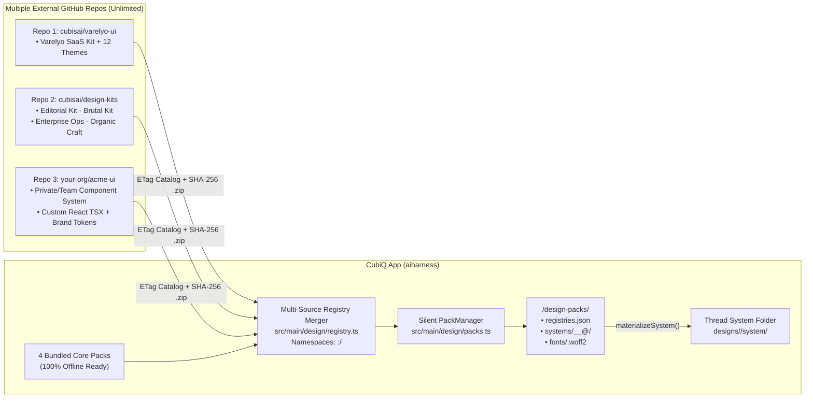

# CubiQ Design Mode 2.0 — Effortless UX & Multi-System Architecture Plan

> **Status:** Research Complete · UX-First Architecture & Implementation Specification  
> **Interactive UI Mock:** [`design_mode_mock.html`](./design_mode_mock.html) *(open in any browser to click through the 5-control Studio Bar, direct selection, inline text edit, live `Customize` panel, 6 multi-system packs, the select-to-create flows and System mode)*  
> **Core UX Goal:** Make Design Mode feel **calm, obvious, and effortless** on the very first try—zero toolbar overload, zero mode-juggling, zero CSS jargon, and instant visual feedback.  
> **Primary External Benchmarks:** [Varelyo (`varelyo.com`)](https://varelyo.com/) · [Varelyo UI (`github.com/varelyo/ui`)](https://github.com/varelyo/ui)  
> **Internal UI Governance:** **CubiQ editor chrome** follows [`DESIGN.md`](./DESIGN.md) ("Ink Flat" tokens in [`src/renderer/src/styles/app.css`](./src/renderer/src/styles/app.css): 28px controls, 13px Geist UI, `1px solid var(--hairline)`, zero static shadows, no literal colors, no emoji icons). **Authored pages and component packs do not** — they follow their own validated pack contracts (§1A.6). Ink Flat rules never apply inside the page iframe.
> **Normative sections:** §1A (Architecture Contracts), §10 (Security), §11 (Roadmap) and §13 (Harness Integration) are binding. Where UX prose elsewhere conflicts with them, §1A/§10 win.

---

## Table of Contents

1. [UX Philosophy: 6 Rules for an Effortless Design Studio](#1-ux-philosophy-6-rules-for-an-effortless-design-studio)
   - 1A. [Architecture Contracts (Normative)](#1a-architecture-contracts-normative)
2. [Current-State UX Audit (Why Design Mode Feels Confusing Today)](#2-current-state-ux-audit-why-design-mode-feels-confusing-today)
3. [End-to-End User Journeys (How Design Mode 2.0 Feels in Practice)](#3-end-to-end-user-journeys-how-design-mode-20-feels-in-practice)
4. [Pillar 1 — Calm Studio Chrome (21 Controls → 5, 4 Bottom Bars → 1)](#4-pillar-1--calm-studio-chrome-21-controls--5-4-bottom-bars--1)
5. [Pillar 2 — Direct Canvas Selection, Inline Editing & Scale-Locked Stage](#5-pillar-2--direct-canvas-selection-inline-editing--scale-locked-stage)
   - 5.7. [Spatial Canvas Direct Feedback: "Draw it for the agent" & "Comments on the code"](#57-spatial-canvas-direct-feedback-draw-it-for-the-agent--comments-on-the-code)
   - 5.8. [Multi-Screen User Flows: Focused Artboard Fidelity & Flow Board Macro View](#58-multi-screen-user-flows-focused-artboard-fidelity--flow-board-macro-view)
   - 5.9. [Comprehensive Varelyo (`varelyo.com`) Feature Benchmark & Full Gap Audit (16 Features)](#59-comprehensive-varelyo-varelyocom-feature-benchmark--full-gap-audit-16-features)
6. [Pillar 3 — Human-Friendly Live Inspector (Page Theme + Component Props)](#6-pillar-3--human-friendly-live-inspector-page-theme--component-props)
7. [Pillar 4 — 1-Click Visual Vibe & Style Picker (Invisible Streaming)](#7-pillar-4--1-click-visual-vibe--style-picker-invisible-streaming)
8. [Pillar 5 — Varelyo-Inspired Multi-System Tokens & AI Component Kits](#8-pillar-5--varelyo-inspired-multi-system-tokens--ai-component-kits)
   - 8.5. [The Select-to-Create Ladder](#85-the-select-to-create-ladder)
   - 8.6. [System Mode (Foundations, Components, System Chat)](#86-system-mode-foundations-components-system-chat)
   - 8.7. [Creating and Editing Components](#87-creating-and-editing-components)
9. [Pillar 6 — Multi-Repository Asset Registry & Zero-Friction Downloader](#9-pillar-6--multi-repository-asset-registry--zero-friction-downloader)
10. [Security, IPC & Local Cache Specification](#10-security-ipc--local-cache-specification)
11. [Phased Implementation Roadmap & File Map](#11-phased-implementation-roadmap--file-map)
12. [Verification Gates & Reference Links](#12-verification-gates--reference-links)
13. [Harness Integration Map (Normative)](#13-harness-integration-map-normative)

---

## 1. UX Philosophy: 6 Rules for an Effortless Design Studio

Comparing CubiQ's live screenshots against [Varelyo](https://varelyo.com/), Figma Sites, and Framer reveals why users feel overwhelmed today: CubiQ currently exposes **every internal feature and developer state simultaneously** (21 header buttons, 4 stacked bottom bars, explicit `Pick` mode toggles, raw `141.797px` CSS properties, manual `Apply` buttons, and cryptic tier/fence chips).

Every screen and interaction in Design Mode 2.0 obeys six strict UX rules:

1. **Progressive Disclosure Over Icon Soup:** Show only the **5 core studio controls** needed 95% of the time (`Layers`, `Design | Preview | Code`, `Desktop | Mobile`, `Customize`, `Export / ⋯`). Everything secondary hides until relevant or inside one clean menu.
2. **No "Pick Mode" Toggle — Direct Click Always Selects:** Within `Design` view, clicking any element selects it and double-clicking text edits it inline; there is no separate pick/insert/edit toggle. `Design | Preview | Code` is a *view* switch (what you are looking at), not a tool mode. This **eliminates the floating `LiveBar` toolbar**. The single contextual selection pill is the only element anchored to the canvas (see §1A.5).
3. **One Prompt Box, Never Two:** Retire `LiveBar`'s separate `Steer` input. There is **one** calm, centered Composer dock at the bottom. Typing with nothing selected steers the whole page; clicking an element attaches its chip (`[Hero Button ×]`) so typing steers that element.
4. **Live Edits + `⌘Z` Undo — Never an "Apply" Button:** Changing a variant, color swatch, font size, or padding in the right panel gives feedback on the next animation frame (optimistic preview), is committed through the mutation service (§1A.2), is saved after 250ms of inactivity, and is undoable with `⌘Z` / `⌘⇧Z`. IDs are assigned automatically when the target resolves unambiguously; ambiguous or stale targets produce a recoverable conflict, never a write to the wrong element.
5. **Speak Design, Not Browser Internals:** Lead with **Component Variants** (`Filled`, `Outline`, `Ghost`), **Size Presets** (`S`, `M`, `L`), and **Theme Swatches** (`Surface`, `Primary`, `Muted`)—never `rgb(255, 255, 255)`, `141.797px`, or `justify-content: normal`.
6. **Low-Friction Infrastructure, Visible Failure:** External design systems, kits, and `.woff2` fonts live in separate repositories and download on demand with immediate, cancellable feedback (no fixed network guarantee). The UI never becomes a package manager with `Installed | Cloud` tabs or file-size badges, but it does show restrained states: `Preparing style…`, `Unavailable offline`, `Retry`. Activation is atomic; the previous style stays in place on failure.

---

## 1A. Architecture Contracts (Normative)

### 1A.1 Theme Switch vs. Kit Migration

| Operation | Condition | Behavior | Picker label |
| :--- | :--- | :--- | :--- |
| **Theme switch** | Same `kitId` **and** compatible `contractVersion` (same major) | Swap tokens only. Content, structure, and user edits/overrides are preserved. Instant, undoable. | `Apply theme` |
| **Kit switch** | Different `kitId` **or** incompatible `contractVersion` | Compute a **migration preview** (side-by-side); list unsupported components; map `data-ui` primitives via the target kit's `migrations.json`; preserve content where possible; unmapped components are kept as-is and flagged. Cancellable before commit; committed as **one undo step**. | `Adapt page to this style` |

- **Picker structure:** the picker opens on **themes of the current kit** (`Apply theme`). A `Kit: <name> ▾` control in the picker header lists the available kits. Choosing another kit shows that kit's themes, labelled `Adapts page`, and applying one opens the migration preview. Cards never mix kits in one flat list.
- A kit switch is never silently executed via `tokens.css` alone. Cards show a kit badge only when it differs from the active kit.
- `components.json` declares `kitId`, `contractVersion`, and `compat: { themes: [...], migratesFrom: [...] }`.
- Migration is deterministic first (mapping tables); AI-assisted adaptation is an explicit, separate, opt-in step.
- §8.1's "swap `tokens.css` without rewriting HTML" applies **only within one kit**.
- **Existing flat styles stay valid.** The 32 styles in `resources/design-styles/` ship `index.md`, `DESIGN.md` and `tokens.css` only, with no components. They become themes of the bundled **Foundation** kit, whose `ui.css` is written against the existing `--color-*`, `--radius-*` and `--space-*` names, so no style needs converting. A thread with no kit in its `system/` keeps today's behaviour: the agent restyles with tokens.

### 1A.2 Authoritative Editing Model

- **Authority:** the source HTML file on disk, mediated by a **single main-process `DocumentMutationService`**. The iframe is a **preview**, never a source of truth. (If a parsed intermediate model is introduced, it is derived from the HTML and rebuilt on each external change; it is never persisted separately.)
- **Stable IDs:** elements are addressed by `data-agent-id`. IDs are stamped automatically when the target resolves unambiguously (single structural match at `baseRevision`). Ambiguous or stale targets return a recoverable `conflict` — never a write to the wrong element.

```ts
type DesignMutation = {
  operationId: string      // idempotency key
  documentId: string
  baseRevision: number     // revision the client rendered against
  targetId: string         // data-agent-id (or a resolvable locator to stamp)
  transactionId: string    // groups continuous gestures (slider drags, typing)
  change: DesignChange     // setProp | setToken | setText | insert | remove | move
}
type MutationResult =
  | { ok: true; operationId: string; newRevision: number }
  | { ok: false; operationId: string; reason: 'stale' | 'ambiguous' | 'invalid' | 'external-change'; currentRevision: number }
```

- **Optimistic preview:** the renderer applies the change to the iframe immediately; the service acks (`newRevision`) or rejects. On rejection the preview **rolls back** to the authoritative render and shows a quiet inline notice with `Retry` / `Reapply on latest`.
- **Serialization:** mutations are applied in order per document; each increments `revision`. A mutation with a stale `baseRevision` is rebased only if its target resolves unambiguously and the touched property was not modified since; otherwise `stale`.
- **Undo grouping:** all mutations sharing a `transactionId` coalesce into one undo step (closed on pointer-up / blur / 500ms idle). Undo/redo are themselves mutations (inverse patches) with new revisions. History is per-document and stored with the document.
- **Save:** persisted via debounce of 250ms of inactivity, atomic write (temp file + rename). Flush on blur, navigation, and quit.
- **External changes (AI generation, external editor):** the service watches the file. If revision on disk differs from the last acknowledged one, pending local mutations are rebased or rejected as above, and undo history is annotated with an `external` boundary (undo does not cross it silently). During an AI turn that targets the same file, the Inspector is read-only for that file (`Design in progress`).
- **Crash/reload durability:** accepted-but-unsaved mutations are journaled to `<userData>/design-journal/<documentId>.wal` before the preview acks; on relaunch they are replayed against the on-disk revision (or surfaced as a recoverable conflict).

### 1A.3 Interaction State Machine

States: `Idle` → `Selected` → (`EditingText` | `ContextMenu` | `AiOperation`).

| State | Click | Double-click | Enter | Escape | Undo (`⌘Z`) | Focus |
| :--- | :--- | :--- | :--- | :--- | :--- | :--- |
| **Idle** | Select target | Select (text → `EditingText`) | — | — | Document undo | Canvas root |
| **Selected** | Reselect / clear on background | Text node or button label → `EditingText` (label wins over drill); container → drill one level | Enter `EditingText` if text, else drill in | Select parent; at root → `Idle` | Document undo | Selection outline; pill reachable via `Tab` |
| **EditingText** | Click outside commits | Select word | Commit (`Shift+Enter` newline in multi-line) | **Cancel edit, revert text**; stays `Selected` | Text-local undo, then one document step on commit | Caret in element |
| **ContextMenu** | Choose item / dismiss | — | Activate item | **Close menu only**; return focus to pill trigger | Document undo | Menu with roving focus |
| **AiOperation** | Cancels? No — selection locked | — | — | **Cancel operation** (confirm if destructive) | Undo of the finished operation is one step | Composer |

- Escape priority: dismiss menu → cancel edit → cancel AI op → select parent → clear. Exactly one action per press.
- Style picker: single-click or arrow-key **previews**; `Apply theme` or `Adapt page to this style` / `Enter` / double-click **commits** (Theme vs. Adapt per §1A.1). Not mixed.
- **Keyboard parity:** `Tab` enters canvas; arrow keys move among siblings, `Alt+↑/↓` parent/child, `Enter` edits, `Shift+Enter` inserts section after the selection (keyboard equivalent of seam insertion; also `Insert section…` in the Layers rail). All pill actions are reachable by keyboard; Layers rail is a full tree with selection sync.
- **Target size:** controls are 28px tall; interactive targets must satisfy WCAG 2.2 SC 2.5.8 (≥24×24 CSS px, or spacing exception). Icon-only controls get a minimum 28×28 hit area and are verified in tests; height alone is not accepted.

### 1A.4 Honest Performance Targets

| Operation | Acceptance target (reference hardware & fixture pages) |
| :--- | :--- |
| Local edit feedback | Next animation frame |
| Save scheduling | Debounced 250ms after last input; flush on blur/quit |
| Cached gallery open | p95 ≤ target set in Phase 0 benchmark (e.g. ≤150ms, 50 cards) |
| Cold pack download | Immediate `Preparing style…`; cancellable; no network guarantee; timeout + `Retry` |
| Pack activation | Atomic; previous style retained on failure |
| Offline | Bundled packs always work; others show `Unavailable offline` |

### 1A.5 Selection UI Model
"Zero floating toolbars" means **no persistent toolbars** (LiveBar retired). One transient contextual selection pill is allowed, dismissed on deselection, positioned to avoid covering the selection, and keyboard accessible.

### 1A.6 Token & Style Scopes (No Leakage)

| Scope | Examples | Owner | Rules |
| :--- | :--- | :--- | :--- |
| **Editor tokens** | `--bg`, `--hairline`, `--primary` | CubiQ chrome | Ink Flat (`DESIGN.md`); `design:check` applies |
| **Page tokens** | `--core-*`, `--bg-canvas`, `--btn-*` | Active pack | Validated against pack schema; color/shadow/typography are free within the pack |
| **Compatibility aliases** | `--color-*` | Versioned mapping in the pack (`aliases@v1`) | Read-only mapping for existing pages and `design_lint` |

- Pages render only inside the sandboxed iframe; editor CSS is never injected into it, and page CSS is never loaded in the renderer document. Editor overlays are drawn in the host layer using geometry from the bridge.
- **Canvas selection colour:** overlays sit on top of any authored page, so Ink cannot stay visible on both light and dark pages. They use one fixed editor token, `--canvas-select`. This needs an explicit exception in `DESIGN.md` (§8 bans blue accents) before Phase 1 ships, and it is used only for canvas selection, its badge and multi-select outlines.

### 1A.7 Failure Behavior Matrix (User-Visible)

| Failure | What the user sees | System guarantee |
| :--- | :--- | :--- |
| Edit target stale or ambiguous | Banner: "This file changed outside the editor. Your last edit was not applied." + `Reapply on latest` / `Discard my edit`; status shows `Conflict` | No write to the wrong element |
| Save fails (disk, permission) | Status `Not saved` + `Retry`; edits stay in the journal | Nothing lost; retry is idempotent by `operationId` |
| External change mid-edit (AI turn, other editor) | Inspector read-only during AI turn; otherwise conflict banner above | Undo never crosses an `external` boundary silently |
| Pack download fails / offline | Preview shows `Unavailable offline` + `Retry`; bundled styles keep working | Previous style stays active |
| Pack download in progress | `Preparing style…` with thin progress bar + `Cancel` | Cancel leaves no partial install |
| Pack fails validation (hash, signature, limits) | `Couldn't verify this style` + `Details` | Nothing extracted or activated |
| Kit switch has unsupported components | Migration dialog lists them; they are kept as-is and flagged in Layers | Cancel = no change; confirm = one undo step |
| App quits or crashes mid-edit | On relaunch, journal replays; conflicts surface as above | Accepted edits are never silently dropped |
| New kit fails validation | Run reports what failed (`Button has no focus state`) and offers `Fix with agent` / `Keep editing draft` | Draft stays in `{dir}/kit/`; `.agents/design-systems/` and the active system are untouched |
| Kit save with no project folder | `Open a project folder to keep this kit` + `Open folder…` | Kit keeps working as a draft in this thread |
| Connected library can't be read or mapped | Scan result lists what was found and what wasn't; `Use what was found` / `Cancel` | Project source is never written from a design thread |
| Component can't render in the canvas | Row marked `Preview only in your app`; agent uses the nearest mapped component and says so | No silent substitution |
| New component repeats one the kit already has | Agent names the existing one and offers `Add a variant` / `Make it anyway` | Nothing is added until the user chooses |
| New component fails its checks | Draft stays open with what failed (`No focus state`) + `Fix with agent` / `Discard` | Saved kit is untouched |
| Removing a variant or prop that's in use | Shows every use and what each will fall back to + `Cancel` / `Remove` | Nothing changes until confirmed; one undo step restores it |
| Editing a bundled or library kit | `Saves a copy in this project` on the first edit | The bundled kit never changes |
| Editing a connected kit | `Preview only · send to a code thread` | Project source is never written from a design thread |
| Screenshot branding gives low contrast | Run reports the pairs it adjusted (`Text on Primary raised to 4.5:1`) | One undo step restores every token |

### 1A.8 What the Mock Demonstrates

[`design_mode_mock.html`](./design_mode_mock.html) is a behavioral sketch of these contracts, not an implementation:

- **Save status** (top right): `Saving…` → `Saved · rN` after 250ms idle; one revision per edit burst; rapid edits to the same element coalesce into one undo step.
- **Conflict**: `⋯` → `Demo: external file change` shows the conflict banner and `Reapply` / `Discard`.
- **Style picker**: opens on the current kit's themes (`Theme`, `Apply theme`). The `Kit: … ▾` control switches to another kit's themes, whose cards say `Adapts page` and whose button says `Adapt page to this style`, opening the migration dialog (adapted vs. needs attention, `Cancel`, one-step undo).
- **Install states**: uncached styles show `Preparing style…` with `Cancel`; `⋯` → `Demo: go offline` then picking an uncached style shows `Unavailable offline` + `Retry`. Added repositories show `Publisher unverified`, and the Add Repo row states what adding a source does and does not authorize.
- **Canvas Selection & Swap Component Popover**: selecting an element renders a blue bounding box and anchored blue badge with swap diamond (`Button ⟐`). Clicking opens the anchored popover with prop loss warnings (`Becomes Dropdown — drops variant, which Dropdown does not take`), taxonomy search, and atomic swap execution.
- **Seam Insertion Palette**: hovering canvas gaps renders a hairline seam with `+` button (`Add below`); clicking opens an inline palette with `[ Before | After | Inside ]` tabs and categorized search that inserts real component instances.
- **Multi-Selection & Structural Wrapping**: `Shift+Click` selects multiple siblings, shifts inspector to `N selected` checklist, and provides 1-click `Wrap in Stack` / `Wrap in 4 in Grid` / `Wrap in Card` actions.
- **Tactile Grid Columns Stepper**: inspector for Grid provides tactile segmented `[ 1 | 2 | 3 | 4 ]` columns stepper that live re-renders the layout on canvas.
- **Foundations & Brand Color Live Overhaul**: picking Teal (`#0f968a`) updates all brand tokens across the app and triggers toast: `Changes applied · Brand colour -> Teal 500 · Undo [Z]`.
- **Keyboard**: `Enter` edits the selected text, `Shift+Enter` inserts a section, `Alt+↑/↓` parent/child, `←/→` siblings. `Esc` takes one action per press (menu/dialog → cancel edit → stop AI turn → select parent). Cancelling an edit restores the text.
- **Keyboard access to canvas:** the canvas is focusable with a visible focus ring. `←/→/↓/Enter` selects the first component, `Tab` moves into the selection pill (a labelled toolbar), and `Esc` from the pill returns focus to the canvas. Selection changes are announced through a live region. The Layers rail has `Insert section after selection…` (`⇧↵`) as the non-pointer alternative to seam insertion.
- **Target sizes:** pill and variant-bar controls are at least 24×24px. `⋯` → `Demo: check target sizes` scans the editor controls and outlines any under 24×24px. Authored page content is excluded, per §1A.6.
- **Launch screen**: `Style`, `Build your own` and the prompt on one clean screen, with no stale Layers, panel or canvas tools.
- **Composer `+` menu**: `Add` (`Files and folders`) and `Design system` (`Start a new kit…`, `Connect my components…`, `Match a screenshot…`).
- **Select-to-create flows**: Journeys D to G run end to end with simulated agent steps, including on-demand component creation and the new kit appearing in the `Kit: ▾` menu. `⋯` → `Demo: new kit fails its checks` shows the draft and fix path.
- **Save as theme**: tweaking the Page Theme shows `Save as new theme…`, and the theme then appears in the picker. `Customize a copy` starts the same path from the picker.
- **System mode**: `Design | Preview | Code | System`, with Foundations pages, component pages (`Variants | Playground | Usage`), the blast-radius notice and its own chat context.
- **Planned, not in the mock yet** (added to this plan on 2026-11-02):
  - The layout card in §6.4.
  - `+ New component` and hand editing in System mode (§8.7).
  - A working `Save as composition…`; today it only shows a toast.
  - Bug: selecting a Grid shows `Value: SCOPE` and `Disabled`, which belong to a card inside it. A container must show only its own props.
- **Not mocked** (spec only): journal/WAL recovery, real rebasing, signature verification, sandbox enforcement, real file scanning, real image reading.

### 1A.9 Studio Workspace Layout & View Transitions (Normative)

- **Design Mode Entrance (3-Column Studio Workspace):**
  - Switching to `Design` mode automatically transitions CubiQ from chat chrome into a dedicated 3-column studio layout ([`Screenshot 2026-10-31 at 12.03.57 in the afternoon.png`](./Screenshot%202026-10-31%20at%2012.03.57%20in%20the%20afternoon.png)):
    1. **Global App Sidebar (`appSidebar`):** Fully collapsed (`width: 0`, hidden border) to dedicate 100% of the display to the design stage.
    2. **Left Semantic Layers Rail (`layersRail`):** Open by default (`224px`), rendering the page switcher, section insert trigger, and semantic component outline tree.
    3. **Right Customize Panel (`customizePanel`):** Open by default (`280px`), rendering Page Theme (when idle) or Component Style Props (when an element is selected).
    4. **Scale-Locked Stage Math:** The stage scaler dynamically calculates available stage width (`scroll.clientWidth - 48`) and scales the `1440px` artboard proportionally (`scale = Math.min(1, availW / targetW)`). Opening or closing panels smoothly adjusts the artboard scale without triggering mobile breakpoint reflows.
- **Preview Mode Transition:**
  - Flipping the top view switcher to `Preview` automatically collapses the left Layers rail and right Customize panel to present the prototype at full width for realistic interactive testing (clicking links, expanding accordions, scrolling).
  - Flipping back to `Design` automatically restores the full 3-column studio layout and active element selection.
- **Composer & Popover Alignment Contract:**
  - The single unified Composer dock is centered horizontally within the active stage column (`.stage-col`).
  - Studio popovers spawned from the dock (including the **Style & Kit Picker**) anchor directly to the Composer dock's bounding box (`dock.getBoundingClientRect()`), matching its exact horizontal width (`660px`), horizontal center, and maintaining an 8px vertical clearance above the dock lip, rather than centering against the full browser window or overflowing off-axis ([`Screenshot 2026-10-31 at 12.07.32 in the afternoon.png`](./Screenshot%202026-10-31%20at%2012.07.32%20in%20the%20afternoon.png)).
- **Narrow windows (`DESIGN.md` §9, 900px):** nothing clips or collides. Below 1180px the save status drops its label and the viewport segment drops its text. Below 1000px the Layers rail starts collapsed and the Customize panel opens as an overlay over the stage instead of squeezing it. The Composer's width is `min(660px, stage width - 24px)` and its chips fold to icons, so `Send` is always visible.
- **Launch state:** a new design thread has no page yet, so it hides the Layers rail, the Customize panel, canvas tools, the view and viewport switches, and `Export`. They appear with the first page.
- **Canvas tools** never cover the artboard: the artboard starts below the tools pill. The selection pill and canvas tools are drawn in the host layer at a fixed size, so they stay readable at any artboard scale.

### 1A.10 Kit Creation Contract

Verified against the code on 2026-11-02. These rules exist because of how the harness already works.

1. **The agent never writes a kit to `system/`.** `materializeSystem` recopies `DESIGN.md` and `tokens.css` over `system/` before every turn (`src/main/service.ts:1877`, `src/main/design/systems.ts:360`), and `DESIGN-MODE.md:15` already says not to edit it.
2. **Drafts live in `{dir}/kit/`.** That is inside the fence (`src/main/design/fence.ts:575`, enforced in the Claude, Codex, ACP and harness drivers), so no fence change is needed.
3. **A kit's home is `.agents/design-systems/<slug>/`.** This folder already exists: `listDesignSystems` reads it (`systems.ts:195-203`), it appears in the picker without a restart, it is per project, and it travels with git. CubiQ does not add a second registry.
4. **Saving goes through a main-process tool.** The new `design_kit_save` validates `{dir}/kit/`, copies it to the project folder, switches the thread to `project:<slug>` and materializes it. The fence stays exactly as strict as it is today, and the agent gets no general write access outside `{dir}/`.
5. **Foundation first.** A new kit starts as a deterministic copy of the bundled Foundation kit, and the agent changes tokens and adds what's missing. It doesn't generate base components from nothing on every run, which keeps token cost low and quality steady.
6. **Missing components are additive.** When a page needs a part the kit lacks, the agent adds it to `{dir}/kit/`, saves again and marks it `new` in Layers and on the selection badge. Existing components are not rewritten.
7. **Connected libraries are read-only.** A design thread never writes the project's source. Variants it needs stay in the kit's mirror and are listed for handoff (§8.5, step 6).
8. **Branding is tokens only, by construction.** `design_tokens_apply` can only change token values, so "no component touched" cannot be violated. One call is one undo step.
9. **A kit is a document for §1A.2.** Hand edits are mutations with revisions, journaling and undo, like page edits. New change types: `addComponent`, `removeComponent`, `addVariant`, `removeVariant`, `addProp`, `removeProp` (`setToken` already exists). Agent writes to `{dir}/kit/` are external changes, with an `external` undo boundary.
10. **Bundled and library kits are never edited in place.** The first edit copies the kit into the project and switches the thread to the copy, as `editDesignSystem` already does for styles (`src/main/service.ts:1730-1735`).

---

## 2. Current-State UX Audit (Why Design Mode Feels Confusing Today)

Evidence from live testing ([`Screenshot 2026-10-31 at 10.33.09 in the morning.png`](./Screenshot%202026-10-31%20at%2010.33.09%20in%20the%20morning.png) and [`Screenshot 2026-10-31 at 10.35.36 in the morning.png`](./Screenshot%202026-10-31%20at%2010.35.36%20in%20the%20morning.png)):

| Pain Point Seen in Live Test | Root Cause in Codebase | User Impact |
| :--- | :--- | :--- |
| **21 controls crammed into the 46px top header** | [`App.tsx:192-242`](./src/renderer/src/App.tsx#L192-L242) renders `Canvas-first`, `Changes`, `Browser`, and `Terminal` beside the portaled `head` from [`DesignCanvas.tsx:1247-1468`](./src/renderer/src/design/DesignCanvas.tsx#L1247-L1468) (`Rail`, `Page`, static `Glacier` label, `More styles`, `Viewport`, `Device`, `Zoom`, `Version`, `Grid`, `Tweaks`, `Inspector`, `Reload`, `Build`, `Open folder`, `Export`). | Severe visual noise; impossible to scan; clicking `Changes` or `Browser` opens a *second* conflicting right panel; static top `Glacier` text duplicates the interactive `Auto · Glacier` button below. |
| **4 horizontal bars stacked at the bottom** | Floating [`LiveBar.tsx`](./src/renderer/src/design/LiveBar.tsx) + `TodoDock` + `DrawerHandle` + `Composer` stack on top of each other. | Eats vertical canvas height; `Steer` inside `LiveBar` duplicates the `Composer` right below it. |
| **Clicking near the top selects invisible `a "Skip to content"`** | [`snapTarget` in `bridge.ts:81-84`](./src/main/design/bridge.ts#L81-L84) snaps to any `<a>` without checking `.sr-only`, `.skip-link`, `clip`, `opacity: 0`, or offscreen bounds. | Users try to click the navbar or hero and get stuck on an invisible accessibility link. |
| **1 click spawns 4 competing selection UIs** | Selecting one element simultaneously renders `.design-crumbs` ([`DesignCanvas.tsx:1502-1528`](./src/renderer/src/design/DesignCanvas.tsx#L1502-L1528)), floating [`ElementBar.tsx`](./src/renderer/src/design/ElementBar.tsx), a Composer chip, and Right [`InspectorPanel.tsx`](./src/renderer/src/design/InspectorPanel.tsx). | Page jumps down by 32px, floating bar covers the navbar, and the user doesn't know which of the 4 places to interact with. |
| **Opening Inspector crushes desktop layout into mobile** | `Fit` in [`frame.ts:58`](./src/renderer/src/design/frame.ts#L58) sets iframe width to remaining container pixels (~840px when Layers + Inspector open). | Desktop hero buttons and multi-column grids suddenly stack into narrow mobile layout while inspecting desktop styles. |
| **Inspector feels like Chrome DevTools, not a design tool** | [`InspectorPanel.tsx:10-34`](./src/renderer/src/design/InspectorPanel.tsx#L10-L34) dumps 22 raw computed strings (`141.797px`, `flex-direction: row` on block nodes), requires clicking `Apply`, and shows `"Pick an element..."` empty state when nothing is selected. | Intimidating for quick visual edits; wasted panel when nothing is selected; frequent `"No data-agent-id: drafts a message"` fallbacks. |
| **Blind text-only Style Picker** | [`DesignSystemMenu.tsx:124-126`](./src/renderer/src/components/DesignSystemMenu.tsx#L124-L126) hides color swatches in the list and requires clicking tiny `Eye` icons one by one. | Users cannot visually scan or feel the difference between 32+ styles without tedious clicking. |

---

## 3. End-to-End User Journeys (How Design Mode 2.0 Feels in Practice)

### Journey A — Starting a New Design (Zero Clutter, Visual Start)
1. User opens a new **Design** thread. Instead of a blank `"Nothing to show yet"` box surrounded by 20 disabled toolbar icons, the header is completely clean. The center shows one prompt box with **6 visual starter style cards** (`Auto — Match my prompt`, `Varelyo Clean`, `Glacier`, `Atelier`, `Carbon`, `Browse all styles…`) and a **Build your own** row (`Start a new kit`, `Connect my components`). This one screen replaces both earlier launch ideas: the cards are the fast path, and the prompt box with its chips (§5.9.2 #6) is always there.
2. User clicks `Glacier` (or leaves `Auto`), types *"A calm workspace landing page called Fieldnote"* in the single centered prompt bar at the bottom, and hits `Enter`.
3. While generating, the Composer shows CubiQ's signature running beam and a single subtle status line (`Designing index.html · Step 2 of 3 · Esc to stop`). No extra stacked docks.

### Journey B — Exploring, Clicking & Editing Directly on Canvas
1. The finished `1440px` desktop page appears cleanly framed on `--bg-subtle`. **No persistent toolbars** cover the design.
2. User moves the mouse over the page:
   - Hidden nodes (`.skip-link`, `.sr-only`) are completely ignored.
   - Real components gently highlight on hover with a crisp `1px` label (`Navbar`, `Hero`, `Button`, `Feature Card`).
   - Moving the mouse over the horizontal seam *between* two sections (`Hero` and `Features`) fades in a subtle centered **`+ Add section`** pill right on the seam—click it to insert a new block right there without ever toggling an "Insert mode"!
3. User **clicks** a CTA button:
   - **Single click** selects the `Button` component. A compact, unobtrusive pill appears 8px above/below it: **`[Button ▾]  [3 Variants ▾]  [Ask AI]`**, and `[Button ×]` appears inside the bottom prompt box.
   - **Double-click** on any heading, paragraph, or button label edits its text **inline right on the page** (`Enter` or click outside saves immediately).
   - Pressing **`Esc`** follows the §1A.3 priority (menu → edit → AI op → select parent → clear).
4. Want to click links, open modals/tabs, and scroll the page like a real visitor? Click **`Preview`** in the top center switch (or press `P`).

### Journey C — Visual Customization Without CSS Jargon
1. User clicks **`Customize`** (`PanelRight` icon, top right):
   - The right panel (`280px`) opens smoothly. **The `1440px` desktop page scales down proportionally (e.g. `82%`)** to fit the stage—it **never** reflows into mobile layout!
   - **With nothing selected**, the panel shows **Page Theme** controls: switch `Glacier → Atelier` live, flip `Light / Dark`, adjust global `Accent` swatch, `Font Pair`, or `Corner Style` (`Sharp / Soft / Round`), plus any page `Tweaks`.
   - **With an element selected**, the panel switches to **Element Controls** (`← Page Theme` at top):
     - **Component Props** first (`Style: Filled | Soft | Outline | Ghost`, `Size: S | M | L`).
     - **Theme Swatches** for Fill / Text / Border (`Surface`, `Subtle`, `Primary`, `Muted`).
     - **Clean Presets** for Text Size, Padding (`Tight / Normal / Roomy`), and Corner Radius.
     - Every click updates the live page immediately—**no `Apply` button**, full `⌘Z` undo.

---

### Journey D — Start From Scratch (New Kit)

Reference: `Screen Recording 2026-10-31 at 11.57.22 in the morning.mov`.

1. User picks `Start a new kit` on the launch screen, or `+` → `Start a new kit…` in the Composer. A `New kit` chip joins the prompt. There is no wizard.
2. User types a normal request: *"A Projects page for the Web team."*
3. The run reports its steps in plain words: `Set up your tokens · colour, type, spacing` → `Made 9 base components · Button, Input, Tabs and 6 more`. The canvas shows a **kit board** with colour, type and each component while it works.
4. The page needs a progress card and the kit has none: `No ProgressCard in your kit yet · added one from your tokens`. It is marked `new` in Layers and on its badge.
5. The page replaces the board. The Composer keeps a `projects-kit` chip, the kit is listed in `Kit: ▾`, and later prompts reuse it.

### Journey E — Bring Your Own Components (Connect)

Reference: the same recording.

1. User picks `Connect my components`. CubiQ suggests folders it found (`src/components/ui`) or the user chooses one.
2. The scan shows what it read: `38 components · 64 tokens · React`, with anything it can't show flagged `Preview only in your app`. `Use this kit` / `Cancel`.
3. User prompts as usual. The run reports reuse first: `Reused Sidebar, PageHeader, FilterBar` → `ProgressCard has no secondary style · added to this kit's preview` → `Built from your kit · 0 new components · 1 new variant`.
4. The new variant is not written to the project (§1A.10.7). `Export` → `Build in Codebase` carries it to a code thread.

### Journey F — Get the Product Right, Then Brand It

Reference: `Screen Recording 2026-10-31 at 11.56.03 in the morning.mov`.

1. The page is built in Foundation's plain look, so the user can test the flow before any styling.
2. `+` → `Match a screenshot…` attaches an image. A `screen.png` chip joins the prompt: *"Brand it like this: dark and calm, one indigo accent, softer corners."*
3. The run reports `Read screen.png · 18 tokens changed · no components touched`. The canvas recolours, the page's structure doesn't move, and `⌘Z` undoes it in one step.
4. The Page Theme panel offers `Save as new theme…` so it can be reused.

### Journey G — Tweak the System Itself (System Mode)

Reference: `Screen Recording 2026-10-31 at 11.53.54 in the morning.mov`.

1. User switches to `System`. The left rail lists Foundations and Components, and the stage shows `Colors`.
2. User changes `Brand colour`. The panel shows what it reaches (*"Changes 14 colour tokens and 102 component instances on every page"*) with `Cancel` / `Apply`.
3. A toast confirms `Brand colour → Teal 500 · Undo ⌘Z`, and every page follows.
4. Opening `Button` shows `Variants | Playground | Usage` and `used 12× in 3 files`. The Composer now targets the system (`System · Button · Light`), so a prompt changes the kit rather than the page.

### Journey H — Change a Layout With Props

Reference: `Screen Recording 2026-11-02 at 5.02.43 in the afternoon.mov`.

1. User selects a row of stat cards. The badge says `Stack`, and the panel shows `Flow` and `Gap`.
2. User picks the grid option in `Flow`. The cards reflow, the badge becomes `Grid`, and `Gap` gives way to `Columns`, with gap still available below it.
3. User picks 2 columns. The code card under the controls updates on the next frame.
4. `⌘Z` undoes each change in one step. No agent turn runs.

### Journey I — Make Your Own Component

1. In System mode, user clicks `+ New component`. A `New component` chip joins the Composer: *"A pricing card with a plan name, a price and one button."*
2. The agent drafts it from the kit's tokens. A `PricingCard` page opens, marked `draft`, with its `Variants` and `Playground` tabs.
3. User tries it, asks for changes in the same prompt, adds a variant by hand, then clicks `Save to kit`.
4. It now appears in the seam palette and in Swap, and the agent can use it on any page.
5. Alternatively, user selects something on the canvas and picks `Save as composition…` to keep it without an agent turn.

---

## 4. Pillar 1 — Calm Studio Chrome (21 Controls → 5, 4 Bottom Bars → 1)

All chrome strictly uses [`DESIGN.md`](./DESIGN.md) Ink Flat tokens (`--bg`, `--bg-side`, `--bg-subtle`, `--bg-chip`, `--bg-hover`, `--bg-selected`, `--text`, `--text-secondary`, `--text-tertiary`, `--hairline`, `--hairline-strong`, `--primary`, `--on-primary`, `--radius-s` 6px, `--radius-m` 8px, `--radius-l` 10px, `--shadow-float` on popovers only, 28px control height, 16px `lucide-react` icons, zero emojis).

### 4.1 The 5-Group Studio Top Bar (`46px` height)

```text
┌──────────────────────────────────────────────────────────────────────────────────────────────────────┐
│ [Sidebar]  [Layers]  Fieldnote / index.html ▾   [Design | Preview | Code | System]  [Desktop | Mobile ▾]   [Customize] [Export] [⋯] │
│ └─── 1. Left: Context & Layers ────────┘        └─── 2 & 3. Center: Mode + Device ───┘        └─ 4 & 5. Right ─┘ │
└──────────────────────────────────────────────────────────────────────────────────────────────────────┘
```

1. **Left — Page & Layers Context:**
   - `[Sidebar]` toggles the global app sidebar (automatically collapsed by default in Design Mode to prioritize canvas space).
   - `[◧]` toggles the left **Pages & Layers** rail (`⌘\`, open by default in Design Mode; auto-shows badge when `pages.length > 1`).
   - `Thread Title` (or `Page Switcher ▾` when multi-page). Version pill (`v2 ▾`) appears **only** when inspecting history or via `⋯` → `Version history`.
   - **Removed:** Non-interactive top `Glacier` style text; chat-only `Changes`, `Browser`, `Terminal`, and `Canvas-first` buttons in [`App.tsx:200-241`](./src/renderer/src/App.tsx#L200-L241) when `design && canvasFirst`.
2. **Center Pill 1 — View Mode (`[Design | Preview | Code]`):**
   - Segmented track (`--bg-chip`, active segment `--bg` + `1px solid var(--hairline)` per `DESIGN.md` §5):
     - **`Design`** *(default)*: Direct click selects components, double-click edits text, seam hover inserts sections.
     - **`Preview`**: Pure interactive page experience (links navigate, tabs/dialogs open, hover effects play; `Present` fullscreen button appears quietly in corner).
     - **`Code`**: Clean syntax-highlighted viewer + 1-click Copy for `index.html`, `system/tokens.css`, and `system/ui.css`.
     - **`System`**: The kit behind the page: Foundations, Components and system chat (§8.6). It replaces today's Inspector `System` tab once the gate is on.
3. **Center Pill 2 — Viewport (`[Desktop | Mobile ▾]`):**
   - Two 1-click icons for the 95% case: **Desktop (`1440px`, auto-fit scaled)** and **Mobile (`390px`)**.
   - Small chevron `▾` opens less-common sizes & view options: `Tablet (768px)`, `Fluid width`, `Slide (1920×1080)`, `Board view (all pages)`, `Zoom (Fit / 50% / 75% / 100% / 150%)`, and `Device frame`.
4. **Right — `Customize` (`[◨]`):**
   - Toggles the Right Panel (**Page Theme** when idle; **Component & Style Inspector** when an element is selected). Open by default in Design Mode so visual props and system tokens are immediately accessible.
5. **Right — `[Export]` & `[⋯]` Menu:**
   - **`Export`** primary ghost/outline menu:
     - `Build in Codebase` (promotes prototype + React UI kit into a real-app implementation thread)
     - `Export HTML` (single self-contained offline file)
     - `Export PNG` / `Export PDF`
   - **`⋯` Overflow Menu** (cleanly grouped, with shortcut hints):
     - `Compare 3 Other Styles` (`designMoreStyles`)
     - `Check Design Quality (Lint)` (runs `design_lint` pins on canvas)
     - `Add Comment Pin (C)`
     - `Version History` (`Latest · Restore older…`)
     - `Show 8px Grid (⌘')` · `Reload Canvas (⌘R)` · `Open Design Folder`
     - `Switch to Split Chat Layout` · `Developer: Git Changes / Terminal`

### 4.2 Single Unified Bottom Prompt Dock (Replacing 4 Stacked Bars)

**Retire [`LiveBar.tsx`](./src/renderer/src/design/LiveBar.tsx) as a separate floating toolbar** and collapse `TodoDock` + `DrawerHandle` + `Composer` into **one** calm, centered Ink Flat Composer dock (`max-width: 680px`, `1px solid var(--hairline)`, `--radius-l`):

```text
          ┌──────────────────────────────────────────────────────────────────────────┐
          │ [Button "Start writing" ×]  Ask AI to refine this button, or edit text…  │
          │ [+]  [Style: Glacier ▾]                       [Chat (3) ▴] [GPT-6 ▾] [↑] │
          └──────────────────────────────────────────────────────────────────────────┘
```

- **Chat History on Demand (`[Chat (3) ▴]`):** Instead of a full-width `DrawerHandle` bar spanning the window, a subtle chip in the Composer opens the conversation sheet upward when you want to read full agent replies, and collapses cleanly out of sight while you work visually.
- **Single Inline Running Status:** While a turn runs, status + step count (`● Designing hero · 2/3 · Esc to stop`) sits on one quiet line directly on the Composer lip—never 3 separate bars.
- **Hidden Technical Knobs:** `Quick / Working / Real-app` tier defaults smartly (e.g. `Working` for standalone chats, `Real-app` inside a code repo) and moves into `+` or `⋯` so everyday users only see **`[+] [Style: Glacier ▾]`** on the left!

---

## 5. Pillar 2 — Direct Canvas Selection, Inline Editing & Scale-Locked Stage

### 5.1 Smart Hit-Testing (`src/main/design/bridge.ts`)

1. **Zero Invisible-Element Traps (`isSelectableElement`):**
   - Automatically skip `.sr-only`, `.visually-hidden`, `.skip-link`, elements with `opacity === 0`, `visibility === "hidden"`, `pointer-events === "none"`, `clip` / `clip-path` clipping, or off-viewport boxes (`width < 4 || height < 4` or `bottom <= 0 || right <= 0`).
   - Clicking near the top of `Fieldnote` will **never** hit `<a class="skip-link">Skip to content</a>` again.
2. **Natural 2-Step Selection Hierarchy (Like Figma & Varelyo):**
   - **Click once** → Selects the semantic **Component or Section** (`[data-ui="button"]`, `[data-ui="card"]`, `[data-ui="navbar"]`, `[data-agent-id]`, or `<header>`, `<section>`, `<footer>`).
   - **Double-click** →
     - On **text** (`h1..h6`, `p`, `span`, `a`, `button`, `li`, `label`): immediately enters **inline text editing** right on the page (IDs stamped only if the target resolves unambiguously, §1A.2). A button's double-click edits its label; use the pill/`Alt+↓` to drill into structure.
     - On a **section/card background**: drills one level inside to select child layout groups.
   - **`⌘/Ctrl + Click`** → Deep-selects the exact leaf element under the cursor in one click.
   - **`Escape`** → Steps up to the parent container, then clears selection.
3. **One Clean Selection Pill (Not 4 Competing Surfaces):**
   - **Delete `.design-crumbs`** ([`DesignCanvas.tsx:1502-1528`](./src/renderer/src/design/DesignCanvas.tsx#L1502-L1528)) so the canvas never jumps vertically when clicking.
   - Render a crisp outline + **one compact contextual pill** (`28px` tall, `--bg` with `1px solid var(--hairline)` and `--shadow-float`) anchored cleanly `8px` outside the element:
     - **`[Button ▾]`** (dropdown shows parent chain: `Button` → `Hero Actions` → `Hero` so stepping up is 1 click)
     - **`[3 Variants ▾]`** (simplified into **6 clear directions** first—`Polish`, `Bolder`, `Calmer`, `Restyle`, `Rearrange`, `Custom…`—with `"More..."` revealing the remaining power actions so the menu isn't a 12-item wall)
     - **`[Ask AI]`** (focuses Composer with `[Button ×]` chip ready to type)
4. **Hover Seam Insertion (`+ Add section`):**
   - In `Design` mode, when the pointer hovers within `16px` of the vertical gap between two top-level sections (`<header>`, `<section>`, `<main> > *`, `<footer>`), display a subtle hairline divider with a centered `+ Add section` pill. Clicking it focuses the Composer (`[Insert below Hero ×] What section should go here?` + quick chips: `Features`, `Pricing`, `Testimonials`, `FAQ`, `CTA`).

### 5.2 Scale-Locked Desktop Artboard (`src/renderer/src/design/frame.ts`)

- Fix [`frameLayout` in `frame.ts:50-64`](./src/renderer/src/design/frame.ts#L50-L64) so `Desktop` defaults to **`1440px` logical width with automatic `Fit` scaling**:
  - If the window or remaining stage (with `Layers` or `Customize` open) is `960px` wide, the page still renders at a true `1440px` desktop breakpoint and scales smoothly (`scale = (960 - 48) / 1440 = 0.633`) with crisp scrolling.
  - Opening or closing side panels **never** breaks multi-column desktop grids or wraps hero buttons onto stacked mobile lines.

### 5.3 Clean Component Layers & Studio Iconography (`src/renderer/src/design/layers.ts`)

- Collapse anonymous layout wrapper `<div>`s (`container`, `wrapper`, `inner`, `row`, `col`) automatically so the left `Layers` rail reads like a clean outline a human wrote.
- Display semantic SVG icons next to each layer node matching studio standards ([`Screenshot 2026-10-31 at 12.09.54 in the afternoon.png`](./Screenshot%202026-10-31%20at%2012.09.54%20in%20the%20afternoon.png)):
  - **Sections & Layout Headers (`section`, `header`, `navbar`, `footer`):** Corner frame icon (`⛶`).
  - **Component Primitives (`data-ui="button"`, `"card"`, `"badge"`):** 3-spoke isometric component symbol (`⎈`), highlighted in `--primary` when selected.
  - **Text & Headings:** `T` typography glyph.
  - **Groups & Layout Stacks:** 4-box layout container icon.
  - **Pages:** Document sheet icon with `Home` / `Board` chips.
  ```text
  ⛶ Navbar                        navbar
      ⎈ Brand "Fieldnote"         button
      ⎈ Nav Links                 group
      ⎈ Button "Get started"      button
  ⛶ Hero Section                  section
      T Heading "Capture quiet"   heading
      T Subtitle                  text
      ⎈ Hero Actions              group
      ⎈ Interactive Note Card     card
  ⛶ Features Bento                section
  ```

### 5.4 Canvas Selection Badge & Swap Component Popover (`Swap Button for…`)

Directly matching [`Screenshot 2026-10-31 at 11.53.07 in the morning.png`](./Screenshot%202026-10-31%20at%2011.53.07%20in%20the%20morning.png) and [`Screen Recording 2026-10-31 at 11.53.54 in the morning.mov`](./Screen%20Recording%202026-10-31%20at%2011.53.54%20in%20the%20morning.mov) (01:01–01:05):
1. **Canvas Selection Header Chip:**
   - When a component is selected, render a blue border (`#2563eb`, 1.5px) and anchor an attached solid blue badge (`background: #2563eb; color: #ffffff`) to its top edge:
     - Component name label: e.g. `Button`, `Dropdown`, `StatCard · Scope`.
     - Swap symbol: diamond / spark icon (`⟐`).
     - Clicking the badge or pressing `⌘S` (or right-click context menu → `Swap component…`) opens the Swap popover immediately adjacent to the element.
2. **Contextual Intelligence & Prop Drop Warning:**
   - Search input: `🔍 Swap [Component] for...` with keyboard auto-focus.
   - **Smart Compatibility Notice:** Evaluates prop schemas before swap. Example: when swapping `Button` → `Dropdown`:
     > *“Becomes Dropdown — drops variant, which Dropdown does not take”*
     - If swapping `Card` → `Box`: *“Becomes Box — preserves child layout, drops elevation and surface styles”*.
     - Preserves common properties: `value`, `label`, `text`, `placeholder`, `size`, `disabled`, and auto-migrates child content.
3. **Grouped Component Taxonomy:**
   - **Inputs:** `Dropdown`, `Input`, `TextField`.
   - **Layout:** `Card`, `Stack`, `Grid`, `Box`, `Container`.
   - **Data display:** `StatCard`, `ProgressCard`, `Avatar`, `Badge`.
   - **Feedback:** `LinearProgress`, `CircularProgress`.
4. **Execution & Rollback:**
   - Clicking an option performs atomic swap via `DocumentMutationService` (§1A.2), updates the Inspector and Layers tree, logs to undo stack (`⌘Z` instantly rolls back the swap), and triggers a toast: `Swapped Button for Dropdown · Undo [⌘Z]`.

### 5.5 Multi-Selection & Structural Wrapping (`Wrap in Stack / Grid`)

Demonstrated in [`Screen Recording 2026-10-31 at 11.53.54 in the morning.mov`](./Screen%20Recording%202026-10-31%20at%2011.53.54%20in%20the%20morning.mov) (00:03–00:12, 01:06–01:17):
1. **Multi-Selection Mechanics:**
   - `Shift + Click` on canvas or Layers tree adds/removes elements from selection set.
   - Canvas renders distinct bounding boxes for all selected siblings with a unified selection extent.
   - Inspector header switches to **`N selected`** (e.g. `4 selected`):
     - Displays prop search: `Filter props and values [⌘F]`.
     - Displays interactive checklist of selected component items (`☑ StatCard · Scope`, `☑ ProgressCard · Completed`, `☑ StatCard · In progress`, `☑ StatCard · Blocked`).
     - Helper note: *“Shift-click on the canvas or in Layers to add or remove an item.”*
2. **Structural Wrap Actions (Inspector & Context Menu):**
   - Direct 1-click wrap actions:
     - **`Wrap in Stack`**: Creates a Flex container wrapping all selected elements, setting `direction="row"`, `gap="16"`, `align="center"`.
     - **`Wrap in 4 in Grid`** (dynamic count matching selection count `N`): Wraps in CSS Grid container with `grid-template-columns: repeat(N, 1fr); gap: 16px`.
     - **`Wrap in Grid`**: Wraps in customizable multi-column grid layout.
     - **`Wrap in Box`** / **`Wrap in Card`** / **`Wrap in Container`**.
   - Maintains DOM tree ordering, preserves all child IDs, stamps new wrapper container with unique `data-agent-id`, and records an atomic undo transaction.

### 5.6 Canvas Seam Insertion Palette (`[ Before | After | Inside ]`)

Demonstrated in [`Screen Recording 2026-10-31 at 11.53.54 in the morning.mov`](./Screen%20Recording%202026-10-31%20at%2011.53.54%20in%20the%20morning.mov) (00:56–01:00):
1. **Hairline Seam Trigger:**
   - Hovering between siblings displays a horizontal hairline guideline with a centered dark circular button (`+`) and tooltip `Add below` (or `Add above` / `Add inside`).
2. **Inline Component Insertion Palette:**
   - Segmented position tabs: `[ Before ]` `[ After (active) ]` `[ Inside ]` with target badge: `After StatCard`.
   - Real-time search: `🔍 Search components...` (e.g. typing `"prog"` immediately filters down to `ProgressCard`, `LinearProgress`, `CircularProgress`).
   - Grouped recommendations:
     - `Data display`: `ProgressCard`, `StatCard`, `Badge`, `Avatar`, `IssueList`.
     - `Feedback`: `LinearProgress`, `CircularProgress`, `Alert`.
     - `Inputs`: `Button`, `Dropdown`, `Input`, `TextField`.
     - `Layout`: `Stack`, `Grid`, `Card`, `Container`.
   - Selecting a component renders the live instance directly into the DOM slot, selects it, and focuses its props in the Inspector.

### 5.7 Spatial Canvas Direct Feedback: "Draw it for the agent" & "Comments on the code"

Directly matching [`Screenshot 2026-11-02 at 10.33.38 in the morning.png`](./Screenshot%202026-11-02%20at%2010.33.38%20in%20the%20morning.png):
1. **Floating Canvas Spatial Tools Pill (`[ ⛶ Select (V) | ↔ Annotate (Draw) (D) | 💬 Comment (C) ]`):**
   - Anchored top-left inside stage column (`top: 14px; left: 18px; z-index: 40`), floating unobtrusively over canvas content.
   - Ink Flat frosted capsule pill (`background: rgba(255, 255, 255, 0.94)`, `backdrop-filter: blur(20px)`, `border: 1px solid var(--hairline-strong)`).
   - 1-click tool switching + global single-key shortcuts: `V` (Select), `D` (Draw / Annotate), `C` (Comment pin).
   - Priority `Escape` key handling: dismisses comment popover → cancels drawing → returns to `Select` tool without losing canvas state.
2. **"Draw it for the agent" (Freehand Canvas Overlay & Action Dock):**
   - Transparent canvas overlay (`.draw-canvas`) synchronized with artboard viewport and scaling.
   - Smooth freehand crimson pen strokes (`#ef4444`, 3.5px line width, round line caps/joins) enabling users to circle what is wrong, sketch layout modifications, or draw visual arrows.
   - Floating Action Dock anchored bottom-center (`bottom: 84px; transform: translateX(-50%)`):
     - Prompt note input: `[ Circle what is wrong, add a note for the agent... ]`.
     - Stroke-level `[ ↶ Undo (⌘Z) ]`, `[ ↷ Redo (⇧⌘Z) ]`, and `[ Erase / Clear ]` controls.
     - `[ Cancel ]` button discards drawing and reverts to Select tool.
     - `[ Send ]` button commits the annotation:
       - Captures stroke bounds and auto-detects enclosed target component (e.g. `WEB-209 Faster sync across projects`).
       - Stamps `.is-annotated-highlight` pulsating red outline alert on the target component.
       - Pushes annotated note into unified conversation Chat drawer and triggers agent inspection and code fix.
3. **"Comments on the code" (Code-Pinned Discussions with Source Anchors):**
   - When Comment tool is active (`C`), canvas elements display an interactive dashed outline on hover (`cursor: cell`).
   - Clicking any component anchors `.pin-comment-box`:
     - Component badge: `<span class="pin-tag">IssueRow</span>`.
     - Code location anchor: `CyclesPage.tsx:42` (resolved from component name, `data-ui`, and AST source map).
     - Comment input: `[ Overdue issues need warning... 💬 ↑ ]`.
   - Submitting pins creates a persistent numbered badge (`[ 💬 1 ]`) anchored to the component's top-right corner.
   - Synchronizes comment to Chat sheet and queues `DesignComment` conformant to [`src/shared/comments.ts`](./src/shared/comments.ts) (`target: { id, selector, tag, text }`, `page`, `label`, `text`, `createdAt`, `resolved`).
   - Clicking any pin badge opens detail popover displaying author, file anchor, timestamp, comment text, and `[ Resolve ]` action. Resolving seamlessly cleans up the badge and records resolution in chat history.

### 5.8 Multi-Screen User Flows: Focused Artboard Fidelity & Flow Board Macro View

Prototypes represent full user journeys rather than single isolated pages (demonstrated in the interactive Notion 5-screen prototype in [`design_mode_mock.html`](./design_mode_mock.html)):

1. **Focused Single-Screen Artboard Fidelity (`Desktop 1440px` / `Mobile 390px`):**
   - Active screen renders at full 100% desktop fidelity (`1440px` scale-locked) without horizontal sprawl, layout squashing, or fragmented multi-window canvas frames.
   - Switch between flow screens instantaneously in 1 click using:
     - Top breadcrumb: `Project / [ screen.html ▾ ]`
     - Flow sub-bar: `[ 1. Onboard | 2. Login | 3. Home | 4. Dashboard | 5. Profile ]`
     - Left Layers rail header: `Layers [ screen.html ▾ ]`
     - Quick Page Switcher `⌘P`.
   - In `Preview` mode (`P`), interactive navigation works naturally: clicking `<a href="login.html">` or submitting a form navigates cleanly to the next screen.

2. **Flow Board Overview (`Board View` / `⌘B`):**
   - Displays all project screens side-by-side in user-flow order on a bird's-eye 2D board grid.
   - Each card displays the screen title, breakpoint, component summary, and thumbnail.
   - Clicking any screen thumbnail zooms directly into that screen on the editing canvas and switches to the Desktop artboard.

3. **Evaluation of Figma Infinite Horizontal Canvas (Discarded UX Experiment):**
   - *Exploration:* An infinite horizontal multi-frame spatial canvas (`❖ Canvas (5)`) with side-by-side frames and connector tags was mocked and evaluated.
   - *Outcome:* Explicitly rejected by user review ("looks bad, horizontal sprawl, clunky navigation"). In an interactive web/Electron studio, horizontal multi-frame sprawling degrades usability, complicates fixed dock positioning (floating composer, spatial draw tools), and fractures the hierarchical layers tree. The single-artboard fidelity + macro Flow Board overview provides a vastly calmer and more precise pair-programming studio experience.

4. **Where Components, Themes, and Screens Live for Each Specific Project:**
   - **Theme & Tokens:** Right `Customize` panel (`Page Theme` state when idle, or `Code` mode → `system/tokens.css`).
   - **Component Library:** Searchable through `Swap Component (⌘S)` and `Seam Insertion (+ Add below)`, with source definitions in `Code` mode (`components/ui/*.tsx`).
   - **Screens & Flows:** Managed via Left Layers rail, Page switcher dropdown, Flow bar, and the Flow Board (`⌘B`).

### 5.9 Comprehensive Varelyo (`varelyo.com`) Feature Benchmark & Full Gap Audit (16 Features)

Following live architectural examination of [Varelyo (`varelyo.com`)](https://varelyo.com/), its documentation (`/docs`), solutions (`visual-editor`, `ai-ui-generator`, `ai-design-system-generator`, `figma-to-react`, `react-prototyping`), release changelogs (October 2026), MCP tools specification (`/mcp`), and Guardian CLI verification rules (`/cli`), this section identifies **every single feature, interaction pattern, and architectural capability** from Varelyo. It compares each against CubiQ's current implementation and establishes the normative specification for complete feature parity.

#### 5.9.1 Comprehensive Feature Audit & Gap Matrix

| # | Feature Area | Varelyo Specification (`varelyo.com`) | CubiQ Current State | Gap Status | Required Implementation in CubiQ |
| :--- | :--- | :--- | :--- | :--- | :--- |
| **1** | **Studio Tabs System** | Browser-style tab bar (`⌘T`). Multiple projects & pages kept warm in memory (last 4 previews). Per-tab history (`⌘[` / `⌘]`), background agent progress spinners & unread notification dots. | Single-project view; page dropdown switcher; no persistent multi-tab bar or warm cache. | 🔴 Missing | Add top-level studio tabs bar with `⌘T`, in-memory cache for up to 4 warm previews, independent tab undo/navigation, and agent status badges. |
| **2** | **Chat in 3 Display Modes** | 3 flexible dock layouts: (1) **Docked below Layers** with draggable split, (2) **Floating compact composer** over canvas with live status strip, (3) **Folded button** at bottom-right with notification pulse ring. | Fixed bottom floating composer with sheet popup; no docked or folded modes. | 🟡 Partial | Implement 3-way layout toggle: Docked below Layers column, Floating bottom pill, or Folded floating action button. |
| **3** | **Auto Layout Alignment Matrix** | Direct switch between `Stack` and `Grid`. Segmented columns `[1\|2\|3\|4]`, independent row/col gap (`A different gap between rows`), and **`Place in cell`** matrix (Vertical: `Fill\|Start\|Center\|End`, Horizontal: `Fill\|Start\|Center\|End`). | Segmented column count implemented, but lacks explicit `Place in cell` 2D alignment matrix and independent row/col gaps. | 🟡 Partial | Add `Place in cell` vertical/horizontal alignment toggles, dual gap controls, and breakpoint-specific layout overrides to Inspector Layout card. |
| **4** | **Structural Keyboard Shortcuts** | `⌘G` (Wrap in Stack), `⌥⌘G` (Wrap in Grid), `⌘⇧G` (Unwrap), `⌘D` (Duplicate), `⌫` (Delete), `I` (Insert at seam), `⌥ + Drag` (Duplicate element to canvas target). | Has click-based wrapping in context pill & inspector; lacks standardized global shortcuts. | 🟡 Partial | Register global keyboard listeners for `⌘G`, `⌥⌘G`, `⌘⇧G`, `⌘D`, `I`, `⌫`, and `⌥+Drag` clone gesture. |
| **5** | **Universal Actions Menu** | Triggered by `/` or Right-Click on canvas. Header search row (`Search actions, or type a change`), Structure wrapping, Variant switcher, Component reset, `Save as composition…`, `Copy JSX`, `Go to component`. | Has Contextual Pill & Swap Popover; lacks unified searchable Actions / Right-Click context menu. | 🔴 Missing | Implement universal Actions popover (`/` or Right-Click) with action search filter, structure shortcuts, and code navigation. |
| **6** | **Launch Screen Unified Prompt Box** | Single launch screen with zero setup wizards. Unified prompt box with integrated chips: `Select UIKit`, `Default location`, `Agent & Model`, `1x..6x parallel`, `Quick edit`, and Recent Projects list. | Has starter template cards, but lacks the unified single-prompt launchpad with attached project chips. | 🟡 Partial | Redesign empty studio state into one prompt box with style cards and a `Build your own` row (Journey A, §8.5). |
| **7** | **"Sketch First, Design System Later" Mode** | Rapid plain-code HTML/JSX sketching without initial kit lock-in. 1-click **`Build design system`** (quantizes 13/15/17px gaps into standard 16px tokens) or **`Adopt to design system`** with non-destructive migration diffs. | No theme generator exists. The nearest things are the agent-run `design-system-extract` skill and single-token edits (`setToken`, `src/main/design/tokens.ts:180`). The 2-stage "Sketch mode → Quantize to Tokens → Rebuild" pipeline is also missing. | 🔴 Missing | Add "Sketch Mode" flag to projects + 1-click `Build Design System` quantization algorithm that extracts repeated markup and tokenizes values. |
| **8** | **3-Tier Token Hierarchy & Blast-Radius Preview** | Formal 3-tier token system (`Core` → `Semantic` → `Component`). Modifying a token shows exact **Blast-Radius Preview** (*"Shared token. Used by 18 UI components on 3 screens"*) with rollback protection. | Has 6 theme packs & CSS variables, but lacks explicit 3-tier token inspection and blast-radius dependency graph before applying. | 🟡 Partial | Expose Core/Semantic/Component tabs in Customize panel and display affected component instance count before committing token changes. |
| **9** | **Multi-Brand Presets Without Forking** | Single component library seamlessly adapts across multiple brands (`Default`, `Studio`, `Forma`) via token layers. Automatic light/dark contrast-checked pairs on day one. | Supports light/dark mode and 6 vibe packs, but lacks multi-brand preset switching across a single shared kit. | 🟡 Partial | Formalize Brand selector (`Brand: Default \| Studio \| Forma`) in Customize panel that swaps semantic token maps without duplicating components. |
| **10** | **Component Playground & States Gallery** | Browse components with `Variants \| Playground \| Usage` tabs. Interactive state matrix (`Normal \| Hover \| Disabled` across variants). Live repository usage stats (*"Used 14× in 6 files · Button.tsx"*). | Inspector shows variants and sizes for active selection, but lacks an all-in-one gallery to test states and inspect repo-wide usage counts. | 🔴 Missing | Add Component Playground view showing interactive state matrices (Normal/Hover/Disabled) and live grep-based usage counts. |
| **11** | **Guardian Verification Engine (9 Rules)** | 9 automated design system rules enforced in app and headless CLI with CI exit codes. Pre-PR check modal (`TypeScript`, `ESLint`, `Unit tests`, `UIKit Guardian`, `Token usage`) + transparent reporting of skipped rules. | Has `design:check` script, but lacks the formal 9 Guardian rules, CI exit code harness, and Pre-PR checks dashboard. | 🔴 Missing | Implement Guardian 9-rule verification engine in `src/main/design/guardian.ts` and expose Pre-PR Checks modal in UI. |
| **12** | **Varelyo 13-Tool MCP Server** | Dedicated MCP server with 13 tools (12 read-only fact/verification tools, 1 controlled scaffolder `uikit_scaffold`). Baked system guardrail: *"Implement design exactly as-is, one-to-one; use only existing UI components."* | Has internal tool handlers, but lacks standardized external MCP server exposing component APIs, tokens, diffs, and screenshots. | 🔴 Missing | Implement `cubiq-mcp` / `varelyo-mcp` server with the 13 standardized tools to allow external agents (Claude Code, Cursor, Codex) to inspect UI. |
| **13** | **Parallel Multi-Agent Execution** | Run `1x` to `6x` parallel agents on one prompt. `Split Work` mode divides plan across specialists (`Layout`, `Components`, `Tokens`, `States`); `Side by Side` generates alternative design directions. | Single-threaded agent execution only. | 🔴 Missing | Add parallel agent execution engine allowing sub-agent decomposition (`Split Work`) or multi-variant competitive exploration (`Side by Side`). |
| **14** | **"Questions First" Proactive Agent Turn** | Agent proactively clarifies ambiguities before designing: asks 2-3 high-leverage product decisions with recommended defaults (*"Three plans or four? If left to me, I'll go with three."*). | Agent acts immediately on prompt text without proactive design alignment turns. | 🟡 Partial | Implement "Questions First" pattern in design prompt templates, prompting agent to clarify key UX decisions before code generation. |
| **15** | **Visual Change History Timeline Panel** | Visual history panel listing every mutation with origin badges (`Inspector · Stack · just now`, `Agent · Issues · 2 min ago`). Visual diff review + 1-click restore to any version. | Has in-memory `⌘Z` undo stack, but lacks a visible chronological Change History panel with origin tags and visual diff review. | 🔴 Missing | Add `Change History` drawer to left or right sidebar displaying timestamped mutation cards with author tags and rollback buttons. |
| **16** | **Kit-Conforming Missing Icon Synthesis** | When a screen requires an icon not present in the kit, the AI synthesizes an SVG icon conforming exactly to the kit's stroke width, viewBox, and corner radius. | Generic icon fallbacks or emoji placeholders. | 🟡 Partial | Add SVG icon generator guardrail ensuring synthesized icons match active kit geometry (e.g. 24x24 viewBox, 2px stroke, round caps). |

---

#### 5.9.2 Detailed Normative Specifications for the 16 Varelyo Capabilities

##### 1. Browser-Style Multi-Tab Studio Engine (`⌘T`)
- **Workspace Tab Bar:** Positioned at the very top of the studio window (below or integrated into the title bar). Each tab represents an open document or project (`IssuesPage.tsx`, `CyclesPage.tsx`, `marketing-site`).
- **Warm Cache Management:** The studio keeps up to 4 recent document previews rendered in memory in hidden iframes/containers. Switching between tabs takes `0ms` (no reload, no DOM reconstruction).
- **Independent History & Navigation:** Each tab maintains its own undo/redo stack (`⌘Z` / `⇧⌘Z`) and history navigation (`⌘[` Back, `⌘]` Forward).
- **Background Agent Progress:** When an agent is running in Tab B while the user works in Tab A, Tab B's tab header displays a smooth indeterminate spinner. When the agent completes, Tab B displays an unread notification dot (`•`) until focused.
- **Shortcuts:** `⌘T` opens a new studio tab; `⌘W` closes active tab; `⇧⌘T` restores recently closed tab.

##### 2. Chat Composer in 3 Flexible Display Modes
- **Mode A: Docked Below Layers:**
  - The left sidebar is split vertically between the Layers tree (top) and the Chat thread (bottom).
  - A draggable splitter bar allows the user to allocate vertical height. Dragging all the way down minimizes the message log, leaving only the single-line input composer.
- **Mode B: Floating Compact Composer (Default):**
  - Frosted capsule bar fixed at `bottom: 14px; left: 0; right: 0; margin: 0 auto; max-width: 680px; z-index: 50`.
  - Displays a live single-line **Status Strip** during agent execution (e.g. *"Looking at the render…"* or *"Updating StatCard props…"*).
  - `Show messages` button expands the conversation drawer upward without dislocating the composer dock.
- **Mode C: Folded Action Button:**
  - For full-canvas focus, the composer folds into a 40×40px circular floating action button at the bottom-right corner.
  - When an agent reply finishes in the background, a pulsating accent ring illuminates around the button with an unread badge. Clicking expands directly into the chat sheet.

##### 3. Auto Layout Visual Matrix & `Place in Cell`
- **Layout Switcher:** Segmented control on layout container Inspector: `[ Stack (Flex) | Grid ]`.
- **Direction & Flow:** `Horizontal (Row)` vs `Vertical (Column)`.
- **Columns Stepper:** Tactile segmented buttons `[ 1 | 2 | 3 | 4 ]` or custom numeric input.
- **Dual Gap Controls:** Primary `Gap` stepper (e.g. `12px · md`). Checkbox: `A different gap between rows` unlocks secondary `Row Gap` stepper.
- **`Place in Cell` Matrix:** 2-axis tactile alignment grid:
  - **Vertical:** `Fill (Stretch) | Start (Top) | Center | End (Bottom)`
  - **Horizontal:** `Fill (Stretch) | Start (Left) | Center | End (Right)`
- **Responsive Layout Overrides:** Selecting `Mobile` or `Tablet` in the viewport bar allows overriding layout parameters (e.g. `Grid Columns: 4` on Desktop becomes `Grid Columns: 1` on Mobile) without detaching components.

##### 4. Standardized Structural Keyboard Shortcuts
The canvas event dispatcher must register global shortcuts when an element or layout container is focused:
- `⌘G`: **Wrap in Stack** (creates Flex container with `direction="row"`, `gap="16"`, `align="center"`).
- `⌥⌘G`: **Wrap in Grid** (creates Grid container with `grid-template-columns: repeat(N, 1fr)` where N is child count).
- `⌘⇧G`: **Unwrap Container** (promotes children to parent container and removes wrapper).
- `⌘D`: **Duplicate Selection** (clones selected element as next sibling, generating fresh ID).
- `⌫` / `Backspace`: **Delete Selection** (removes element from DOM and records inverse patch in undo history).
- `I`: **Quick Seam Insert** (opens component insertion palette at nearest seam below focused element).
- `⌥ + Drag`: **Direct Clone Drag** (holding Option while dragging an element clones it to the drop destination).

##### 5. Universal Actions / Context Menu (`/` or Right-Click)
Right-clicking anywhere on the canvas or pressing `/` opens the floating Actions Menu at cursor:
- **Search Header:** `Search actions, or type a change…` (focuses input, filters actions dynamically or sends prompt).
- **Structure Actions:**
  - `Wrap in Stack (⌘G)` / `Wrap in Grid (⌥⌘G)`
  - `Wrap in Box` / `Wrap in Card` / `Wrap in Container` / `Wrap in Paper`
  - `Insert… (I)` / `Move to…`
  - `Save as composition…` (saves the selection to the active kit as a reusable block; full behaviour in §8.7)
  - `Duplicate (⌘D)` / `Delete (⌫)`
- **Variant Switcher:** Quick sub-menu: `Variant › [Contained | Outlined | Text | Ghost]`.
- **Component Utilities:**
  - `Reset all props` (restores element to default kit props).
  - `Go to component` (switches editor to `Code` mode and highlights component definition `.tsx`).
  - `Copy JSX` (copies clean, formatted JSX snippet to system clipboard).

##### 6. Launch Screen Unified Prompt Box
The empty studio launchpad must avoid multi-step wizards, presenting a single clean prompt box with attached chips:
- **Main Input:** `"Describe the screen you want to design…"` + `/` for skills and commands.
- **Chip 1: `Style`:** Opens the style picker. Its `Kit: ▾` menu lists bundled kits and this project's kits, then `Start a new kit…` and `Connect my components…` (§8.5).
- **Chip 2: `Default Location`:** Sets target directory (`web-app/src/screens`).
- **Chip 3: `Agent & Model`:** Selects CLI harness (`Claude Code`, `Codex`, `Gemini CLI`, `OpenCode`) + model + Effort (`Low | Medium | High`).
- **Chip 4: `1x Parallel`:** Stepper to select parallel worker count (`1x` to `6x`) and execution mode (`Split Work` vs `Side by Side`).
- **Chip 5: `Quick edit`:** Toggle switch to enable fast small edits on lighter models.
- **Recent Projects List:** Displayed beneath prompt box with project name, kit tag, and relative timestamp.

##### 7. "Sketch First, Design System Later" Mode
- **Phase 1: Freehand Code Sketching:** Users or agents draft screens rapidly using raw HTML/JSX tags (`div`, `button`, `h2`) and inline styles without choosing a formal component library upfront.
- **Phase 2: 1-Click `Build design system`:**
  - Analyzes the sketch AST.
  - **Token Quantization:** Detects near-identical values (e.g. padding of `13px`, `15px`, `17px`) and automatically snaps them to the nearest standard token scale step (`16px · md`).
  - **Component Extraction:** Detects repeated structural markup (e.g. repeated stat cards or list rows) and extracts them into typed `.tsx` components with inferred props.
  - Generates 3-tier `tokens.json` and `tokens.css`.
- **Phase 3: `Adopt to design system`:**
  - For projects connecting to an existing UIKit, maps sketch elements onto matching kit components (e.g. `<button style="background:blue">` becomes `<Button variant="primary">`).
  - Generates a non-destructive side-by-side migration report showing exactly what was mapped and any visual deltas.

##### 8. 3-Tier Design Token Hierarchy & Blast-Radius Preview
- **Token Layers:**
  1. `Core Tokens` (`primitive.color.indigo.500: #5E6AD2`, `primitive.spacing.4: 16px`).
  2. `Semantic Tokens` (`semantic.color.action.primary: {primitive.color.indigo.500}`, `semantic.surface.card: #FFFFFF`).
  3. `Component Tokens` (`component.button.background: {semantic.color.action.primary}`, `component.input.border: {semantic.border.default}`).
- **Blast-Radius Impact Preview:**
  - Modifying any token triggers an AST dependency traversal across all screens and components in the repository.
  - Displays a modal notice before committing:
    `Change Plan: color.accent (#5e6ad2 -> #0f968a)`
    `Shared token. Used by 18 UI components across 3 screens (IssuesPage.tsx, CyclesPage.tsx, InboxPage.tsx).`
    `[ Cancel ] [ Review Diffs ] [ Apply ]`
  - **Rollback Safeguard:** If a token deletion or renaming leaves existing screens with orphan references, the operation automatically rolls back with an actionable diagnostic report.

##### 9. Multi-Brand Presets Without Component Forking
- **Architecture:** Components reference semantic tokens exclusively; they never hardcode brand-specific values.
- **Brand Presets:** Projects declare multiple brand stylesheets or JSON maps (e.g. `brands/default.json`, `brands/studio.json`, `brands/forma.json`).
- **Instant Switching:** Changing the active brand in the Customize panel updates CSS custom properties on the root container (`data-brand="forma"`), instantly transforming the entire app's visual identity without rewriting a single line of component JSX.
- **Contrast-Checked Light/Dark Pairs:** Every brand preset provides paired background and foreground tokens mathematically validated against WCAG 2.2 AA contrast standards (≥4.5:1 for body text, ≥3.0:1 for large text and interactive controls).

##### 10. Component Playground & Interactive States Gallery
- **Access:** Available via `Customize › Component Library` or double-clicking any component definition in `Code` mode.
- **View Tabs:** `[ Variants | Playground | Usage ]`.
- **Interactive Matrix:** Displays all permutations of the component across states:
  - Rows: Component Variants (`Primary`, `Secondary`, `Outline`, `Ghost`, `Soft`).
  - Columns: Interactive States (`Normal`, `Hover`, `Focus`, `Active`, `Disabled`, `Loading`).
- **Sub-Part Isolation:** Allows inspecting and styling individual sub-elements (e.g. `Button.Root`, `Button.Icon`, `Button.Spinner`, `Button.Label`).
- **Repository Usage Counter:** Displays exact instance metrics:
  `Button · used 14× in 6 files · src/components/ui/Button.tsx`
  Clicking lists all consuming files with direct jump links.

##### 11. Guardian Verification Engine (The 9 Design System Rules)
The Guardian engine (`src/main/design/guardian.ts`) enforces 9 strict rules over all visual edits and agent turns. It runs inside the Electron studio before pull requests and headless via CLI for CI:
1. `real-components`: Flags hand-rolled HTML tags (`<button>`, `<input>`, `<div class="card">`) where a matching kit component exists (`<Button>`, `<Input>`, `<Card>`).
2. `variant-validity`: Flags variant or size attributes not declared in the component's TypeScript interface.
3. `uikit-style-hardcode`: Flags raw hex, rgb, hsl, or px values in inline styles where a design token exists.
4. `arbitrary-spacing`: Flags margins, paddings, or gaps that fall outside the project's declared spacing scale.
5. `custom-css-vs-props`: Flags inline CSS doing a job already supported by a first-class prop (e.g. `style={{ width: '100%' }}` instead of `fullWidth`).
6. `composition-vs-new-component`: Flags the creation of redundant new components when composing two existing ones satisfies the design.
7. `no-cross-foundation-imports`: Flags illegal mixing of design systems (e.g. importing both `@mui/material` and `@/components/ui/button` in the same screen).
8. `state-coverage`: Flags interactive data components lacking loading, empty, or error states.
9. `accessibility-baseline`: Flags missing `alt` on images, missing `aria-label` on icon buttons, and unassociated form `<label>` tags.
- **Pre-PR Dashboard:** Displays a 5-point verification checklist before pushing: `[✓ TypeScript] [✓ ESLint] [✓ Unit tests] [✓ UIKit Guardian (9/9)] [✓ Token usage (100%)]`.

##### 12. Varelyo-Compatible 13-Tool MCP Server
The studio exposes an MCP (Model Context Protocol) server over stdio or local port, enabling external AI CLIs (Claude Code, Codex, Gemini CLI, Cursor) to interact with the project under strict guardrails:
- **12 Read-Only Verification Tools:**
  1. `varelyo_projects`: Lists registered studio projects.
  2. `uikit_search`: Semantic and keyword search across component library.
  3. `uikit_component_api`: Returns typed props, declared variants, sizes, and default values.
  4. `uikit_tokens`: Returns hierarchical design tokens and CSS variable mappings.
  5. `brand_search`: Lists active brand themes.
  6. `brand_get`: Returns token overrides for a specific brand.
  7. `design_handoff`: Returns structured delta between two design revisions.
  8. `design_diff`: Returns semantic visual and DOM diff between two versions.
  9. `design_versions`: Lists historical screen revisions.
  10. `guardian_check`: Runs the 9 Guardian rules over changed files, reporting line-level errors.
  11. `preview_screenshot`: Captures high-fidelity PNG render of active viewport.
  12. `preview_layout_snapshot`: Returns accessible bounding boxes and layout tree without images.
- **1 Controlled Scaffolder Tool:**
  13. `uikit_scaffold`: The only write tool. Carries no arbitrary user/agent code; triggers the studio's internal AST scaffolder to generate a new component adhering 100% to project conventions.
- **Baked Agent Guardrail:** System prompt permanently embedded in server responses:
  *“Implement the received design exactly as-is, one-to-one; do not redesign it. Use only this project's existing UI components.”*

##### 13. Parallel Multi-Agent Execution (`1x` to `6x`)
- **`Split Work` Mode (Decomposition):**
  - When the parallel slider is set to `4x`, the studio decomposes a complex screen request into 4 specialized sub-agents executing concurrently on shared design rules:
    - Agent 1: **Layout & Structure** (Grid, Stack, responsiveness).
    - Agent 2: **Components & Props** (reusing kit components, wiring props).
    - Agent 3: **Tokens & Styling** (applying semantic tokens, light/dark contrast).
    - Agent 4: **States & Edge Cases** (loading spinners, empty state illustrations, error alerts).
  - Results are merged through an AST reconciliation pass and verified against Guardian rules.
- **`Side by Side` Mode (Competitive Exploration):**
  - Runs N parallel agents exploring alternative design directions for the same prompt.
  - Displays candidates side-by-side on the Flow Board (`⌘B`) with 1-click selection to adopt the winning design.

##### 14. "Questions First" Proactive Agent Turn Protocol
- **Behavior:** When an agent receives an open-ended or ambiguous request (e.g. *"Add a billing page"*), it is forbidden from hallucinating assumptions that require massive rework.
- **Interview Turn:** The agent generates 2-3 concise decision questions with recommended defaults:
  - *“Before I design the billing screen, two decisions are yours:*
    *1. Monthly and yearly billing toggle, or monthly only? (Recommended: Yearly toggle with '2 months free' badge)*
    *2. Three pricing tiers or four? (Recommended: 3 tiers: Starter, Pro, Enterprise)*
    *If you agree with the recommendations, press Proceed or reply with your preferences.”*
- **UI Presentation:** Rendered as interactive radio/checkbox options directly in the chat drawer.

##### 15. Visual Change History Timeline Panel
- **Drawer Location:** Accessible via `Layers › History` or `Right Panel › Change History`.
- **Chronological Cards:** Every committed mutation appears as an interactive card with metadata:
  - `Gap · md (12px) → lg (24px)` · *Inspector · Stack · just now* · `[ Revert ]`
  - `Added status filter tabs` · *Agent (Claude Code) · Issues · 2 min ago* · `[ View Diff ]`
  - `Button → Dropdown ("Ends in 4 days")` · *Canvas Swap · 5 min ago* · `[ Revert ]`
  - `Scaffolded IssuesPage.tsx` · *Agent (Opus 5.5) · 12 min ago*
- **Visual Diff Inspection:** Clicking `View Diff` renders a split before/after comparison with green/red element highlights.
- **Rollback:** Clicking `Revert` executes an inverse mutation patch via `DocumentMutationService`.

##### 16. Kit-Conforming Missing Icon Synthesis
- **Problem:** AI agents frequently introduce inconsistent icon libraries (e.g. mixing FontAwesome, Lucide, and raw SVGs with conflicting stroke widths).
- **Rule:** When an agent needs an icon not present in the kit:
  1. It inspects the project's existing icon set geometry (viewBox e.g. `0 0 24 24`, default `stroke-width="2"`, `stroke-linecap="round"`, `stroke-linejoin="round"`, `fill="none"`).
  2. It synthesizes an inline SVG icon conforming strictly to those exact geometry parameters.
  3. It registers the new icon into `@/components/ui/icons.tsx` for immediate reuse across future screens.

---

## 6. Pillar 3 — Human-Friendly Live Inspector (Page Theme + Component Props)

Overhaul [`src/renderer/src/design/InspectorPanel.tsx`](./src/renderer/src/design/InspectorPanel.tsx) and [`src/main/design/edit.ts`](./src/main/design/edit.ts) so visual customization feels effortless for non-CSS experts while staying 100% token-accurate under the hood:

### 6.1 Dual-State Panel (Never a Useless Empty Screen)

| Canvas State | What the Right `Customize` Panel Shows |
| :--- | :--- |
| **Nothing Selected (`Page Theme`)** | **1. Active Design System Card:** `Glacier` + 4 swatches + `[Switch Style…]` button<br>**2. Appearance:** `[Light \| Dark]` live toggle<br>**3. Global Theme Tokens:** Quick color swatches for `Accent`, `Canvas`, and `Surface`; `Font Pairing` selector; global `Corner Style` (`Sharp · Soft · Round · Pill`)<br>**4. Page Tweaks:** Interactive knobs declared by the page (`Density`, `Hero Layout`, etc.) |
| **Element Selected (`Element Style`)** | Header: `← Page Theme` · **`Button "Get started"`** (`div` / tag noise hidden)<br>**1. Live Content Overrides** ([`Screenshot 2026-10-31 at 12.09.20 in the afternoon.png`](./Screenshot%202026-10-31%20at%2012.09.20%20in%20the%20afternoon.png)):<br>• Text elements & buttons: `Value` text input overrides canvas label live.<br>• Textfields, inputs & search bars: Exposes both `Value` (live input text) and `Placeholder` (placeholder attribute override) inputs with live bi-directional canvas synchronization and debounced undo.<br>**2. Component Style**: `Variant` segmented pill (`Filled · Soft · Outline · Ghost`) + **Tactile Size Stepper Slider** (light grey pill track, notches `\|`, `!`, `'`, and right-aligned badge `sm`)<br>**3. Component State**: `Disabled` toggle switch<br>**4. Colors:** `Fill`, `Text`, `Border` — 1-click **System Token Swatches** (`Primary`, `Surface`, `Subtle`, `Muted`) + `+ Custom` hex picker<br>**5. Text & Spacing:** Text scale (`S · M · L · XL`), `Padding` (`Tight · Normal · Roomy`), `Corners`<br>**6. Quiet Footer Link:** `View HTML / Reset overrides (⌘Z)` |

### 6.2 Zero-Friction Direct Writes & Undo
- **Auto-Stamped `data-agent-id` (`src/main/design/edit.ts`):** if the target lacks an ID, the mutation service stamps one **only when the target resolves unambiguously**; otherwise it returns a recoverable conflict (§1A.2).
- **Preview, Commit, Undo:** the preview updates on the next animation frame; the change is committed through `DocumentMutationService` (§1A.2), saved after 250ms idle, and grouped by `transactionId` into one undo step.

### 6.3 Inspector Chrome, Dual Tabs (`[ Design | Code ]`), Search Filter (`⌘F`), and Breakpoint Bar

Pixel-perfect implementation of [`Screenshot 2026-10-31 at 12.09.20 in the afternoon.png`](./Screenshot%202026-10-31%20at%2012.09.20%20in%20the%20afternoon.png):
1. **Header Bar:**
   - Component name title (`Dropdown`, `Button`, `Stack`, `Grid`).
   - Overflow menu `···` (reset props, copy JSX, wrap component).
   - Dismiss button `✕` (clears canvas selection, returns to Page Theme).
2. **Mode Segmented Control:**
   - Segmented buttons: `[ ⟐ Design ]` and `[ <> Code ]`.
   - Keyboard icon shortcut button `⌨`.
   - Switching to `[ <> Code ]` toggles the active inspector view to the live TSX component source (e.g. `<Dropdown value="Ends in 4 days" />`), allowing bidirectional visual and code comprehension without context switching.
3. **Props Filter Bar:**
   - Full-width pill input: `🔍 Filter props and values      ⌘F`.
   - Typing instantly filters the prop cards below (e.g. typing `"size"` hides Content and State cards, isolating the Size slider).
4. **Breakpoint Scope Container:**
   - Label: `📱 Breakpoint` with trailing status: `Writes the base value`.
   - Segmented device icon array: `[ 📱 Mobile ]` `[ 📱 Tablet ]` `[ 🖥 Desktop (active) ]` `[ 💻 Wide ]`.
   - Overriding a prop while a non-base breakpoint is selected writes a responsive override token rather than the base default.

### 6.4 Layout Inspector for Stack & Grid (Tactile Segmented Columns Stepper)

Demonstrated in [`Screen Recording 2026-10-31 at 11.53.54 in the morning.mov`](./Screen%20Recording%202026-10-31%20at%2011.53.54%20in%20the%20morning.mov) (00:09–00:12) and [`Screen Recording 2026-10-31 at 11.56.43 in the morning.mov`](./Screen%20Recording%202026-10-31%20at%2011.56.43%20in%20the%20morning.mov):
1. **Semantic HTML Render Tag:**
   - Dropdown selector: `Render as` (`div`, `main`, `section`, `article`, `header`).
2. **Layout Mode Toggle (`Flow`):**
   - Three icon options: column, row and grid. Reference: `Screen Recording 2026-11-02 at 5.02.43 in the afternoon.mov`.
   - Changing it changes the component, not just its CSS: `<Stack>` becomes `<Grid>`, and the selection badge, Layers row and Composer chip all follow.
   - Children, their order and their content never change. The whole switch is one undo step.
   - Column or row shows `Gap` and `Align`. Grid shows `Columns`, `Gap` and `Place in cell`. Each mode remembers its last values, so switching back restores them.
3. **Tactile Columns Stepper:**
   - Segmented buttons for 1 to 6 columns, each drawn as a small column icon.
   - Visual column preview: segmented track dynamically illustrates multi-column distribution.
   - Clicking `4` immediately animates children into a 4-column layout (`grid-template-columns: repeat(4, 1fr)`) and syncs to JSX `<Grid columns={4} gap="16">`.
4. **Gap & Alignment Controls:**
   - `Align`: start, center, end, stretch.
   - `Gap`: a notched slider over the kit's named spacing tokens, labelled by name and value (`md 12 px`). It writes the token name (`gap="md"`), never raw pixels (§1 rule 5). The steps come from the active kit.
   - Helper label: *“A different gap between rows or columns”*.
5. **Live Code Card:**
   - Under the layout controls: a collapsible, read-only card headed with `file:line`, which updates on the next frame after each change. Clicking the header opens `Code` mode at that line.
   - It shows what is really in the source. On a normal design page, that's HTML: `<div data-ui="grid" data-columns="2" data-gap="md">`.
   - It shows JSX (`<Grid columns={2} gap="md">`) only when the kit's `components.json` links that component to real React source. CubiQ never invents code that doesn't exist.
6. **Only the Selection's Own Props:** a container shows its layout props, not a child's `Value` or `Disabled`. The panel is built from that component's `components.json` entry.
7. **What It Needs:** Foundation must ship `stack` and `grid` as real components, with `direction`, `columns`, `gap` and `align` props. An element with no `data-ui` keeps today's style controls and has no `Flow` switch.

## 7. Pillar 4 — 1-Click Visual Vibe & Style Picker (Invisible Streaming)

Redesign [`src/renderer/src/components/DesignSystemMenu.tsx`](./src/renderer/src/components/DesignSystemMenu.tsx) so picking a design system feels like choosing a theme in [Varelyo](https://varelyo.com/) or Linear—visual, fast, and completely free of technical clutter:

```text
┌─────────────────────────────────────────────────────────────────────────────────────┐
│ Search styles (e.g. minimal, editorial, dark, brutalist)…          [Light | Dark]   │
│ [Kit: Varelyo UI ▾]  Themes for your current kit                    [+ Add Repo…]   │
├──────────────────────────────────────────┬──────────────────────────────────────────┤
│ ┌─────────────────┐  ┌─────────────────┐ │  ┌────────────────────────────────────┐  │
│ │ Auto            │  │ Aa    ● ● ● ●   │ │  │  Fieldnote                  [Sign] │  │
│ │ Matches your    │  │ [CTA] [Card]    │ │  │  Calm notes for teams.             │  │
│ │ prompt's vibe   │  │ Glacier         │ │  │  [Start free]  [Read manifesto]    │  │
│ └─────────────────┘  └─────────────────┘ │  │  ┌──────────────┐ ┌──────────────┐ │  │
│ ┌─────────────────┐  ┌─────────────────┐ │  │  │ 99.9% Sync   │ │ Offline-1st  │ │  │
│ │ Aa    ● ● ● ●   │  │ Aa    ● ● ● ●   │ │  │  └──────────────┘ └──────────────┘ │  │
│ │ [CTA] [Card]    │  │ [CTA] [Card]    │ │  └────────────────────────────────────┘  │
│ │ Varelyo Clean   │  │ Atelier Serif   │ │  Glacier · Crisp Nordic SaaS             │
│ └─────────────────┘  └─────────────────┘ │  Includes 28 UI components · Light & Dark│
│ ┌─────────────────┐  ┌─────────────────┐ │                                          │
│ │ Aa    ● ● ● ●   │  │ Aa    ● ● ● ●   │ │  [Customize a copy]    [Apply theme ↵]   │
│ │ Carbon Ops      │  │ Brutalist Press │ │                                          │
│ └─────────────────┘  └─────────────────┘ │                                          │
└──────────────────────────────────────────┴──────────────────────────────────────────┘
```

### Why This Picker Is Effortless
1. **Miniature Styled Cards (Not Plain Text):** Each card in the 2-column grid uses the style's own surface hex, text hex, accent button shape/radius, border style, `Aa` font preview, and 4 palette dots—rendered directly from lightweight metadata in `registry.v2.json` so cached cards open within the §1A.4 target with no network wait.
2. **Hover to Preview, Click to Use:** Hovering or arrow-keying a card updates the live specimen on the right; clicking **`Apply theme`** or **`Adapt page to this style`** (or double-clicking a card) commits it, per §1A.1. **`Customize a copy`** saves the theme as your own and opens it for editing (§8.5, step 3).
3. **Search by Feel:** Search matches moods as well as names (`clean`, `editorial`, `dark`, `brutal`), and there is a global `Light / Dark` preview toggle in the top-right corner. Filtering stays inside the current kit, because cards never mix kits (§1A.1).
4. **Low-Friction Downloads, Visible States:** No `Installed | Cloud` tabs, no size labels. Uncached styles show `Preparing style…` (cancellable, thin progress bar), then `Unavailable offline` / `Retry` on failure. Same-kit styles show `Apply theme`; cross-kit styles show `Adapt page to this style` (§1A.1).

---

## 8. Pillar 5 — Varelyo-Inspired Multi-System Tokens & AI Component Kits

To make generated pages look as clean, consistent, and smooth as **[Varelyo (`varelyo.com`)](https://varelyo.com/)** and **[Varelyo UI (`github.com/varelyo/ui`)](https://github.com/varelyo/ui)** across **many distinct design systems**, we upgrade what CubiQ gives the AI agent from *"a prose file + 35 flat colors"* to a **3-Layer Token System + Ready-to-Use UI Component Kit**.

### 8.1 Three-Layer Token Architecture (`Core → Semantic → Component`)

Every Design System Pack v2 ships `tokens.css` structured in three clean tiers (keeping `--color-*` aliases so existing pages and `design_lint` remain 100% compatible):

1. **Layer 1 — Core Primitives (`--core-*`):** Raw color ramps, modular font scale (`--text-xs`..`--text-display`), 4px/8px spacing steps (`--space-1`..`--space-16`), corner radii (`--radius-xs`..`--radius-full`), and motion curves.
2. **Layer 2 — Semantic Roles (`--bg-*`, `--fg-*`, `--border-*`, `--accent-*`, `--status-*`):** Contextual light + dark role mappings (`--bg-canvas`, `--bg-surface`, `--bg-subtle`, `--fg-default`, `--fg-muted`, `--fg-on-accent`, `--border-subtle`, `--accent-default`, `--accent-soft`).
3. **Layer 3 — Component Tokens (`--btn-*`, `--card-*`, `--input-*`, `--nav-*`, `--badge-*`):** Per-component personality knobs bound to Layer 2 by default.
   - *Result:* within one kit, swapping `tokens.css` between themes (e.g. `varelyo-clean` → `glacier` → `midnight`) changes geometry tokens, borders, elevation, typography, and light/dark surfaces without rewriting HTML. Moving **between kits** (e.g. to `brutal-kit`) is a migration (§1A.1), not a token swap.

### 8.2 Multiple Independent Component Design Systems (Not Just 1 Reskinned Kit!)

Yes—CubiQ is **100% kit-agnostic**: we are **not** limited to a single component library that only changes colors. We can create **many completely different Component Design Systems** (each with its own component HTML anatomy, CSS architecture, JS behaviors, section blocks, and React `.tsx` source), AND each Component Design System can also ship multiple visual theme presets!

| Component Design System (`kitId`) | Structural & Component Anatomy | Unique Components & Section Blocks Included | Example Theme Presets |
| :--- | :--- | :--- | :--- |
| **`varelyo-ui`** *(SaaS & Studio)* | Crisp `1px` hairline surfaces, compact controls, Linear/Varelyo spatial rhythm, clean segmented tabs | `command-menu`, `textfield`, `stat-tile`, `segmented`, `bento-grid`, `pricing-tiers`, `app-sidebar-shell` | `Varelyo Clean`, `Glacier`, `Midnight` |
| **`editorial-press`** *(Publishing & Brand)* | Magazine grid rules, typographic hierarchy, drop-caps, serif pull-quotes, asymmetric split heroes | `masthead-nav`, `pull-quote`, `article-lead`, `gallery-reel`, `manifesto-sheet`, `footnote-aside` | `Atelier Serif`, `Chronicle`, `Kinfolk` |
| **`brutal-kit`** *(Bold Indie & Commerce)* | Thick `2px–3px` ink borders, `0px` sharp corners, tactile hard-offset press shadows, sticker callouts | `sticker-badge`, `marquee-banner`, `press-button`, `comparison-matrix`, `chunky-switch` | `Brutalist Press`, `Acid Print`, `Mono Zine` |
| **`enterprise-ops`** *(Data, Fintech & AI)* | High-density tabular layouts, status timelines, filter toolbars, split detail drawers, telemetry cards | `data-grid`, `filter-bar`, `kpi-spark`, `status-timeline`, `inspector-drawer`, `audit-log` | `Carbon Ops`, `Terminal Slate`, `Ledger Light` |
| **`organic-craft`** *(Consumer & Mobile)* | Tactile soft radii (`16px–24px`), warm layered cards, pill navigation bars, bottom sheets | `pill-navbar`, `story-card`, `bottom-sheet`, `testimonial-wall`, `warm-cta` | `Warm Craft`, `Terracotta`, `Sage Studio` |
| **Custom / Team Kits** *(Any External Repo)* | Your company's or community's own component contracts (`@acme/ui`, `shadcn`-adapted, `material-3`, etc.) | Any custom `[data-ui="..."]` primitives + `react/*.tsx` components declared in its `components.json` | Team-defined light/dark brand themes |

#### How CubiQ Supports Unlimited Component Systems Dynamically (`components.json`)
CubiQ **never hardcodes** component names or variants in the app binary. Instead, every Component Design System pack is **self-describing** inside `designs/<id8>/system/`:
- **`system/tokens.css`** — That kit's 3-layer `Core → Semantic → Component` variables.
- **`system/ui.css` & `system/ui.js`** — That kit's actual component styles and lightweight `< 3 KB` interactive behaviors (tabs, dialogs, drawers, accordions).
- **`system/components.json`** — Machine-readable manifest declaring every component (`data-ui`), its human label, its editable props (`variant`, `size`, `tone`, `align`, etc.) for **CubiQ's Right `Customize` Panel**, its HTML snippet, and its matching **`react/<Component>.tsx`** file!
- **`system/DESIGN.md` & `system/blocks/*.html`** — Teaches the AI agent (`claude`, `codex`, `opencode`) how *that specific Component System* composes layouts and sections.

### 8.3 Agent Training / Skill Integration
- Update [`resources/DESIGN-MODE.md`](./resources/DESIGN-MODE.md) and [`resources/skills/design-prototype/SKILL.md`](./resources/skills/design-prototype/SKILL.md) so agents inspect `system/DESIGN.md` and `system/components.json` for whichever Component Design System is active and compose with its `data-ui` primitives + section blocks instead of inventing 600 lines of raw CSS from scratch.
- Add a lightweight read tool `design_kit_inspect` in [`src/main/design/tools.ts`](./src/main/design/tools.ts) so the agent can query components, variants, and block blueprints from *any* installed Component Design System on demand.
- Upgrade `design_lint` in [`src/main/design/lint.ts`](./src/main/design/lint.ts) to validate token adherence and `data-ui` prop contracts dynamically against the active pack's `components.json`.

### 8.4 Foundations & Brand Token Palette Live Regeneration

Demonstrated in [`Screen Recording 2026-10-31 at 11.53.54 in the morning.mov`](./Screen%20Recording%202026-10-31%20at%2011.53.54%20in%20the%20morning.mov) (00:23–00:37) and [`Screen Recording 2026-10-31 at 11.56.03 in the morning.mov`](./Screen%20Recording%202026-10-31%20at%2011.56.03%20in%20the%20morning.mov):
1. **Foundations Rail & Token Explorer:**
   - Left rail `Foundations` section (in System mode, §8.6) enumerates token counts from the active kit, e.g. `Colors 48`, `Typography 14`, `Spacing 16`, `Shape 6`, `Elevation 5`, `Breakpoints 5`, `Motion 8`.
   - Clicking `Colors` opens the full token foundations sheet on canvas:
     - Primary, Secondary, Error, Success palettes across 100..900 steps (`indigo-500`, `teal-500`, `slate-500`, `red-500`, `green-500`).
2. **Brand Token Overhaul & Propagation Notice:**
   - Inspector displays `Brand colour` with core hex value (e.g. `#5e5ad2` → `#0f968a` Teal 500).
   - Dynamic impact calculation banner:
     > *“Brand colour → Teal 500. This rewrites 14 colour tokens, 102 component instances. Every page already showing it updates live.”*
   - Actions: `Cancel` and `Apply`.
3. **Execution & Toast Notification:**
   - Clicking `Apply` regenerates the primary palette across both light and dark modes.
   - Instantly triggers toast notification:
     `Changes applied · Brand colour -> Teal 500 · Undo [Z]`
   - Every primary button (`+ New issue`), status indicator, and progress card (`ProgressCard Completed`) on every active page immediately shifts to the new brand color without requiring a page reload or code recompilation.

### 8.5 The Select-to-Create Ladder

One path from using a theme to owning a kit. Each step is optional, and none is a wizard. Everything past step 1 starts from a prompt or from a control the user is already looking at.

| # | Step | Where the user starts | Result | What backs it |
| :--- | :--- | :--- | :--- | :--- |
| 1 | **Select** | Launch cards, or the `Style` chip | Theme or kit applied | Picker (§7), §1A.1 |
| 2 | **Tweak** | Page Theme panel: accent (with a custom colour), font pair, corners, rhythm | Overrides on this page | Mutation service (§1A.2) |
| 3 | **Save as theme** | `Save as new theme…` after a tweak, or `Customize a copy` in the picker | New theme in the same kit, listed in the picker | Existing `forkSystem` and `setToken` (`src/main/design/systems.ts:412`, `tokens.ts:180`) |
| 4 | **Match a screenshot** | `+` → `Match a screenshot…` | Tokens changed, components untouched, one undo step | `design_tokens_apply`, `design-system-extract` |
| 5 | **New kit** | `Build your own` card, `+` → `Start a new kit…`, or the `Kit: ▾` menu | A kit with its own components, saved to the project | Foundation copy, `design-kit` skill, `design_kit_save` |
| 6 | **Connect** | `Build your own` card, `+` → `Connect my components…`, or the `Kit: ▾` menu | A read-only preview kit that mirrors the project's library | `design-kit` skill, `design_kit_inspect`, `design_kit_save` |

**Smaller than a kit.** To add or change one component rather than a whole kit, see §8.7.

**How Connect works in the canvas.** The canvas renders self-contained HTML with no network and no build (`resources/DESIGN-MODE.md:5`), so a project's React components cannot run in it directly. There are two levels:

- **Level 1 (Phase 6):** the agent reads the library's components and tokens and writes a mirror kit: `tokens.css` from the project's real values, `ui.css` matching each component, and `components.json` where each entry records its `source` (e.g. `src/components/ui/Button.tsx`). The canvas shows the mirror, `Code` and handoff use the real names, and whatever can't be matched is flagged `Preview only in your app`.
- **Level 2 (deferred, with arbitrary third-party repos in §11):** render through the project's own dev server in the canvas, as the reference recording does with `localhost:5173`. This needs the fence and the sandbox reconsidered, so it is not part of this plan.

### 8.6 System Mode (Foundations, Components, System Chat)

The screen where a kit is viewed and edited. Named **System**, because the sidebar's **Library** already means skills, MCP servers and agents (`src/renderer/src/components/Sidebar.tsx:368`), and the app already uses "System" for this (the Inspector's `System` tab and the `system/` folder).

- **Left rail:** search (`Search names, tokens, values`), **Foundations** (`Colors`, `Typography`, `Spacing`, `Shape`, `Elevation`, `Breakpoints`, `Motion`, each with its count) and **Components** (each with its usage count; ones the agent added are marked `new`).
- **Foundations pages:** `Colors` shows each role (`Primary`, `Secondary`, `Error`, `Success`) as `Default | Hover | Active` for fill and container, then the palette ramps. Clicking a role opens it in the right panel.
- **Brand colour:** the right panel shows the core value and a picker. Changing it shows the blast radius with `Cancel` / `Apply` (§8.4, §5.9.2 #8).
- **Component pages:** a title with usage (`Button · used 12× in 3 files`) and `Variants | Playground | Usage` tabs. `Variants` is the state matrix (§5.9.2 #10). The right panel picks what the matrix shows (`Primary | Secondary | Ghost`, `S | M | L`).
- **System chat:** the same Composer, never a second prompt box (§1 rule 3). In System mode its context chips read `System · Colors · Light` and its placeholder is `Describe a change to the system…`.
- **Reuse:** today's `SystemPanel.tsx` already edits tokens with contrast badges and edits `DESIGN.md`. Its token groups become the Foundations pages rather than being rewritten.

### 8.7 Creating and Editing Components

This is what makes a kit truly the user's own. So far the agent can create a whole kit (§8.5), but the user can't add or change one component. Each path below works on the active kit.

| Goal | Start from | Who does the work | Result |
| :--- | :--- | :--- | :--- |
| New component | `+ New component` in the System rail | Agent, in `{dir}/kit/` | Draft to review, then `Save to kit` |
| Keep something from a page | `Save as composition…` on a selection | CubiQ, with no agent turn | Reusable block in the kit |
| Add or remove a variant or prop | Component page in System mode | User, by hand | Saved with one undo step |
| Change any token | Foundations pages | User, by hand | Applied after the reach is shown |
| Change a component's structure | Composer, in System mode | Agent, in `{dir}/kit/` | Draft to review, as above |

**`+ New component`**

- Sits on the `Components` heading in the System rail. It adds a `New component` chip to the Composer, so there is still only one prompt box (§1 rule 3) and no form. `Start from selection` does the same with the selected element attached.
- The `design-kit` skill tells the agent to use the kit's tokens, compose from existing components, and add one entry to `components.json` (name, `data-ui`, props, variants, snippet).
- **Existing components come first.** If one already fits, the agent says so and offers a variant instead (§5.9.2's `composition-vs-new-component` rule).
- The draft opens as a normal component page marked `draft`, and later prompts keep refining it. `Save to kit` runs the checks and saves through `design_kit_save`. `Discard` removes the draft.
- The name is suggested from the prompt, can be edited in review, and must be unique in the kit.
- This is different from §1A.10.6: a component the agent adds while building a page saves automatically and is marked `new`, because the run needs it. A component the user asked for waits for review.

**`Save as composition…`**

- Works on one element or several siblings, from the Actions menu or by right-clicking. It asks only for a name.
- It is deterministic and runs in the main process with no agent turn. It writes the markup to `blocks/<name>.html` and adds a `components.json` entry with `kind: "composition"`. Text becomes editable content slots.
- It adds no new CSS. A selection that uses styling outside the kit gets a warning listing what won't carry over, with `Save anyway` / `Cancel`.
- It then appears in the seam palette and in Swap. The selection on the page stays as it is.
- **Copies are not linked.** Pages are plain HTML with no instance system, so inserting a composition copies it. Editing the saved block later doesn't change earlier copies. The UI says this at save time rather than implying a live link.

**Hand editing in System mode**

- **Variants:** `+ Add variant` copies the nearest variant under a new name. The user then changes its component tokens (`--btn-*`) in the right panel. Each variant has `Remove` in its `⋯` menu.
- **Props:** the right panel lists the component's props. `+ Add prop` asks for a name, a type (`text`, `boolean` or `choice`) and a default. Hand edits change the `components.json` contract and token values; anything needing new markup or CSS goes to the agent.
- **Tokens:** every Foundations row can be edited in place: a colour picker with a contrast badge, a step control for scales, and validated text for the rest. `SystemPanel.tsx` already has the contrast badges and the single-token write.
- **Reach first.** Before a change applies, the panel shows what it affects: *"Used 12 times in 3 files"*. This counts every design thread in the project that uses the kit. Removing something in use also lists what each use falls back to.
- **`Apply` here is deliberate.** §1 rule 4 bans `Apply` for page edits, which stay live. System edits can reach every page, so they follow §8.4: live preview on the current page, then `Cancel` / `Apply`.
- **Undo:** each applied change is one undo step (§1A.10.9).
- **Other threads:** a thread using the kit picks up the change through `materializeSystem` on its next turn, and an open canvas reloads it.

**Kits that can't be edited directly**

- **Bundled or library kit:** the first edit saves a copy in the project (§1A.10.10), so a new component always has somewhere to go.
- **No project folder:** the work stays a draft in this thread (§1A.7).
- **Connected kit:** new components and variants stay in the preview, marked `Preview only`, and go to a code thread through `Build in Codebase` (§1A.10.7).

---

## 9. Pillar 6 — Multi-Repository Asset Registry & Zero-Friction Downloader

### 9.1 Multi-Repo & Multi-Kit Architecture

CubiQ supports **both** multiple Component Design Systems inside one repository **and** connecting **multiple separate GitHub repositories** simultaneously (official CubiQ repos, community UI kit repos, or private company design-system repos):



### 9.2 Two Flexible Ways to Author External Component Systems
1. **Multi-Kit Mono-Repo (`cubisai/design-kits`):** One repo hosting multiple distinct Component Kits under `kits/<kit-id>/` + multiple theme presets under `systems/<slug>/`, publishing one combined `registry.v2.json`.
2. **Standalone Single-Kit Repos (`cubisai/varelyo-ui`, `cubisai/brutal-ui`, `acme/design-system`):** Separate independent repos—each with its own release cycle, maintainers, React package, and root `cubiq-registry.json`.
3. **Collision-Proof Namespacing:** Official packs keep short IDs (`style:glacier`), while third-party/extra repos automatically namespace as `style:<repo-alias>:<slug>` (e.g., `style:acme-ui:corporate-dark`), stored cleanly under `<userData>/design-packs/systems/<repo-alias>__<slug>@<ver>/`.

### 9.3 Effortless UX for Multi-Kit & Multi-Repo Browsing
- **In the Everyday Style Picker (`[Style: ... ▾]`):**
  - The picker shows **one kit's themes at a time**; the `Kit: … ▾` control in the header switches kits (see §1A.1). Cards do not carry per-card kit badges.
  - A quiet **`+ Add Repo…`** link in the picker header lets you paste any GitHub URL (`https://github.com/owner/repo`)—CubiQ validates its `cubiq-registry.json` and merges all of its Component Design Systems into the gallery in 1 click!
- **Works Offline Out of the Box:** `aiharness` bundles compact starter packs locally so Design Mode works offline; external kits and deduplicated `<sha256>.woff2` fonts are fetched on selection under the §10 trust rules, with progress, cancel, and retry.

---

## 10. Security, IPC & Local Cache Specification

### 10.1 Process & Preview Isolation (Electron baseline)
1. **Renderer/preview hardening:** `contextIsolation: true`, `sandbox: true`, `nodeIntegration: false`, no `remote`; preview iframe is sandboxed (no `allow-same-origin` with scripts unless on a dedicated origin), served from `cubiq-design://` / `cubiq-style://` with a restrictive CSP (`default-src 'none'`; explicit `style-src`/`font-src`/`img-src`; `connect-src 'none'`; `form-action 'none'`; `frame-ancestors` host only).
2. **Navigation & windows:** `will-navigate`, `will-redirect`, and `setWindowOpenHandler` deny everything except allowlisted internal origins; external links open via the host after explicit user action.
3. **IPC:** every handler validates `event.senderFrame` (origin + frame identity), validates payload schemas, and exposes no generic channels. Preview→host messages use a single `MessageChannel` with an allowlisted message schema, per-session nonce, and size/rate limits. Previews never receive host handles.
4. **Network:** only the main process fetches packs, `https:` only, redirects re-validated against the allowlist, no credentials forwarded cross-origin.

### 10.2 Source Trust & Pinning
- **Trusted sources:** (a) bundled packs (signed with the app); (b) official CubiQ registry, whose **catalog is signed by a publisher key shipped in the app** (hash from the same registry as the download is integrity only, not authentication); (c) user-added repositories — **untrusted by default**.
- **Adding a repository** authorizes only: fetching its catalog and showing its packs. Each pack install shows a one-time consent (`Source: acme/ui · publisher unverified`). It never authorizes code execution outside the preview sandbox or auto-updates.
- **Pinning:** installs pin `{source, version, sha256, publisherKeyId?}`; updates are explicit (or auto for official signed releases only) and never silently change a pinned version. Downgrade/rollback protection via minimum-version metadata.
- **Private repos:** tokens are stored in the OS keychain, scoped per host, attached only to requests to that exact origin, stripped on redirect to another origin, and never logged or written into packs.

### 10.3 Content-Class Treatment

| Pack content | Treatment |
| :--- | :--- |
| Tokens, fonts, declarative manifests (`components.json`, `registry`) | Schema-validated; loaded under resource limits (size, count, depth) |
| HTML, SVG, CSS | **Untrusted preview content**; sanitized/CSP-confined; SVG never inlined into the host DOM |
| `ui.js` | Executes **only inside the restricted preview sandbox**; no host APIs; size-capped; cannot run in the privileged app |
| React/TypeScript source | **Copied as source**; never evaluated, imported, or built in the privileged app |

### 10.4 Archive & Install Guardrails
- Verify `SHA-256` (and signature where applicable) **before** parsing. Limits: archive ≤ 10 MB, expanded ≤ 25 MB, entries ≤ N (set in Phase 0), per-file size cap, max compression ratio, max path depth; no `..`, absolute paths, symlinks, or duplicate/case-colliding names; extension allowlist.
- Install into `staging/<uuid>` → validate → atomic rename to `systems/<slug>@<ver>`. Activation switches a pointer; **the previous version remains until success**. Interrupted installs are cleaned on next launch.

### 10.5 IPC Surface (`src/preload/index.ts`)
- `design:systems:catalog` — merged list with inline card tokens.
- `design:systems:ensure` — verified install (progress, cancel, retry) when previewed/selected.
- `design:systems:sources` — add/remove/sync registries (consent-gated).
- `design:mutate` — submit a `DesignMutation` (§1A.2); returns `MutationResult`.
- `design:history` — undo/redo by document.

### 10.6 Security Acceptance Tests
- Unauthorized preview→host messages (wrong origin, wrong schema, oversize, flood) are dropped.
- Navigation, popup, form submission, and `window.open` attempts from preview are blocked.
- Redirects to non-allowlisted hosts/schemes (incl. `http:`, `file:`) are rejected.
- Private-repo credentials never reach other origins, logs, or pack contents.
- Archive bombs: entry count, expanded size, ratio, path traversal, symlinks all rejected.
- Interrupted install (kill mid-download, mid-extract, mid-rename) leaves prior pack intact and no partial state.
- IPC sender validation: calls from non-main frames/unknown origins are rejected.

---

## 11. Phased Implementation Roadmap & File Map

| Phase | Focus & Exit Criteria | Key Files Touched |
| :--- | :--- | :--- |
| **Phase 0: Contracts & Fixtures** | Specify and test fixtures for: document identity, `DesignMutation`/revisions, undo grouping, journal/recovery, pack schema (`components.json`, `contractVersion`, compat), theme-vs-kit rules, trust boundaries, perf benchmark harness. **Exit:** contract tests pass against fixture documents; no UI work yet. | `src/main/design/mutation.ts` (new), `src/main/design/schema/*`, fixtures under `test/design/` |
| **Phase 1: One Complete Editing Loop** | One bundled kit (Foundation, `resources/design-kits/foundation/`), fixed 1440px stage, direct selection (with visibility filtering), inline text editing, minimal Inspector (variant/size/color/text), persistence, undo/redo, crash recovery. **Exit:** end-to-end edit → save → reload → undo works, incl. external-change conflict. | [`bridge.ts`](./src/main/design/bridge.ts), [`edit.ts`](./src/main/design/edit.ts), [`frame.ts`](./src/renderer/src/design/frame.ts), [`InspectorPanel.tsx`](./src/renderer/src/design/InspectorPanel.tsx), [`layers.ts`](./src/renderer/src/design/layers.ts) |
| **Phase 2: Calm Chrome, Keyboard Workflows & Visual Layout** | 5-group top bar; remove `LiveBar`/`.design-crumbs`; unified Composer with 3 modes (Docked, Floating, Folded); keyboard structural shortcuts (`⌘G`, `⌥⌘G`, `⌘⇧G`, `⌘D`, `I`, `⌥+Drag`); universal Actions menu (`/` or Right-Click); Layout card (§6.4): `Flow` switch, named gap sizes, controls that swap with the layout, live code card, and a badge that follows the change; panel shows only the selection's own props; Auto Layout `Place in cell` matrix + dual gap controls; 900px responsive layout. | [`App.tsx`](./src/renderer/src/App.tsx), [`DesignCanvas.tsx`](./src/renderer/src/design/DesignCanvas.tsx), [`LiveBar.tsx`](./src/renderer/src/design/LiveBar.tsx), [`ElementBar.tsx`](./src/renderer/src/design/ElementBar.tsx), [`InspectorPanel.tsx`](./src/renderer/src/design/InspectorPanel.tsx), [`app.css`](./src/renderer/src/styles/app.css) |
| **Phase 3: 3-Tier Tokens, Blast Radius & Multi-Brand Systems** | Visual style picker with `Apply theme` and `Customize a copy`; the 32 existing styles become Foundation themes (§1A.1); 3-tier token architecture (`Core` → `Semantic` → `Component`); `Save as new theme…`; blast-radius impact calculation before applying changes; multi-brand presets (`Default`, `Studio`, `Forma`) without component forking; contrast-checked light/dark modes. **Exit:** existing flat-style threads render unchanged. | [`DesignSystemMenu.tsx`](./src/renderer/src/components/DesignSystemMenu.tsx), [`style-preview.ts`](./src/main/design/style-preview.ts), [`systems.ts`](./src/main/design/systems.ts), `src/main/design/tokens.ts` |
| **Phase 3A: System Mode** | `System` view (§8.6) built on `SystemPanel.tsx`; Foundations pages; component pages with `Variants`, `Playground` and `Usage` (moved up from Phase 5, because kits need them to be reviewed); system chat context; hand editing of tokens, variants and props with reach shown first (§8.7); kits become documents in the mutation service (§1A.10.9). **Exit:** a token edit in System mode reaches every page, with one undo step, and removing a variant in use shows every use first. | [`DesignCanvas.tsx`](./src/renderer/src/design/DesignCanvas.tsx), [`SystemPanel.tsx`](./src/renderer/src/design/SystemPanel.tsx), `src/renderer/src/design/SystemMode.tsx` (new), `src/renderer/src/design/ComponentPlayground.tsx` (new) |
| **Phase 3B: Create** | Launch screen and `+` menu entries (§8.5); `design_tokens_apply` and `Match a screenshot…`; `design-kit` skill; `design_kit_inspect`, `design_kit_save`; pack-aware `materializeSystem`; fix `design-system-extract` so its output is saved through `design_kit_save` (§13.3); `+ New component` and a working `Save as composition…` (§8.7). **Exit:** Journeys D, F and I pass live on Claude, Codex and OpenCode, and on Windows. | [`Composer.tsx`](./src/renderer/src/components/Composer.tsx), [`tools.ts`](./src/main/design/tools.ts), [`systems.ts`](./src/main/design/systems.ts), [`service.ts`](./src/main/service.ts), `resources/skills/design-kit/SKILL.md` (new) |
| **Phase 4: Guardian Verification Engine & 13-Tool MCP Server** | Guardian 9-rule verification engine (`real-components`, `variant-validity`, `arbitrary-spacing`, etc.) running in studio and headless CLI for CI; Pre-PR check modal; Varelyo-compatible 13-tool MCP server (12 read-only + `uikit_scaffold`); external pack installer (§10). | `src/main/design/guardian.ts`, `src/main/design/mcp.ts`, `src/main/design/packs.ts`, [`tools.ts`](./src/main/design/tools.ts), [`lint.ts`](./src/main/design/lint.ts) |
| **Phase 5: Multi-Tab Studio, Sketch Quantization & Parallel Agents** | Browser-style Multi-Tab studio engine (`⌘T`, up to 4 warm in-memory preview caches, per-tab history `⌘[`/`⌘]`, background agent spinners); "Sketch First, Design System Later" quantization engine; parallel multi-agent execution (`1x` to `6x`). | `src/renderer/src/design/TabsBar.tsx`, `src/main/design/quantize.ts`, `src/main/design/agents.ts` |
| **Phase 6: Connect** | `Connect my components…` at Level 1 (§8.5): scan, mirror kit, `source` links in `components.json`, `Preview only in your app` flags, and variant handoff through `Build in Codebase`. **Exit:** Journey E passes on a real React project, and no project source is written from the design thread. | `resources/skills/design-kit/SKILL.md`, [`tools.ts`](./src/main/design/tools.ts), `src/main/design/kit-scan.ts` (new), [`design-handoff`](./resources/skills/design-handoff/SKILL.md) |

**Deferred until Phase 1 is reliable:** arbitrary third-party team git repositories, universal cross-framework AST translation, rendering a connected library through the project's own dev server (§8.5, Level 2).

**Every phase:** ships behind the `designV2` gate (§13.5), passes the `DESIGN.md` §9 checklist, and passes the Windows gate.

---

## 12. Verification Gates & Reference Links

### Automated & Live Quality Gates
- **Static & Token Checks:** `bun run typecheck` · `bun run design:check` (enforces [`DESIGN.md`](./DESIGN.md) Ink Flat tokens, zero literal colors, zero off-scale font sizes) · `bun run design:docs`
- **Unit & Security Suite (`bun run test`):** Selection visibility filtering, `1440px` fit math, mutation/revision/undo contract tests (stale, ambiguous, external change, WAL recovery), theme-vs-kit compatibility, the §10.6 security acceptance suite, and offline fallback.
- **Real App Verification:** Drive the live Electron app in both Light & Dark themes and at narrow `900px` window width (`DESIGN.md` §9), verifying 5-control header clarity, zero horizontal overflow, smooth `1440px` stage scaling, 1-click component variant switching, and silent remote style streaming.

### Reference Links
- **Varelyo Studio (Clean Visual UX & Component Canvas Benchmark):** <https://varelyo.com/>
- **Varelyo UI (`Core → Semantic → Component` Tokens & AI-Ready Primitives):** <https://github.com/varelyo/ui>
- **W3C Design Tokens Format Specification:** <https://tr.designtokens.org/format/>
- **shadcn/ui Source-Owned Registry Architecture:** <https://ui.shadcn.com/docs/registry>
- **CubiQ Ink Flat Design System (Mandatory Renderer Rules):** [`DESIGN.md`](./DESIGN.md) · [`src/renderer/src/styles/app.css`](./src/renderer/src/styles/app.css)
- **CubiQ Design Engine Modules:** [`App.tsx`](./src/renderer/src/App.tsx#L192-L242) · [`DesignCanvas.tsx`](./src/renderer/src/design/DesignCanvas.tsx#L1247-L1708) · [`LiveBar.tsx`](./src/renderer/src/design/LiveBar.tsx) · [`ElementBar.tsx`](./src/renderer/src/design/ElementBar.tsx) · [`InspectorPanel.tsx`](./src/renderer/src/design/InspectorPanel.tsx) · [`DesignSystemMenu.tsx`](./src/renderer/src/components/DesignSystemMenu.tsx) · [`frame.ts`](./src/renderer/src/design/frame.ts) · [`bridge.ts`](./src/main/design/bridge.ts) · [`systems.ts`](./src/main/design/systems.ts) · [`tools.ts`](./src/main/design/tools.ts)

---

## 13. Harness Integration Map (Normative)

Design Mode 2.0 plugs into parts of CubiQ that already work. This section says what each one does today and what changes. Verified against the code on 2026-11-02. Line numbers are from that date.

### 13.1 What the agent reads

| Item | Today | v2 change | Action |
| :--- | :--- | :--- | :--- |
| `resources/DESIGN-MODE.md` | Injected into **every** design-thread turn (`src/main/guide.ts:109`), 49 lines | Add the kit folder rules and name the new skill and tools. Budget: **at most 60 lines**. Kit details never go here | Change |
| `system/patterns.md` | Written per surface by `design_set_direction` (`src/main/service.ts:1652`) | Stays. A surface's rules are still useful with a kit. `blocks/` adds to it and does not replace it | Keep |
| `design-prototype` skill | Hand-composes CSS from tokens | When `system/components.json` exists, compose from `data-ui` parts and `blocks/`. Otherwise behave as today | Change |
| `design-system-extract` skill | Writes to `.agents/design-systems/<name>/`, which the fence blocks (§13.3) | Write to `{dir}/kit/`, then save through `design_kit_save`. Screenshot branding goes through `design_tokens_apply` | Change |
| `design-kit` skill | Doesn't exist | New, on demand only: new-kit, new-component and connect paths (Journeys D, E and I). Add it to `DESIGN_SKILLS` in `test/design-brain.test.ts:17` | Add |
| `design-mobile`, `design-slides`, `design-variants` | Read `system/DESIGN.md` and tokens | Work unchanged. Use `data-ui` parts when a kit is present | Keep |
| `design-critique`, `design-handoff` | Read `system/DESIGN.md` | Also read `components.json` when present. Handoff lists kit changes that need a code thread | Change (small) |
| `resources/design-styles/` (32) | `index.md`, `DESIGN.md`, `tokens.css`. No components | No file changes; they become Foundation themes (§1A.1) | Keep |
| `resources/design-kits/foundation/` | Doesn't exist | New bundled kit. `ui.css` targets `--color-*`, so all 32 styles work with it | Add |
| Experts (`ui-designer`, `design-system-architect`) | Bound to skills in `src/shared/experts.ts` | Add `design-kit` to the architect's skills. Experts stay manual-only: no flow here ever summons one | Change (small) |
| `DESIGN.md` (repo root) | Rules for CubiQ's own chrome | Add the `--canvas-select` exception and the System mode and kit board component notes | Change |

**Token cost:** skills load only when used, so `design-kit` costs nothing until a kit flow runs. Only `DESIGN-MODE.md` and the tool descriptions ride on every turn. The `+` menu's choice reaches the agent as a one-time note through `prepareDesignSystem`, the same route the Auto and style-switch notes use (`src/main/service.ts:1864-1880`).

### 13.2 What the main process does

| Item | Today | v2 change |
| :--- | :--- | :--- |
| `materializeSystem` (`systems.ts:360`) | Copies `DESIGN.md`, `tokens.css`, fonts and a `.system` marker before every turn | Also copies `ui.css`, `ui.js`, `components.json` and `blocks/` **when the system has them**. Flat styles take the same path as today |
| `forkSystem` (`systems.ts:412`) | Copies a style to `.agents/design-systems/<id>-custom/` on the first edit | Reused for `Save as new theme…` and `Customize a copy`, with a user-chosen name; copies kit files too |
| `listDesignSystems` (`systems.ts:195`) | Lists the project's `DESIGN.md`, `.agents/design-systems`, then styles | Reads the optional kit fields from `index.md`, so kits group under `Kit: ▾` |
| `editDesignSystem` (`service.ts:1726`) | Takes one token edit or a `DESIGN.md` edit, and copies a library style first | Add the §1A.10.9 change types, and keep its copy-first rule |
| `design_kit_save` | New (§1A.10.4) | Also saves a single reviewed component, not only a whole kit |
| `src/main/design/compositions.ts` (new) | Doesn't exist | Deterministic `Save as composition…`: writes `blocks/<name>.html` and the `components.json` entry |
| `parseTokens`, `setToken` (`tokens.ts`) | One-token edits from the System tab | `design_tokens_apply` applies a batch through them as one undo step |
| `design_lint` (`lint.ts`) | Checks `--color-*` use, contrast, targets, spacing, slop | New layers are ignored, not failed. Add `data-ui` checks only when `components.json` exists |
| `tiers.ts:51` (real-app tier) | Says to run `design-system-extract` first | Works once the §13.3 fix lands; offers the connected kit if there is one |
| New tools (`tools.ts`) | Four design tools today | `design_kit_inspect` (read), `design_kit_save` (mutate), `design_tokens_apply` (mutate). They replace the single `uikit_scaffold` write tool in §5.9.2 #12 for in-app use |

### 13.3 Existing Bug This Plan Fixes

`design-system-extract` tells the agent to write to `.agents/design-systems/<name>/`, and `tiers.ts:51` sends real-app threads to it. But `fenceWrite` denies anything outside `designs/<id8>/` in all four drivers (`src/main/agents/claude.ts:540`, `codex.ts:886`, `acp/driver.ts:898`, `harness/driver.ts:432`). From reading the code, the skill can't save its output in a design thread. Confirm this with one live run before the fix, and pin it with a test. It is fixed by `design_kit_save` (§1A.10.4), not by widening the fence.

### 13.4 What the renderer reuses

| v2 surface | Build on | Notes |
| :--- | :--- | :--- |
| `+` menu entries | `GooeyPlus` `items` in `Composer.tsx:721` | Add three items, only in design threads with the gate on |
| System mode | `SystemPanel.tsx` (token groups, contrast badges, `DESIGN.md` editor) | The Foundations pages and hand token editing reuse it. Component pages, `+ New component` and variant and prop editing are new |
| Layout card | `InspectorPanel.tsx`, with its controls built from `components.json` | `Flow`, `Gap`, `Columns` and the code card are new. Foundation must ship `stack` and `grid` |
| Style picker | `DesignSystemMenu.tsx`, including its existing mounts | New card UI over the same data |
| Customize panel | `InspectorPanel.tsx` | Dual state, and no `Apply` button |
| Layers rail | `ElementsTree.tsx` and the rail in `DesignCanvas.tsx:1192` | There is no mode switch here today. System mode swaps the rail's contents |
| Flow Board | `Board.tsx`, `board-layout.ts` | Flow arrows already exist |

### 13.5 Shipping Without Regressions

- **Gate:** a `designV2` setting, default off, following the `codeMode` pattern (`src/shared/types.ts:223`, `src/main/settings.ts:215`, `src/renderer/src/store.ts:527`). With it off, the current design mode is unchanged. The new agent tools register only when it is on.
- **Pin old behaviour with tests before changing it:** a flat style materializes the same files as today; `system/` is restored before each turn; a design-thread write outside `designs/<id8>/` is still denied; `DESIGN-MODE.md` stays within budget; every design skill still loads.
- **Live checks per phase:** drive the real app and screenshot it in the dark theme. Test Claude, Codex and OpenCode where a phase touches agents, and keep runs minimal. Run the Windows gate before a phase closes: kit paths use `path.join`, and no flow relies on symlinks or a Unix shell.
- **Secrets:** a connected library's scan never reads `.env` files or sends file contents outside the normal agent turn.
